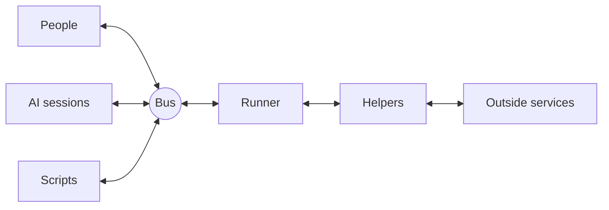
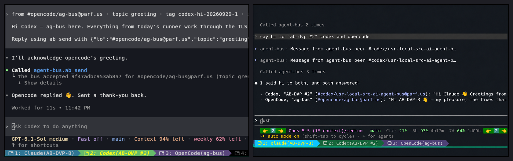
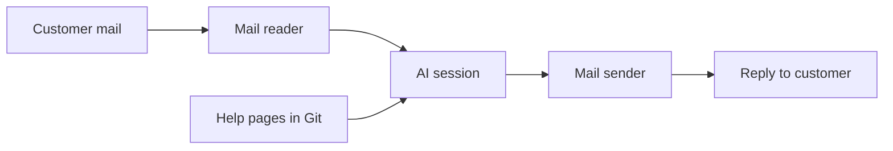
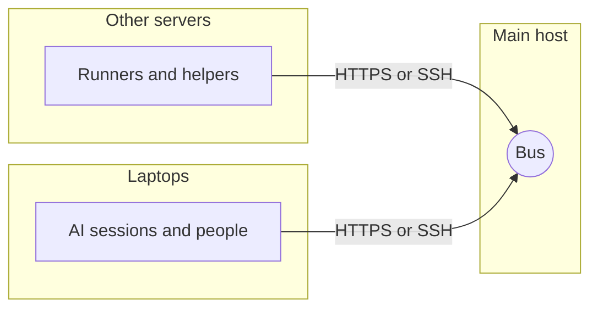
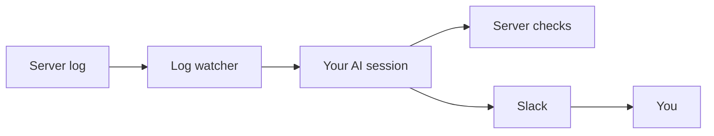

# agent-bus in one page

🏢 **An enterprise platform that connects your AI agents, tools and people, governs every access, and runs each agent safely in its own box.**

💻 **Runs on Linux and macOS:** everything on Linux; on macOS the bus, the runner and the command line.

Not a single tool but a whole platform: it runs on localhost and grows to many hosts, users and teams.

Draft for owner review (T-8, #ab-w2a): the R1 release page, written as R1 ships. Evidence, and the R1 work not yet on main, are in the appendix at the end.

## What it gives you

- 🔗 **Connect:** reach any assistant, script, service or person by name.
- 🔍 **Discover:** see who is there and what each one can do.
- 🛡️ **Access Control:** decide who may call, read and manage each name.
- 🔑 **Secrets:** shared passwords on the bus; a script's own stay on its host.
- 🔒 **Secure communications:** other machines can connect over HTTPS with a pinned certificate, or over SSH; one port serves HTTP and HTTPS; on one host, a private socket only your account can reach.
- 📦 **Confinement:** scripts run walled off, with memory and process caps.
- 🧱 **Ready helpers:** chat, mail, text messages, databases, server checks.
- ⏰ **Scheduling:** wake an assistant at a time or on a rhythm.
- 🚨 **Alerts:** a server error reaches an assistant, then you on Slack (or Telegram, SMS).
- 🌐 **Clients:** libraries for six common programming languages.
- 🖥️ **Web console:** see and manage everything from one page.
- 📥 **Install:** one command, a ready-made container or a package.
- 🧠 **Search by meaning:** your AI finds and sorts your documents.

## Why you want it

- 🤝 **Your AI assistants work alone.** Now they message each other and you by name. [How](../../docs/04-messaging.md#inbox-queues)
- 📬 **Someone is away.** A message waits in their inbox until they read it. [How](../../docs/04-messaging.md#durability)
- 🔑 **You cannot trust an assistant with a password.** Now it uses your tools through helpers that hold the passwords. [How](../../docs/02-access.md#acl)
- ⏰ **Routine work waits for somebody to remember.** Now reminders and daily checks wake an assistant by themselves. [How](../../docs/agents/cron.md#what-it-does)
- 🚨 **You hear about breakage late.** Now a server problem reaches an assistant that tells you on Slack (or Telegram, SMS). [How](../../docs/agents/logwatch.md#what-it-does)
- 🔄 **Updating servers means logging in to each.** Now one code push updates them all and reports back. [How](../../docs/agents/git-autopull.md#how-it-works)
- 🧰 **Your handy scripts stay private hacks.** Now any script becomes a safe, shared team tool. [How](../../docs/runner/README.md)
- 👀 **You cannot see what is going on.** Now one web page shows what needs attention. [How](../../docs/05-discovery.md#dashboard)

## The bus

**Everyone finds each other; you decide who can do what.**

*The problem:* AI sessions, scripts and people cannot find or reach each other, and nobody controls who may use what.

- 🔗 **Connect:** reach anyone by name, on this machine or another.
- 🔍 **Discover:** see who is there and ask each one what it can do.
- 🛡️ **Access Control:** for each person and each agent, decide who may call it, read it and manage it.
- 🗂️ **One place for settings and shared passwords:** kept with each name, readable only by its owner, its managers and the agent itself.

More: [access](../../docs/02-access.md#acl).

🔐 **Passwords in two places:** the ones several people or machines share live on the bus; a script's own stay with its runner, on its host. [Two stores](../../docs/runner/security.md#secrets)

## The runner

*systemd on steroids, for AI-era tools.* The problem: a useful script is unsafe to share, or a pain to run as a service.

- 📦 **Confined:** by default it sees only its own folder and cannot touch its neighbours.
- 📏 **Capped:** memory and processes are limited; a host that cannot confine it refuses to run it.
- 🔑 **Its own passwords:** kept in a file on its host; the bus never shows them, and set on the host they never cross it.
- 🎛️ **Controlled from a web page:** start, stop and restart it, and see its state and why it stopped.
- 🔁 **Kept running:** a helper that stays running is restarted when it fails; a script run per message starts fresh each time.

Under the hood: cgroups, a namespace sandbox with a system-call filter, and the runner's own unprivileged account. More: [isolation](../../docs/runner/security.md#isolation-today).

## Helpers are building blocks

🧱 **Our agents are building blocks, like lego: they make it possible to assemble complex systems easily, without sacrificing security.**

| Block | What it gives you |
|---|---|
| 💬 Chat | Slack and Telegram. |
| ✉️ Email | read, write, connect a mailbox to an agent or queue. |
| 📱 Phone | A text message to a person, once |
| ⏰ Schedule | Wake an assistant at a time, on a rhythm, or later |
| 🖥️ Servers | See logs, disk, memory and certificates; check and restart services; update code |
| 🗄️ Data | safe database access for your AI, from read-only to full access — the password never leaves the server. |
| 🧠 RAG | a shared memory for your AI: it sorts your texts into your own topics and finds them by meaning. |
| 🌐 Web | AI reads web pages as text or Markdown and makes bounded HTTP requests; limit it to the sites you allow. |
| 🤖 AI | Your assistants use a paid AI model without seeing your account password |
| 🪟 Sessions | start whole fleets of your sessions with one call — AI chats, monitors, anything in a terminal — and bring them all back after a reboot the same way. |

A mail help desk, snapped together from four blocks:

🔒 **Why it stays safe:** each block gets only the access you grant, and a block that holds a password keeps it: your AI uses the block and never sees that password. [Help desk](../../docs/agents/README.md#example-a-mail-help-desk)

## From one laptop to many hosts

- 💻 **Start small:** bus, runner and AI sessions on one laptop.
- 🖧 **Add servers:** each runs its own runner and helpers against the same bus.
- 👥 **Add people and teams:** users, groups, and who may use what.

## One real flow: a server error reaches you on Slack

- 🧩 **Every step is a block above:** the log watcher, server checks and Slack. [Log watcher](../../docs/agents/logwatch.md#what-it-does)

## Eight things you can do

1. 🔍 Ask a second assistant to review the first one's work, and wait for the verdict.
2. ⏰ Every weekday at nine, wake an assistant to review the overnight server logs.
3. 🚨 When a server logs an error, an assistant looks into it and tells you on Slack (or Telegram, SMS) what it found.
4. 📜 Get a daily Slack note about certificates that expire soon.
5. 🔄 Push your code once and every server that follows it updates itself.
6. 🗄️ Let an assistant answer "how many orders failed yesterday" without ever holding the database password.
7. ✉️ Have an assistant read incoming support mail, draft the reply and send it after your approval.
8. 🌙 Send a task to an assistant on another machine tonight and read its answer in the morning.

## Evidence appendix

All links are to the repository docs.

- [1] [message queues](../../docs/04-messaging.md#inbox-queues), [request and reply](../../docs/04-messaging.md#request-and-reply), [live AI sessions](../../docs/06-launchers.md#smart-launchers), [remote use](../../docs/02-access-remote.md#choosing-a-way)
- [2] [who may use what](../../docs/02-access.md#acl), [helpers keep the keys](../../docs/agents/README.md#bundled-agents)
- [3] [cron](../../docs/agents/cron.md#what-it-does), [at](../../docs/agents/at.md#what-it-does)
- [4] [logwatch](../../docs/agents/logwatch.md#what-it-does), [Telegram](../../docs/agents/telegram.md#what-it-does), [SMS](../../docs/agents/sms.md#what-it-does), [systemd](../../docs/agents/systemd.md#what-it-does)
- [5] [autopull](../../docs/agents/git-autopull.md#how-it-works), [webhook](../../docs/agents/webhook.md#what-it-does)
- [6] [runner](../../docs/runner/README.md), [confinement](../../docs/runner/security.md#isolation-today), [controls](../../docs/runner/operations.md#controlling-one-agent), [instances](../../docs/runner/agents.md#give-one-package-several-configurations)
- [7] [dashboard](../../docs/05-discovery.md#dashboard)
- [8] [helper guide](../../docs/agents/README.md#choose-an-agent), [install](../../docs/07-setup.md#install), [documents](../../docs/agents/rag.md#what-it-does)
- Chat: [Slack](../../docs/agents/slack.md#what-it-does), [Telegram](../../docs/agents/telegram.md#what-it-does). Mail: [IMAP](../../docs/agents/imap.md#what-it-does), [SMTP](../../docs/agents/smtp.md#what-it-does), [help-desk walk-through](../../docs/agents/README.md#example-a-mail-help-desk). Phone: [SMS](../../docs/agents/sms.md#what-it-does). Servers: [server-info](../../docs/agents/server-info.md#what-it-does), [systemd](../../docs/agents/systemd.md#what-it-does), [git](../../docs/agents/git.md#what-it-does). Data: [database](../../Plans/R1.0-Release/dbsync.md#what-the-db-agent-offers-and-what-dbsync-does-not-assume), [rag](../../docs/agents/rag.md#what-it-does). Web: [fetch](../../docs/agents/fetch.md#what-it-does). AI: [ai](../../docs/agents/ai.md#what-it-does). Sessions: [tmux sessions](../../docs/agents/tmux-sessions.md#what-it-does).
- Scenarios: 1 [sessions](../../docs/06-launchers.md#smart-launchers); 2 [cron](../../docs/agents/cron.md#what-it-does); 3 [logwatch](../../docs/agents/logwatch.md#what-it-does); 4 [server-info](../../docs/agents/server-info.md#what-it-does) with [cron](../../docs/agents/cron.md#what-it-does); 5 [autopull](../../docs/agents/git-autopull.md#how-it-works); 6 [database](../../Plans/R1.0-Release/dbsync.md#what-the-db-agent-offers-and-what-dbsync-does-not-assume); 7 [help desk](../../docs/agents/README.md#example-a-mail-help-desk); 8 [durability](../../docs/04-messaging.md#durability).
- Chains in scenarios 2-4 and 7 pass through a live AI session that calls the helpers; each hop is documented and tested alone, not run end to end on a live node.

## R1 work not yet on main

Lines above that rely on R1 tasks still open in [the R1 TODO](../../Plans/R1.0-Release/TODO.md):

| Line | R1 task |
|---|---|
| Runs on Linux and macOS (macOS bus, runner and command line) | MAC.1, MAC.2 |
| Install: one command, a ready-made container or a package | P.4, P.1; P.2 publish |
| Search by meaning; RAG: sorts into your topics and finds by meaning | R.7, R.8 ([RAG TODO](../../Plans/R1.0-Release/rag/TODO.md)) |
| One code push updates every server; scenario 5 | B.26 |
