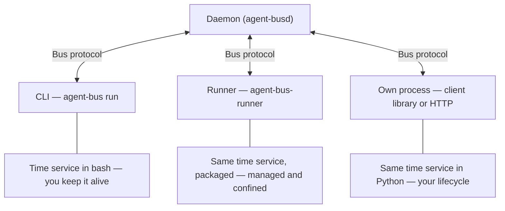

# What a good agent does

📌 **TL;DR:** propose a short checklist for an agent developer who already
understands how the daemon works. It covers decisions the agent's own code
makes: answering, state, permissions, private values, effects and diagnostics.
It opens with three ways to run the same time service, then the checklist.
This is a plan only; implementation follows the owner's Q324 approval.

## Proposed home

Create `docs/10-writing-an-agent.md`, titled “What a good agent does”, after
[Q324](QUESTIONS.md#r1-release-decisions) is settled. Link it from the root
README's agent-writing entry and docs/00's Document ownership section.
It is not a daemon introduction, installation tutorial or SDK implementation guide.

Use a TL;DR, the opening choice below, and the three tiers; keep the checklist
within 1,200 prose words. Worked examples live on separate pages. Each item
gets one short paragraph and one link to its owning reference. Follow
[WRITING.md's order](../../WRITING.md#-the-order-of-every-page) and the R1 README's
plain voice: the behavior a caller gets first, details through links.
No copied limits, default values, role tables, schemas or protocol rules.
The checklist owns the reading path, not another version of those contracts.

## 3 ways to run agents

This is the guide's TOP section, before the tiers. Use a simple Mermaid flowchart
like [FileScan's](../R1.1/filescan.md#how-it-works), without extra visual styling.
The diagram is a proposed reading aid, not a claim that these examples already run.

All three lanes communicate with the daemon over the same bus protocol; `#bus`
is its reserved agent interface, not the name of the daemon executable.
**How to pick:** trying it out → CLI; a service that stays up → runner;
inside an existing app or language → own process.

1. **CLI tool.** `agent-bus run` runs the bash time service in the foreground;
   the caller starts it and keeps it alive. Start with help and one time answer,
   then the advanced service. Proposed NEW worked page:
   `docs/user/write-agent-cli.md`. Link the owning [script-agent rules](../../docs/06-dedicated-runner.md#script-agents).
2. **Runner.** Package that same service for `agent-bus-runner`, with private
   Configuration/Secret and the documented file, CPU and network confinement.
   Autostart requires an installed/enabled runner service and enabled inventory;
   per-message agents start on demand, while kept agents stay running.
   Proposed NEW worked page: `docs/user/write-agent-runner.md`. Link
   [packaging](../../docs/runner/agents.md#package-a-script),
   [inventory](../../docs/runner/configuration.md#inventory) and
   [isolation](../../docs/runner/security.md#isolation-today).
3. **Own process.** Run the same service in Python using our client, with an
   explicit consume/reply lifecycle managed by the application. Go, Python,
   TypeScript, Rust, Java and PHP clients are alternatives; raw HTTP uses the
   [Daemon API client contract](../../docs/09-daemon-api.md#the-client-contract).
   Proposed NEW worked page: `docs/user/write-agent-process.md`. Link
   [clients](../../src/clients/README.md#what-you-get); do not duplicate their
   connection, credential or protocol-compatibility implementation.

### Page homes and ownership

All three NEW pages belong under `docs/user/`: the overview's
[User guides ownership](../../docs/00-overview.md#document-ownership) assigns
“what to type” there. The numbered guide owns the checklist and links to them;
`docs/user/README.md` lists them. Existing runner and dedicated-runner pages
keep their canonical rules and point to the worked pages, not copied sessions.
`docs/agents/` remains the catalogue of bundled helpers, not this author tutorial.

The runner worked page reuses the existing
[getting-started path](../../docs/runner/getting-started.md#try-this-first): replace
its hand-written hello session with a short link to the checked time example
when implementing. Do not keep two competing runner walkthroughs. These homes
and cross-links are proposals only; this revision creates no current-doc pages.

### Same examples and tier coverage

The service always tells time: same request meanings, help and observable
results across all three paths. Bash and Python are language implementations,
not different demo applications. Tests compare dynamic time to the fixture's
clock window; no fabricated fixed-time output is published.

| Example on each page | Coverage mapped to the checklist |
|---|---|
| Simple time service | MINIMUM: help/ask dispatch, help-json where delegated, one time request → one answer on the original return route. CLI runs bash; runner packages the same bash; own process implements the same behavior in Python. |
| Advanced time service | SUGGESTED: status, Configuration/Secret separation and redaction, state placement, own-log levels, refusals/deadlines/uncertainty, send-once effects, restart-safe progress, graceful stop and treating the body as data. Use a configured display format and bounded time-report history, not a new domain. |
| Optional advanced exercises | MORE: a shared lock protects report generation; KV keeps progress; a bigfile carries a larger report; optional role checks and event subscriptions/forwarding use their owning rules. Ack/done is shown only in an appropriate later-turn or no-answer exercise, never after a time answer. |

Keep per-mode responsibilities honest: per-message CLI and runner scripts do
not receive a bus credential. Their advanced bash part handles local
Configuration/Secret, work state, asks and safe answers; the harness asserts
launcher-owned routing/receipts. Direct KV, locks, event writes and subscriptions
are exercised by the advanced self-serving Python implementation, packaged
unchanged for the runner and run directly on the own-process page. The CLI page
links to those exercises and explicitly names the boundary; never pass a token
into a per-message script to make an example appear equivalent. Business
behavior remains the same time service; identical capabilities are not promised.

Every checklist item gets an exercised case or an explicit applicability/gap
note. Do not invent policies for the gaps below. The daemon subscription
exercise follows Q325: revoking a source role after add still permits delivery,
but revoking the creator's may-send to the target prevents delivery; target
Allow is also checked on every send. App-helper exercises retain their current
per-delivery recheck, pending [Q326 after 1.0](../R1.1/QUESTIONS.md#access-context). Optional subscription exercises wait for P3 and T-31d.

### Single source and real runs

Proposed example source home: `src/clients/examples/agent-guide/`, with bash,
Python, runner package files and a common driver. Keep client examples under
[MIT](../../src/clients/LICENSE.md#mit-license). Pages quote marked regions from
these exact files; the check verifies quoted regions, commands and package
metadata against the files it executes. Do not maintain a second prose script.

Every example runs on an isolated test daemon before its page lands. Build on
existing disposable-daemon fixtures, never a live node, sudo installation or a
hand-invented session. Add a runner-on-test-bus helper: start the real runner
with private package, host, work and inventory paths, authenticated fixture
socket, readiness signal and bounded shutdown/process cleanup. The existing
Go client fixture has no runner; this helper is new work, not assumed available.

The driver asserts help, reply correlation and counts, access refusals, state
survival/reset, secret absence and bounded completion. An output block is either
captured and asserted by this check or omitted; illustrative output is not a
worked run. Use disposable secrets and destinations. Check autostart/restart
through the private runner, not host service modification.

### Drift check proposal

Verified against local main `96aba981`, 2026-11-02: [subsystems](../subsystems.md#subsystems)
assign H to CLI, F to runner/sandbox/script, K to clients, N to docs and M to
acceptance harnesses. In `src/smoke-map.json`, reverse dependencies are F→HL,
H→FIJKL, K→JL and N→none. No existing check has N; guide prose currently does
not select an example check. Do not edit the map or smoke driver in this plan.

Propose ONE `agent_guide` shard, registered in smoke.sh's SHARDS and function
list, with a smoke-map check tagged H/F/K/N/M. Its path prefixes must cover
CLI, runner/sandbox/cgroup/script, client code and the example directory,
`src/acceptance/agent-guide`, the numbered guide, all three worked pages and
their navigation pages. Include these paths with the tags: tags alone do not
bypass the selector's path filter. Add selection assertions with named reasons
for an H, F, K, N guide-doc and M helper change; do not promote every docs change
just to cover these pages. M is included because the proposed helper path
`src/acceptance/agent-guide` maps to M; the `paths` list, not the M tag,
scopes the shard away from unrelated M paths during ordinary path selection.
Shared smoke/build edits and explicit subsystem overrides remain broader
selection triggers under the existing selector rules.

- **Fast:** the bash time service only, on a test bus; explicit argv allowlist,
  measured within the fast budget. No Python/build-everything/confined runner.
- **Normal:** the CLI and Python-process examples and the shared assertions,
  plus a named guard for the packaged form that needs no runner: each package's
  `agent.json` parses, its command is an executable `./` path, and
  `agent-bus run --package-dir` answers the packaged help (description, or the
  script's own for `help: native`). Reuse smoke-built binaries; no systemd scope,
  so nothing reaches the host journal (owner rule; Q327 asks whether systemd's
  own scope line counts).
- **Slow:** every example packaged for a private runner (Configuration, Secret,
  confinement views, limits read from the live cgroup, a kept process that comes
  back) and the deliberate CPU-limit enforcement. The runner needs
  `systemd-run --scope`, which writes one systemd line per run, so it lives
  here; if the owner accepts that line the runner part moves back to normal.
  Every published example still runs in this one shard's slow form before
  landing. Do not silently skip missing sandbox prerequisites.

Confinement proof covers the real writable/read-only view, applied CPU quota
without provoking a normal-run limit kill, and denied networking versus the
explicit network-enabled form against a local fixture. Listed hosts are not a
network allowlist; CPU is not bounded unless configured; disk is not a hard
quota. Link the owning security sections rather than copying limit defaults.

### Verified names and implementation facts

Dated source evidence, not another current contract (local main `96aba981`):

| Name or claim in the diagram | Source file:line |
|---|---|
| `run`, not `serve`, is the CLI verb | `src/cmd/agent-bus/main.go:142`; usage `src/cmd/agent-bus/usage.go:22` |
| Runner binary is `agent-bus-runner` | `src/cmd/agent-bus-runner/main.go:46` |
| Six client languages | `src/clients/README.md:23`–28, its language table |
| Raw HTTP is the “Daemon API”, with a client contract | `docs/09-daemon-api.md:1`, `:5`, `:18` |
| Boot claim is conditional, not inherent in a script | `src/cmd/agent-bus-setup/user_runner.go:315` (linger), `:323` (enable/start service); `docs/runner/configuration.md:229` (inventory enabled) |
| Files, CPU and networking are different controls | `docs/runner/security.md:53`–56 (network and self-serving socket), `:60` (file view), `:75` (process limits); `docs/runner/configuration.md:290` (CPU unbounded by default) |
| No token for a per-message script | `docs/06-dedicated-runner.md:93` (credentials row); `docs/runner/security.md:55` |

### AI-time implementation estimate

Planning estimate, not executed evidence. Assume an owner GO at **13:35 EST on
2026-11-02**, one worker and no lock/deploy wait. Observed native three-client
event work took about 15 minutes and the web slice about 30; this includes new
runner fixture work, so it is larger than merely adding prose.

| Work | Clock window (AI wall time) | Deliverable |
|---|---|---|
| Checklist/top diagram and three pages | 13:35–13:55 | Reading path, source-region quotes and canonical links; gaps stay explicit |
| Bash/Python examples and common assertions | 13:55–14:25 | Same simple/advanced time behavior, packaging and bounded private runner helper |
| One shard and drift selection | 14:25–15:05 | Shared smoke.sh/smoke-map.json/smoke selection tests; H/F/K/N/M proofs; measured fast timing, normal run under budget and CPU-limit enforcement on a real cgroup |
| Review and findings | 15:05–15:35 | Two readers for the runner/confinement harness boundary, docs review and fixes; final executed outputs |

Implementation ready **15:05 EST**, review complete about **15:35 EST**.
This adds roughly 25–30 minutes for shared-shard wiring, measurements and
review over the earlier estimate. Earliest landing follows gate availability;
shift each window by any later GO. P3/T-31d subscription readiness and resolving
owning-rule gaps can delay the optional exercises. Native-platform confinement
availability must be measured, not inferred from prose. No release-ready claim
follows from this plan alone.

## Proposed section order

Only decisions belonging to the agent's code are included. A reference marked
as a gap is a proposed place to resolve it, not evidence of a rule already there.

### ABSOLUTE MINIMUM — every agent

- **Serve help first.** Answer help and `--help-json`, dispatch the ask flag
  before ordinary body handling, and keep help free of business effects. Native
  help belongs to the agent only where its execution model delegates it.
  Owner: [Agent self-description](../../docs/constitution.md#agent-self-description).

- **Give one request its one answer on the return route.** Preserve the consumed
  request's routing and correlation context through asynchronous work; do not
  reconstruct the destination from the sender or emit an extra final answer.
  Owner: [Reply routing](../../docs/04-messaging.md#reply-routing).

### SUGGESTED — a good agent

- **Answer status when supported.** As the first suggested capability, answer
  the empty-body `status` ask with observed activity, backlog, last error and a
  safe configuration summary. The runner answers starting/stopping/failed
  lifecycle states anyway. Owner: [Agent self-description](../../docs/constitution.md#agent-self-description).
  **Gap 7:** dispatch is documented, running-status content guidance is not.
  Never dump private values or raw errors. Status is suggested, not required
  of every agent; publish no sample answer until the advanced time-service
  check executes and asserts it.

- **Separate Configuration from Secret, then read each correctly.** Non-secret
  settings belong in the record's Configuration, readable by Owner/Maintainers;
  credentials belong only in Secret and are read at start through the supported
  execution path. A secret never appears in Configuration, help, answers,
  status or logs. Split owner: [Configuring a template](../../docs/03-records-agent.md#configuring-a-template).
  For agent-side reads retain `AGENT_BUS_CONFIG`/“What it is told” in
  [Agents that serve themselves](../../docs/runner/configuration.md#agents-that-serve-themselves),
  the [not-configured wait rule](../../docs/runner/operations.md#not-configured)
  and the execution-mode distinction for private reads in [Secrets](../../docs/runner/security.md#secrets).

- **Choose notice, warning or alert deliberately.** The checklist must cover the
  owner's requested distinction between routine facts, handled problems and
  failures requiring attention. **Gap:** promote the T-29 [Levels text](agent-events/README.md#levels)
  describing routine lifecycle notices, stderr warnings and unexpected-failure
  alerts into the current author-facing severity reference; the plan is not
  that current reference.

- **Write to the agent's own event log.** Use explicit event writes for intended
  operational events rather than stderr as the event API; never include private
  values or imply verified runner provenance. **Gap:** T-29's own-write authority
  and waiting/answer behavior still need an accepted current-doc home; the
  [T-29 surface](agent-events/README.md#r1-min-surface-and-authority) is a plan.

- **Choose package, work or volatile state deliberately.** Keep code apart from
  writable application state and distinguish lasting work files from temporary
  files or process memory lost on restart. Choose paths within the actual
  writable view. Owner: [Isolation today](../../docs/runner/security.md#isolation-today).

- **Use KV for small durable state.** Choose durable values and atomic operations
  for the agent's progress or coordination instead of assuming process memory
  survives. Do not invent a second store contract. Owner: [KV rules](../../docs/03-records-kv.md#rules).

- **Handle refusals as outcomes.** Distinguish a daemon refusal from an
  application answer and an internal daemon failure; decide what the operation
  can safely do next without treating every refusal as retryable.
  Owner: [Refusals](../../docs/05-discovery.md#refusals).

- **Send once; distinguish timeout from uncertain outcome.** Honor the caller's
  travelling deadline and the TTL boundary for a late answer, already owned by
  [Request and reply](../../docs/04-messaging.md#request-and-reply). **Gap:** promote
  the client's “an uncertain write is never repeated automatically” rule from
  [What you get](../../src/clients/README.md#what-you-get) into the author-facing
  outcome reference; the deadline/TTL rule itself is not missing.

- **Make work idempotent and restart-safe.** Decide how progress and duplicate
  effects are handled after interruption; restarting the process is not replaying
  an operation safely. **Gap:** no general owning recipe covers the crash window
  around an external effect; proposed home: [Request and reply](../../docs/04-messaging.md#request-and-reply).

- **Stop gracefully.** The agent decides how to stop intake, finish or cancel
  bounded work, persist progress and close resources when asked to stop.
  **Gap:** the runner documents its signal and kill boundary, not a general
  author-side drain contract; proposed home: [Agents that serve themselves](../../docs/runner/configuration.md#agents-that-serve-themselves).

- **Treat the body as data.** Parse only the agent's intentional command grammar;
  body text must not change trusted identity, authority or code policy.
  **Gap:** the requested general rule is not stated in the current proposed
  owner, [Trust boundary](../../docs/02-access.md#trust-boundary).

### MORE — when needed

- **OPTIONAL support: ack and done.** No ack when the answer comes in the same
  turn; ack when the answer needs another turn; done only for a task with no
  answer expected; never done after an answer;
  nothing for reports, notices or receipts. Do not duplicate support already
  provided by the runner or client. Owner: [Receipts](../../docs/04-messaging.md#receipts).

- **Use application roles only when needed.** Roles are optional: define them
  when methods need different permissions, and check the delivered role rather
  than a body-claimed role. Declaring help metadata does not enforce a method.
  Owner: [Roles](../../docs/03-records-agent.md#roles).

- **Use shared locks for shared work.** Take, extend and release a lock where the
  algorithm needs ownership; choose its TTL and handle loss or expiry explicitly. A held lock is
  not a completed operation or proof of exactly-once effects. Owner: [Shared locks](../../docs/01-identity-and-authority.md#shared-locks).

- **Use bigfile for large content.** Choose references and integrity-checked
  transfers when a message is the wrong place for content. Keep body/request
  limits at their owner rather than adding another limit table to the checklist.
  Owner: [Bigfiles](../../docs/03-records-kv.md#bigfiles).

- **Offer standard publish/subscribe when emitting events.** Reuse the shared
  `sub add <target> [filter]`, `sub list`, `sub delete <id>` family, with the
  helper's documented selector where needed, as logwatch, Discord, eventlog and
  T-29 `#bus` do. State send-once/no-replay behavior rather than implying durable
  at-least-once delivery. Owner: [The shared behaviour](../../docs/agents/subscriptions.md#the-shared-behaviour).
  Distinguish authorization profiles: daemon `#bus` checks the SOURCE right
  once, at creation; later source-role revocation does not stop it. On every
  send it checks target delivery admission: the creator's may-send to the target
  and the target's Allow ([Q325 decision](DECISIONS.md#recorded-decisions)).
  App helpers, including named `#eventlog`, currently recheck the creator's
  reach on every delivery, as the shared vectors' `revoked-source` and
  `revoked-target` cases assert. Whether they follow the daemon is
  [Q326, post-1.0](../R1.1/QUESTIONS.md#access-context); keep their behavior
  unchanged and do not claim one general permission rule.

- **Check may-send before forwarding for someone.** Decide whether the author's
  request may reach the chosen destination before forwarding; the agent's own
  send privilege is not the author's authorization. An unavailable check is
  not permission. Owner: [Checking permission to send](../../docs/09-daemon-api.md#checking-permission-to-send).

**Before you share it:** provide a `docs/agents/` end-user page for useful work,
safe calls, settings, access, diagnostics and troubleshooting, and check actual
help, a safe call and relevant refusal/interruption behavior. Debug checks bus
health, not the business result. Follow
[How we write docs](../../WRITING.md#how-we-write-docs). This closing deliverable
is not an agent-code checklist item.

## Gaps to resolve before writing

Snapshot: local main `b80999f9`, 2026-11-02. The gap-marked items above stay held
until an owning rule exists; this plan does not fill them with a new policy.

- **Body trust:** add the approved body-as-data rule to the proposed Trust
  boundary home, preserving deliberate agent command parsing.
- **Uncertain outcome:** promote the client README's explicit no-repeat rule
  to the author-facing outcome home. Request and reply already owns travelling
  deadlines and the TTL boundary; those are not gaps.
- **Idempotent/restart-safe effects:** define the author-facing scope and limits
  of any recipe; never imply transport or KV alone gives exactly-once effects.
- **Severity selection:** promote the T-29 Levels text named in the checklist
  into an agreed current owning section; do not substitute ring retention rules.
- **Own event log:** promote accepted T-29 use instructions before linking them
  as current behavior. Do not use stderr forwarding as a substitute write API.
- **Graceful stop:** agree the author-side responsibility and its relationship
  to the client's drain behavior, without inventing a new runner stop policy.
- **Gap 7 — Status answer content:** Agent self-description owns the empty-body
  ask and runner-observed starting/stopping/failed dispatch, but does not define
  useful running-status content. Add the approved activity/backlog/last-error/
  safe-configuration guidance there before writing it as a current guide rule.

## Deliberate cuts

Removed daemon naming/record onboarding, tokens, enrolment and credential
acquisition: those are not this reader's code decisions. Removed protocol
negotiation and version checks, handled by the client. The owner has now
restored the worked bash/Python time examples and their
packaging paths on separate user pages above. Keep install mechanisms, sandbox
policy, runner restart/backoff controls and bus-health administration at their
owning references; the checklist does not become a setup tutorial.
Kept only code-level state placement, interruption handling and meaningful
checks. The drift shard belongs to implementation acceptance, never the user guide;
no mutants, gate locks or repository versioning enter the guide. The
package-building gap from the earlier outline is therefore removed.

## Approval and acceptance

The owner approves the revised scope through Q324 before the guide is written.
This branch edits the plan and its navigation only, not current docs.

- The minimum starts with help, then one request and one answer on its return
  route. Status is the first suggested item, not mandatory; the reader knows the daemon.
- Every checklist item concerns an agent-code decision, has one short paragraph
  and a link to the owning section for each rule, or is visibly held as a gap.
  Roles and ack/done support are explicitly optional. No policy values or client
  internals are duplicated.
- The opening diagram and three NEW worked pages precede the owner-ordered
  tiers. Each uses the same time service, source-checked examples and only
  asserted output; every example runs on a disposable bus before landing.
- The end-user page and meaningful agent checks remain, without repository
  test machinery or a claim that bus health proves application correctness.
- After approval, link the real guide from docs/00 and the root README. Resolve
  each accepted gap at its owning home first; never silently invent its rule.

## Publish/subscribe comparison

Read on 2026-11-02; this compares recognizable practice, not a claim of wire
compatibility with another broker. [Redis pub/sub](https://redis.io/docs/latest/develop/pubsub/)
uses subscribe/unsubscribe, channel-pattern filters and at-most-once delivery;
[Google Pub/Sub](https://docs.cloud.google.com/pubsub/docs/subscription-overview)
uses subscriptions, acknowledgement/redelivery and defaults to at-least-once.
Thus publish/subscribe alone does not promise retries, replay or deduplication.

| Check | Our documented profile and comparison |
|---|---|
| Naming | `sub add` subscribes, `sub delete` unsubscribes by id; `sub list` inspects. Same lifecycle, different command vocabulary, not a Redis/MQTT-compatible API; no rename or alias proposed. |
| Filters | Selector plus portable bounded regex is our profile; Redis channel glob matching differs. Describe the supported grammar, not generic broker interchangeability. |
| Delivery | Shared subscriptions attempt each matching copy once and drop/count refusal or uncertainty; this fits an at-most-once-style forwarding profile, not Google's acknowledged redelivery model. An uncertain attempt may have arrived. |
| Dedupe | No shared global event dedupe is promised: logwatch repeated arrivals and multiple matching subscriptions remain distinct copies. Redis also documents multiple delivery when channel and pattern subscriptions overlap; applications needing idempotent effects must handle that explicitly. |
| Permission | Daemon `#bus` checks the SOURCE right once at creation. Every send still checks the creator's may-send to the target and the target's Allow ([Q325 decision](DECISIONS.md#recorded-decisions)). App emitters, including `#eventlog`, keep their per-delivery recheck unchanged ([shared vectors](../../src/testdata/subscriptions.json), `revoked-source` and `revoked-target`); changing them is [Q326, post-1.0](../R1.1/QUESTIONS.md#access-context). No general authorization rule is claimed. |

Recommendation: call this standard publish/subscribe with our documented
send-once subscription profile. Keep naming, filters and delivery unchanged;
describe the daemon creation-time rule and the app helpers' current
per-delivery reach check separately; app-helper alignment is Q326, post-1.0. Do not add
retries, dedupe, aliases or new permission behavior.
