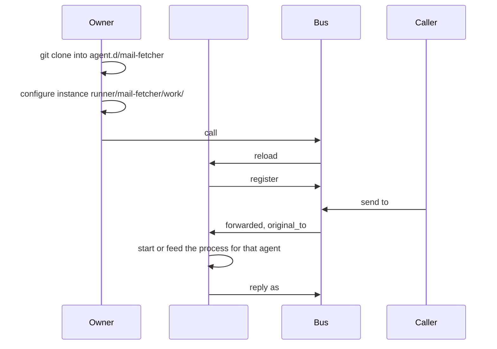

# Managed runner

Status: **partly built.** The foreground runner, `agent-bus start`, serves one
script under an agent name ([script agents](../../docs/06-runner-role.md#script-agents)).
The foreground runner can [sandbox](../../docs/06-runner-role.md#sandboxing) its script on request;
the managed runner below, which sandboxes every agent, is not built. Detail is in the
[implementation page](runner-implementation.md#what-the-runner-does); open
choices are in [questions](QUESTIONS.md#runner-context).

📌 **TL;DR:** The runner is `systemd-run` without the systemd (it still
borrows its cgroups): it starts processes, keeps pools of them, restarts the
ones that fail, and sandboxes every one. It turns a `git clone` into agents on
the bus, and is itself an agent: every agent it runs forwards to it, so it
receives their messages and feeds them to its processes. An agent runs on
demand, as one process, or as a pool, and a template runs one configured
instance per use.

## The rule

| | |
|---|---|
| **The runner is an agent** | `#runner@<host>`, deployed to by calls under its ACL; no ssh door and no account to be let into. On an edge box with no daemon it takes the bus's realm, `#runner/<edge>@<realm>` ([where it runs](runner-implementation.md#where-it-runs)) |
| **It does the bus talking** | each agent it runs is registered by it with a [`deliver_to`](runner-implementation.md#many-names-into-one-inbox) naming the runner: the runner reads one inbox, dispatches on `original_to`, and answers as the agent that was addressed |
| **A child holds no credential** | a script gets the message and gives back the answer |
| **A smart agent serves itself** | one whose `agent.json` says it serves itself, usually through a [client library](../../src/clients/README.md), is not registered by the runner: it holds its own token and reads its own inbox, and the runner only starts it and restarts it when it dies |
| **It mints nothing** | it starts a name only with the credential it was handed for it, so deploying on a host never means impersonating a name |
| **Code is public, decisions are not** | `agent.d/` holds what an agent *is*, a checkout anyone may read; `runner/` holds what this host decided about it, secrets included |
| **Every agent is sandboxed** | each runs in its own cgroup, with limits on what it may spend and see; a sandbox that cannot be had is a refusal to start, never a quiet run without it ([sandboxing](#sandboxing)) |
| **It keeps its processes running** | a pool stays within its [`processes`](#kinds-of-agents) count, and a process that dies is restarted with backoff and reported by name |
| **A bus that is away is not a failed agent** | the runner reconnects; it restarts a child only when the child died |

## How it works

| Step | Who | What happens |
|---|---|---|
| 1. Install | the Owner | `git clone <agent> agent.d/<agent>`: its code, its `agent.json` and `env.dist` |
| 2. Configure | the Owner | for a template, one instance per use, each with its own `env` (and secrets) under `runner/<agent>/<instance>/` |
| 3. Reload | the Owner | `agent-bus call '#runner@host' reload`: the runner rereads what is installed and configured |
| 4. Serve | the runner | registers each new agent or instance, forwarding to itself, and serves it in its kind, each process inside the agent's [sandbox](#sandboxing); one it cannot start is reported by name, never skipped |

`reload` means one thing for everything that has it: *reread your
configuration*. Sent to `#runner`, the runner rereads what is installed; a
kept process is sent [`SIGHUP`](#stop-and-reload).

## Kinds of agents

One setting, `processes`, says how many processes an agent may have: a number
is a fixed count, and `min..max` a range (owner decision, Q150).

| Kind | `processes` | Meaning |
|---|---|---|
| On demand | `0..1`, or `0..N` | nothing runs between messages; the runner starts a process for a message, at most N at once. The default |
| Single process | `1` | one process kept running, fed every message |
| Fixed pool | `33` | 33 processes kept running |
| Pool | `10..33` | at least 10 kept running, more started as messages wait, up to 33 |

The agent's form decides what a process lives for, and no second setting can
disagree with it ([forms](runner-implementation.md#additional-script-forms)):
a one-message form (`args`, `json`) runs once per message and exits, and a
stream form (`jsonl`, `msgpack`) is a kept process. A one-message form keeps
nothing, so for it `processes` caps how many run at once: `33` and `0..33` mean
the same. The author's `agent.json`
gives the default; the host's `agents.json` may change it.

### Stop and reload

The runner stops and reloads a process with the usual signals, so every agent
gets them, one that serves itself included (owner decision, Q150):

| Signal | The agent | Sent when |
|---|---|---|
| `SIGTERM` | finishes what it holds, answers it, and exits; `SIGKILL` once its deadline passes | a process above `min` has been idle; the runner is stopping |
| `SIGHUP` | rereads its configuration and keeps serving | the agent's configuration changed; `#runner` was sent `reload` |

**A configuration change waits for `reload`** (owner decision, Q19). Then the
runner signals each kept process of every agent whose env files, override
files or bus `config` changed (the record's `config_sha` moved); a one-message
form reads the new configuration at its next message. An env file cannot
reach a running process this way, which is [Q161](QUESTIONS.md#open-questions).

**An agent that handles neither still works.** The runner sends `SIGTERM` only
to a process it knows is idle, so its default exit loses nothing; an unhandled
`SIGHUP` also exits, the runner starts it again, and a fresh start reads the
configuration. A process above `min` is idle after **5 minutes** without a
message by default; `agents.json` may change it (owner decision, Q154).

## Templates and instances

**An agent can be a template**, which runs only once configured, and then once
per configuration. `mail-fetcher` fetches one mailbox; a host runs one
instance per account, each a name of its own
([agent templates](../../docs/03-records-agent.md#agent-templates)):

| Instance | Its configuration |
|---|---|
| `#mail-fetcher/work@realm` | `runner/mail-fetcher/work/env`: the work account and its password |
| `#mail-fetcher/home@realm` | `runner/mail-fetcher/home/env`: the home account and its password |

An agent whose `env.dist` declares a variable with no default is a template:
it cannot start until an instance supplies it. One that declares none starts
as itself.

## What an agent ships

| File | Read by | May define |
|---|---|---|
| `agent.json` | the runner | what the code is and can do: command, form, whether it serves itself, `processes`, roles, what it depends on; every option is in [agent configuration](runner-config.md#the-authors-options) |
| `env.dist` | the runner | every variable the agent reads, with a default for each one that is not secret; one without a default is required, which is what makes a template |
| its own settings files | the agent | anything non-secret the code wants, shipped with it; a host [overrides](#overriding-a-shipped-file) them |

Never in any shipped file: a secret, a token, or anything this host decided.

### Overriding a shipped file

**The host overrides a shipped JSON file with its own file of the same name
and the same JSON** (owner decision, Q152). It sits in the same layers as the
env files, and the host's values win:

| Layer | Where |
|---|---|
| shipped | `agent.d/<agent>/<file>` |
| every instance on this host | `runner/<agent>/<file>` |
| one instance | `runner/<agent>/<instance>/<file>` |

The agent reads its file where it always does and sees the result, so its
code does not change. An override holds no secret, since secrets have one
home on the host, the env files ([secrets](#secrets)). It merges as a JSON
Merge Patch, may change only run options, never what the code is, and is
mounted over the shipped path inside the sandbox
([overriding a shipped file](runner-config.md#overriding-a-shipped-file), Q155).

## Secrets

The runner keeps **per-agent and per-instance env files**, injected into the
process before it starts, never as a path it could open. They duplicate and
extend the bus's own [record secret](../../docs/03-records-service.md#secrets),
which lives in the daemon:

| Layer, lowest first | Holds | Where |
|---|---|---|
| `env.dist` | declared variables and non-secret defaults | the agent's checkout |
| the record's bus secret | what the Owner set on the bus, in env-file form | the daemon |
| `runner/<agent>/env` | what every instance shares, such as one API key | this host |
| `runner/<agent>/<instance>/env` | this instance's own, such as its mailbox password | this host |

**Local wins over remote** (owner decision, Q153): a variable set in the
runner's env files overrides the same variable in the record's bus secret, and
an instance's own file overrides the agent's.

## Sandboxing

**Limiting what an agent's processes can do is one of the main reasons the
runner exists.** An agent is code from a `git clone`; the runner, not the
author, decides what it may spend and see.

| | |
|---|---|
| **One sandbox per agent** | an agent, or one instance of a template, is a cgroup; its processes are inside it, so a pool of 33 shares one ceiling and one runaway cannot starve the others |
| **Resources** | memory, CPU, number of processes, open files, disk I/O weight, and disk space in its work directory and `/tmp` |
| **Filesystem** | the system read-only, no home, a private `/tmp`; its checkout read-only, its own work directory writable |
| **Network** | none unless asked; when asked, optionally only to named hosts |
| **Privilege** | no new privileges, no capabilities, system calls limited to what a service needs, no devices |
| **Siblings** | every agent runs as the runner's one account, which alone keeps nothing apart; the sandbox must stop one agent seeing, signalling or tracing another's processes, or reading their environment |
| **The author asks, the host decides** | `agent.json` says what the code needs, such as the network or a memory size; `agents.json` sets the limits and wins. A need above the host's limit is refused at `reload`, by name |
| **On by default** | a managed agent is sandboxed unless the host turns it off for that agent, unlike the foreground `start`, where [sandboxing](../../docs/06-runner-role.md#sandboxing) is opted into |
| **It fails closed** | a host that cannot sandbox refuses to start the agent; it never runs it unsandboxed |
| **What it costs is visible** | an agent killed for memory is reported as that, then restarted with backoff like any other death |

The same holds for an agent that serves itself: the runner starts it, so the
runner sandboxes it. The cgroups come from a subtree delegated to the
runner's own unit, and the sandbox is on by default (owner decision, Q157);
the rest is applied by **bubblewrap**, each agent in namespaces of its own,
so no agent can see or touch another's processes, and the network to named
hosts goes through a filtering proxy of the runner's (owner decision, Q158).
Detail is in the
[implementation page](runner-implementation.md#sandboxing).

## Open decisions

| | |
|---|---|
Q159–Q163, found by the 2026-10-16 deep review, each before the wave it
blocks ([questions](QUESTIONS.md#open-questions)). Q15, Q19, Q33, Q139 and
Q150–Q158 are settled ([decisions](DECISIONS.md#recorded-decisions)).
