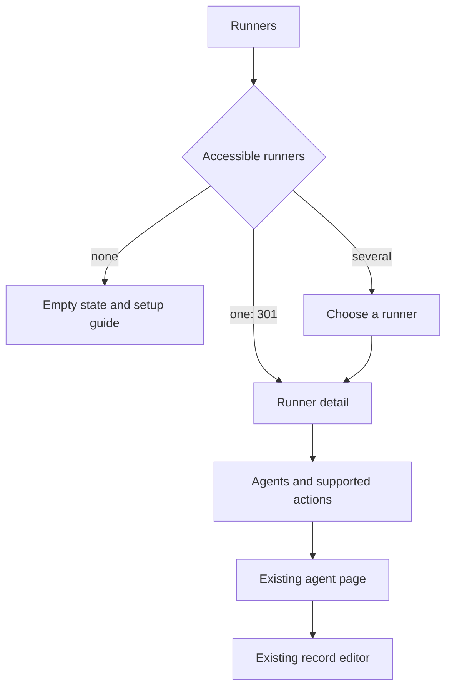

# Runners in the web face

## Goal

The status-and-reload slice is built (0.8.198), and per-agent controls, the host's files and instances (0.8.211); [page contract](../../../src/web/web-face/runners.md#web-face-runner-pages). Manage the runners you can access and their
agents without leaving the web face.

- Find a runner and see whether it is answering.
- See its agents, start or stop serving them, and understand refusals.
- Open the existing agent page for record details and editing.
- Offer only actions the runner actually supports and the caller may perform.

This section is for `agent-bus-runner`. The dedicated runner (`agent-bus run`)
remains a separate program. A task carrying the `runner` tag is not itself a
runner; that tag alone must not populate this section.

This is a wrapper for runner agent APIs, focused on the extra observations and
actions a runner provides. The host's files — env files, overrides,
`agents.json` — are the runner's, edited here through its calls
([№RD101](../DECISIONS.md#recorded-decisions)). Do not duplicate agent pages,
metadata forms, or the record's bus Secret and JSON configuration editors here.
Link to the existing agent page and let its normal permissions and editing flow
apply.

## Main journeys

| Page | What the user gets |
|---|---|
| Runners | Caller-visible runners, with owner, host and observed availability. No runners: explain the empty state and link to setup guidance |
| Exactly one accessible runner | An authenticated GET returns **301** to that runner's page. Decide this from the caller's current accessible set, not the node-wide count; the final response must carry `Cache-Control: no-store` |
| Several runners | A chooser with useful status; inaccessible runners affect neither rows nor counts |
| Runner detail | Identity and owner in the header, last successful observation, alerts and its agents; information only, no operation (owner instruction, 2026-10-18). An unreachable runner remains identifiable rather than appearing empty |
| Manage | Each agent's operations on its own page, linked last in its runner row; stop, disable and delete in one closed danger-zone expand; reload with the host's inventory (owner instruction, 2026-10-18) |
| Agent link | Open the existing agent page, preserving a return path to the runner; use its existing details and editing actions |

## Minimum checklist

`RW` labels the original runner-web work, additions and acceptance checklist entries.

- ✅ RW1 (0.8.198) Add a Runners entry to the web navigation and appropriate GitHub docs links.

- ✅ RW2 (0.8.198) Discover actual runners the signed-in caller may access. Reuse the bus's
  - Details: visibility rules and the [runner identity rule](../runner.md#the-rule). The remaining person/edge naming choice is [№Q165](../QUESTIONS.md#open-questions). A task tag alone is not runner identification.

- ✅ RW3 (0.8.198) Implement zero/one/many navigation, including the requested single-runner
  - Details: 301. Apply it only to navigation, never to submitted actions; avoid redirect loops and stale redirects after the accessible set changes. Verify `Cache-Control: no-store` on the final response, including the normal web response wrapper, rather than inspecting only the redirect helper.

- ➡️ RW4 (moved to R1.1, [Q311](../DECISIONS.md#recorded-decisions)) Join the runner's agent inventory with caller-visible registry records.
  - Details: Runner status supplies name, enabled/disabled setting, observed serving state, refusal reason and running/minimum/maximum process counts; description and tags come from the records. Keep registry information available when status fails, with its last observation identified as stale. Distinguish a disabled agent, a refused agent, an unreachable runner and an idle agent.
  - Built: status rows joined with the visitor's records. Partial: a last observation is not kept between requests (the face stores nothing across requests), so a failed status shows the runner identified and its agents "not known" rather than stale rows.

- ✅ RW5 (0.8.211) Start and stop serving individual agents through supported runner actions.
  - Details: State what happens to work in progress and queued messages. Do not substitute registry activation/deactivation or the dedicated runner's `stop` command.
  - Built: Start, Stop and Restart per agent, through the runner's calls ([№Q181](../DECISIONS.md#recorded-decisions)).

- ✅ RW6 (0.8.198) Link each visible agent to its existing agent page, with a return path
  - Details: to the runner. Metadata, Secret (ENV) and pretty-printed JSON configuration remain in the existing record editing flow; add no parallel forms or private value reads to the runner section. Runner access grants no extra record rights.

- ✅ RW7 (0.8.198) Use the existing `/agent?name=<encoded name>&return=<encoded local path>`
  - Details: link form. Extend the existing record detail/edit/save return-path allowlists to admit the runner page once its route is defined; today they accept only the record's list page. Preserve the local-path checks and safe fallback.

- ➡️ RW8 (moved to R1.1, [Q311](../DECISIONS.md#recorded-decisions)) Make saved versus applied settings clear. Offer an explicit reload/apply
  - Details: action where supported, with its scope explained. A saved value must not be presented as already applied to a running process.
  - Built: reload explained as runner-wide, a saved change taking effect only then. Partial: no per-setting saved/applied view.

- ✅ RW9 (0.8.198) Report action results from the runner, including timeouts and uncertain
  - Details: outcomes; never report success solely because the bus accepted the request.

## What is available and what must precede it

The [current operations guide](../../../docs/runner/operations.md)
owns current behavior. At planning time the runner answers `status` and
`reload`; agent lifecycle and remote installation/configuration are later
[runner waves](../TODO.md#runner-waves).

Start with the useful user outcome, compare it with the actual API and the
owning runner plan, then synchronize the missing runner methods and the web
work. Do not let today's two commands define the whole intended experience.

| What users should have | What the API has today | Planned work / dependency |
|---|---|---|
| Runner availability, version and load failures | `status` answers runner identity, version and load error | Discovery and caller authorization in the web face |
| Agent inventory, serving state, refusals and current concurrency | `status` answers names, enabled setting, state, reason and running/min/max counts | Render these observations; use existing agent links for record details |
| Reread installed code/configuration and see the result | `reload` answers the resulting status | Explain runner-wide scope and report the actual answer |
| Start/stop an individual agent, with clear treatment of current and queued work | No per-agent control or argument slot | Agree targeting, authorization and lifecycle behavior in [runner waves](../TODO.md#runner-waves); add runner methods before their web controls |
| Restart, enable/disable and kept-process/pool supervision | No corresponding control methods | Synchronize with process work and its acceptance before exposing actions |
| Install/update/remove packages and change runner-owned deployment settings | No remote management methods | [Deploy over the bus](../runner-implementation.md#reaching-the-runner); keep separate from bus record editing |
| Effective protections, capacity and bounded operational diagnostics | Only the status observations above | Extend runner observations where needed, following the security and process plans |
| Agent metadata, ENV and JSON editing | Existing record pages and private-value operations | Link out; no duplicate runner editor or new runner method for existing record functionality |

The minimum is not complete until start/stop works. Before then, ship an honest
status/reload subset with links to existing agent pages. Mark unavailable
lifecycle controls clearly and explain the missing capability.
The web face is a client of an external runner: no host shell, direct file
editing or privileged systemd calls from the web process. Missing runner calls
or formats must be agreed in the runner work before wiring a form to them.
Today's status/reload calls have no agent argument; per-agent controls therefore
also depend on an agreed command format that can identify the target agent.
This plan does not introduce that format.

The single-runner 301 is the owner's explicit requirement. It must not become
a stored navigation shortcut: the response's `no-store` directive prohibits
cache storage and reuse ([HTTP caching rule](https://www.rfc-editor.org/rfc/rfc9111.html#section-5.2.2.5)).
The existing web response wrapper already applies this directive to non-assets;
the acceptance check must hold it on this redirect too.

## Useful additions

RT11 RW10–RW17 moved to [R1.1](../../R1.1/runner-web.md#useful-additions) by owner decision (Q299), 2026-11-01, and RW4 and RW8 by Q311, 2026-11-02; the R1 minimum and acceptance below stay here.

## Acceptance checklist

- ✅ RW18 (0.8.198) Zero, one and multiple accessible runners exercise distinct pages; one
  - Details: produces 301, including when other runners exist but are inaccessible.

- ✅ RW19 Revocation, another signed-in user and a newly added second runner cannot
  - Details: reuse a cached private redirect or expose a runner's name/count. Check both the final 301's `no-store` header and navigation after each change in the same browser; each navigation must consult the current caller's accessible set.
  - Built: the 301 is decided from the visitor's set on each request and is `no-store`. `src/web/test/runners.test.ts` "RW19 current caller set…" (`a2ee21cc`) keeps one cookie jar through: bob gets the 301, revocation (no redirect, no runner name in the page), restore, sign-out, carol (no access: no name, no redirect, 404 on the runner's own page), bob again, a second runner (the chooser lists exactly the two rows), and the second removed (the 301 again); every response is `no-store` and each body is checked. Mutants: a cacheable 301, and the runner count taken from every record, both red on that test.

- ✅ RW20 (0.8.198) A `runner`-tagged ordinary task never appears as a runner by itself.

- ✅ RW21 Read-only callers can observe permitted status but forged action posts
  - Details: cannot start/stop work or change metadata, secrets or configuration.
  - Built: the face adds no action beyond the runner's own verbs, each called as the visitor. Read-only means see-without-use, and there is no new role: anyone the daemon lets send to the runner can read its status, but only the runner's Owner and Maintainers may use the managing verbs (`reload`, `start`, `stop`, `restart`, `enable`, `disable`, `read`, `write`, `create`, `delete`, `install`, `remove`), and the runner refuses everyone else (`agent-bus-runner` `main.go`, the `managing` map).
  - Evidence: `runners.test.ts` "RW21 a visitor who may see the runner…" posts start, stop, restart, enable, disable and reload directly as a visitor: each reaches the runner once as the visitor, the page says it was not carried out with the runner's refusal and never says it worked, the fake runner carried out nothing, and the runner's page still lists its agents; the same posts as the Owner do reach the verb. That test's refusal is the fake runner's copy of the rule, so "the fake runner's managing verbs are the real runner's" fails if the two lists drift. At the real runner, the smoke runner section has a caller the ACL admits (not a Maintainer) send `reload`, `start` and `restart`: each is refused, the agent the Owner stopped stays stopped (a reload would serve it again) and answers nothing, and the Owner's own `start` still works.

- ✅ RW22 (0.8.198) Runner access alone cannot reveal another agent's private ENV/config.
  - Details: the record's bus Secret and configuration. The host's env files are the runner's own: only its Owner and Maintainers may read them (`read` is one of the runner's managing verbs, and it refuses everyone else, so an ACL admission alone shows no env file) ([№RD101](../DECISIONS.md#recorded-decisions)).

- ✅ RW23 (0.8.198) A refused/timed-out action is not shown as success; an offline runner is
  - Details: not shown as having zero agents. An uncertain write is not blindly repeated.

- ✅ RW24 (0.8.211) Start/stop effects are verified at the runner, including drain/queued-work
  - Details: behavior; toggling registry status alone cannot satisfy the check.
  - Built: smoke checks a stopped agent answers nothing while its sibling does, a restart replaces a kept agent's processes, and a stop lasts only until reload.

- ✅ RW25 Agent links reach the existing detail/edit flow and return to the runner.
  - Details: Verify return navigation through detail, edit, save and validation failure; a forged external return destination must still use the safe fallback. Runner pages introduce no duplicate metadata, ENV or JSON editor and do not fetch private values merely to display inventory.
  - Built: the detail page returns to the runner and a forged return falls back. `runners.test.ts` "RW25 runner return survives detail, edit, save and validation failure" and "RW25 forged external return stays out of edit, validation and save" (`a2ee21cc`) follow the rendered Edit link and its hidden return through a validation failure, a successful save and the final detail page, check the daemon's state, and send a forged external return at each step. Mutants: the edit return dropped from the allowlist, and a forged return accepted, both red.

- ✅ RW26 (0.8.198) Unsupported actions cannot silently fall through to host-level commands.

- ✅ RW27 Add compiling mutants for access bypass, unfiltered runner counts, false
  - Details: action success and tag-only runner discovery; each must fail its named assertion. Run the full slow gate before implementation ships.
  - Built: seven mutants (tag or look-alike discovery, no 301, timeout as an empty answer, reload always success, no runner return, hidden agents linked, any record a runner), each failing an assertion in `src/web/test/runners.test.ts`; and, for the access checks, seven more in `runners.test.ts`, each failing an assertion: a cacheable 301 and a runner count taken from every record (RW19), a control's refusal and a reload's refusal shown as success (RW21), the edit return dropped from the allowlist and a forged return accepted (RW25), and the fake runner's verb list drifting from the real one. At the real runner, a production mutant that stops refusing `reload` for a caller who is not a Maintainer fails three smoke checks (the refusal, the agent still stopped, and still silent).
