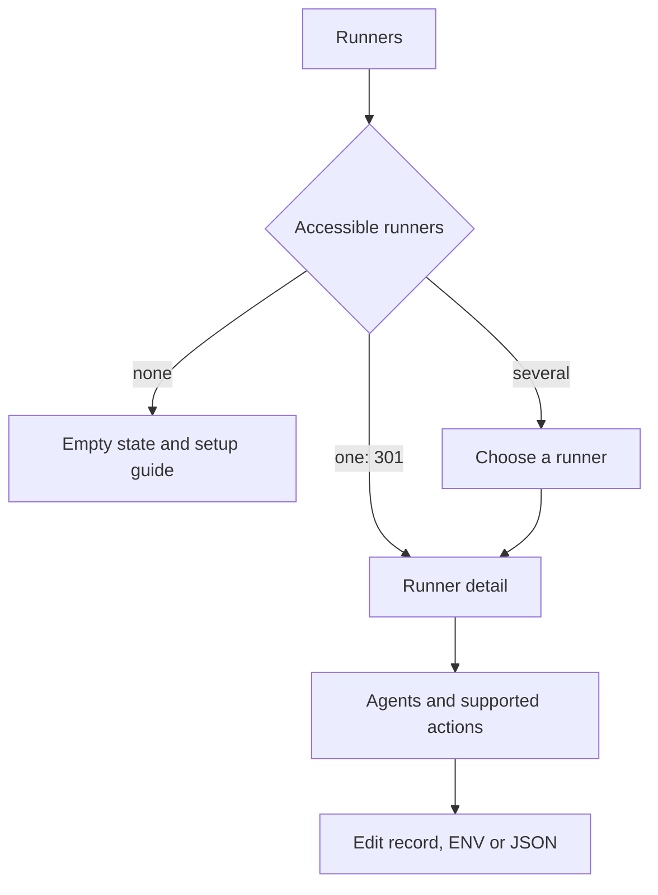

# Runners in the web face

## Goal

Planned for R1; not implemented. Manage the runners you can access and their
agents without leaving the web face.

- Find a runner and see whether it is answering.
- See its agents, start or stop serving them, and understand refusals.
- Edit an agent and its Secret (ENV) or JSON configuration in one place.
- Offer only actions the runner actually supports and the caller may perform.

This section is for `agent-bus-runner`. The dedicated runner (`agent-bus run`)
remains a separate program. A task carrying the `runner` tag is not itself a
runner; that tag alone must not populate this section.

## Main journeys

| Page | What the user gets |
|---|---|
| Runners | Caller-visible runners, with owner, host and observed availability. No runners: explain the empty state and link to setup guidance |
| Exactly one accessible runner | An authenticated GET returns **301** to that runner's page. Decide this from the caller's current accessible set, not the node-wide count; the final response must carry `Cache-Control: no-store` |
| Several runners | A chooser with useful status; inaccessible runners affect neither rows nor counts |
| Runner detail | Identity and owner in the header, last successful observation, supported actions, and its agents. An unreachable runner remains identifiable rather than appearing empty |
| Agent detail/edit | Existing record editor and permissions, linked back to its runner; no duplicate editable identity/owner fields |

## Minimum checklist

- [ ] Add a Runners entry to the web navigation and appropriate GitHub docs links.
- [ ] Discover actual runners the signed-in caller may access. Reuse the bus's
  visibility rules and the [runner identity rule](../runner.md#the-rule).
  The remaining person/edge naming choice is [Q165](../QUESTIONS.md#open-questions).
  A task tag alone is not runner identification.
- [ ] Implement zero/one/many navigation, including the requested single-runner
  301. Apply it only to navigation, never to submitted actions; avoid redirect
  loops and stale redirects after the accessible set changes. Verify
  `Cache-Control: no-store` on the final response, including the normal web
  response wrapper, rather than inspecting only the redirect helper.
- [ ] Join the runner's agent inventory with caller-visible registry records.
  Runner status supplies name, enabled/disabled setting, observed serving state,
  refusal reason and running/minimum/maximum process counts; description and
  tags come from the records. Keep registry information available when status
  fails, with its last observation identified as stale. Distinguish a disabled
  agent, a refused agent, an unreachable runner and an idle agent.
- [ ] Start and stop serving individual agents through supported runner actions.
  State what happens to work in progress and queued messages. Do not substitute
  registry activation/deactivation or the dedicated runner's `stop` command.
- [ ] Reuse normal record editing for agent metadata and the existing authority
  rules. Viewing a runner does not grant management rights over every agent.
- [ ] Add or replace each agent's Secret (ENV), using the existing private-value
  permissions and ENV validation contract. Display stored values only in an
  authorized editor; never include them in lists, status, logs or refusal text.
  Blank input keeps the value; an invalid replacement leaves it unchanged.
- [ ] Show and edit stored configuration as pretty-printed JSON (**json-pp**).
  Validate before writing; preserve exact values, including large integers.
  Reuse existing read/write permissions and keep rejected private input out of
  error pages. Show absent configuration distinctly from a failed read.
- [ ] Make saved versus applied settings clear. Offer an explicit reload/apply
  action where supported, with its scope explained. A saved value must not be
  presented as already applied to a running process.
- [ ] Report action results from the runner, including timeouts and uncertain
  outcomes; never report success solely because the bus accepted the request.

## What is available and what must precede it

The [current operations guide](../../../docs/runner/operations.md#not-available-yet)
owns built/pending behavior. At planning time the runner answers `status` and
`reload`; agent lifecycle and remote installation/configuration are later
[runner waves](../TODO.md#runner-waves).

| Work | Dependency |
|---|---|
| Runner page, agent inventory, status and reload | Existing runner behavior, caller authorization, and a reliable discovery/identification rule |
| Agent metadata, ENV and JSON editors | Existing record/private-value operations; reuse their forms rather than create separate storage |
| Per-agent start/stop and enable/disable | Runner lifecycle controls must exist and have defined authorization and drain behavior |
| Add/install/update/remove agent packages | Remote management work; show these controls only when supported |

The minimum is not complete until start/stop works. Before then, ship an honest
status/editing subset with lifecycle controls marked unavailable and explained.
The web face is a client of an external runner: no host shell, direct file
editing or privileged systemd calls from the web process. Missing runner calls
or formats must be agreed in the runner work before wiring a form to them.
Today's status/reload calls have no agent argument; per-agent controls therefore
also depend on an agreed command format that can identify the target agent.
This plan does not introduce that format.

The single-runner 301 is the owner's explicit requirement. It must not become
a stored navigation shortcut: the response's `no-store` directive prohibits
cache storage and reuse ([HTTP caching rule](https://www.rfc-editor.org/rfc/rfc9111.html#section-5.2.2.5)).
The existing web response wrapper already applies this directive to non-assets;
the acceptance check must hold it on this redirect too.

Showing/editing bus JSON configuration is an explicit requirement of this web
journey, using the existing private-value read rights. It does not assert that
the runner's planned remote configuration API already supports reading files.

## Useful additions

Proposals to prioritize after the minimum:

- [ ] Search and filter agents by name, tag, state and refusal reason; count
  before pagination and only over the caller-visible set.
- [ ] Show running work versus capacity, queued work, last failure and last
  successful status refresh when the runner supplies those observations.
- [ ] Show effective sandbox/resource limits and warnings when protection is
  disabled, without implying settings the running version does not enforce.
- [ ] Explain configuration precedence and whether changes need reload or a
  process restart; provide a deliberate restart action when supported.
- [ ] Enable/disable future serving separately from starting/stopping it now.
- [ ] Offer bounded, permission-checked logs and diagnostics when available,
  with secret redaction and a clear unavailable state.
- [ ] Add agents from installed packages/templates, then install/update/remove
  packages when the runner supports remote management. Keep removal and
  interruption behind consequence confirmations.
- [ ] Recheck status after an action and show the resulting agent state; refresh
  without losing an unsaved editor or overwriting a newer edit.

## Acceptance checklist

- [ ] Zero, one and multiple accessible runners exercise distinct pages; one
  produces 301, including when other runners exist but are inaccessible.
- [ ] Revocation, another signed-in user and a newly added second runner cannot
  reuse a cached private redirect or expose a runner's name/count. Check both
  the final 301's `no-store` header and navigation after each change in the same
  browser; each navigation must consult the current caller's accessible set.
- [ ] A `runner`-tagged ordinary task never appears as a runner by itself.
- [ ] Read-only callers can observe permitted status but forged action posts
  cannot start/stop work or change metadata, secrets or configuration.
- [ ] Runner access alone cannot reveal another agent's private ENV/config.
- [ ] A refused/timed-out action is not shown as success; an offline runner is
  not shown as having zero agents. An uncertain write is not blindly repeated.
- [ ] Start/stop effects are verified at the runner, including drain/queued-work
  behavior; toggling registry status alone cannot satisfy the check.
- [ ] ENV validation failure preserves the stored value; JSON formatting and
  save preserve a number larger than JavaScript's safe integer range.
- [ ] Unsupported actions cannot silently fall through to host-level commands.
- [ ] Add compiling mutants for access bypass, unfiltered runner counts, false
  action success, rounded JSON and tag-only runner discovery; each must fail
  its named assertion. Run the full slow gate before implementation ships.
