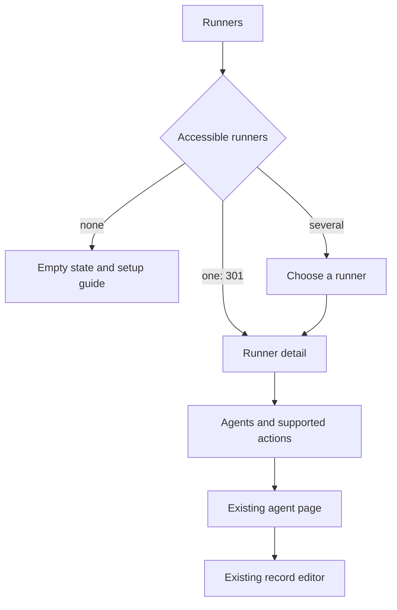

# Runners in the web face

## Goal

The status-and-reload slice is built (0.8.198), and per-agent controls, the host's files and instances (0.8.211); [page contract](../../../src/web/web-face/runners.md#web-face-runner-pages). Manage the runners you can access and their
agents without leaving the web face.

- Find a runner and see whether it is answering.
- See its agents, start or stop serving them, and understand refusals.
- Open the existing agent page for record details and editing.
- Offer only actions the runner actually supports and the caller may perform.

This section is for `agent-bus-runner`. The dedicated runner (`agent-bus run`)
remains a separate program. A task carrying the `runner` tag is not itself a
runner; that tag alone must not populate this section.

This is a wrapper for runner agent APIs, focused on the extra observations and
actions a runner provides. The host's files — env files, overrides,
`agents.json` — are the runner's, edited here through its calls
([№RD101](../DECISIONS.md#recorded-decisions)). Do not duplicate agent pages,
metadata forms, or the record's bus Secret and JSON configuration editors here.
Link to the existing agent page and let its normal permissions and editing flow
apply.

## Main journeys

| Page | What the user gets |
|---|---|
| Runners | Caller-visible runners, with owner, host and observed availability. No runners: explain the empty state and link to setup guidance |
| Exactly one accessible runner | An authenticated GET returns **301** to that runner's page. Decide this from the caller's current accessible set, not the node-wide count; the final response must carry `Cache-Control: no-store` |
| Several runners | A chooser with useful status; inaccessible runners affect neither rows nor counts |
| Runner detail | Identity and owner in the header, last successful observation, alerts and its agents; information only, no operation (owner instruction, 2026-10-18). An unreachable runner remains identifiable rather than appearing empty |
| Manage | Every operation on the runner, on a page of its own; stop and disable under a collapsed danger zone |
| Agent link | Open the existing agent page, preserving a return path to the runner; use its existing details and editing actions |

## Minimum checklist

`RW` labels the original runner-web work, additions and acceptance checklist entries.

- ✅ RW1 (0.8.198) Add a Runners entry to the web navigation and appropriate GitHub docs links.

- ✅ RW2 (0.8.198) Discover actual runners the signed-in caller may access. Reuse the bus's
  - Details: visibility rules and the [runner identity rule](../runner.md#the-rule). The remaining person/edge naming choice is [№Q165](../QUESTIONS.md#open-questions). A task tag alone is not runner identification.

- ✅ RW3 (0.8.198) Implement zero/one/many navigation, including the requested single-runner
  - Details: 301. Apply it only to navigation, never to submitted actions; avoid redirect loops and stale redirects after the accessible set changes. Verify `Cache-Control: no-store` on the final response, including the normal web response wrapper, rather than inspecting only the redirect helper.

- ⚠️ RW4 Join the runner's agent inventory with caller-visible registry records.
  - Details: Runner status supplies name, enabled/disabled setting, observed serving state, refusal reason and running/minimum/maximum process counts; description and tags come from the records. Keep registry information available when status fails, with its last observation identified as stale. Distinguish a disabled agent, a refused agent, an unreachable runner and an idle agent.
  - Built: status rows joined with the visitor's records. Partial: a last observation is not kept between requests (the face stores nothing across requests), so a failed status shows the runner identified and its agents "not known" rather than stale rows.

- ✅ RW5 (0.8.211) Start and stop serving individual agents through supported runner actions.
  - Details: State what happens to work in progress and queued messages. Do not substitute registry activation/deactivation or the dedicated runner's `stop` command.
  - Built: Start, Stop and Restart per agent, through the runner's calls ([№Q181](../DECISIONS.md#recorded-decisions)).

- ✅ RW6 (0.8.198) Link each visible agent to its existing agent page, with a return path
  - Details: to the runner. Metadata, Secret (ENV) and pretty-printed JSON configuration remain in the existing record editing flow; add no parallel forms or private value reads to the runner section. Runner access grants no extra record rights.

- ✅ RW7 (0.8.198) Use the existing `/agent?name=<encoded name>&return=<encoded local path>`
  - Details: link form. Extend the existing record detail/edit/save return-path allowlists to admit the runner page once its route is defined; today they accept only the record's list page. Preserve the local-path checks and safe fallback.

- ⚠️ RW8 Make saved versus applied settings clear. Offer an explicit reload/apply
  - Details: action where supported, with its scope explained. A saved value must not be presented as already applied to a running process.
  - Built: reload explained as runner-wide, a saved change taking effect only then. Partial: no per-setting saved/applied view.

- ✅ RW9 (0.8.198) Report action results from the runner, including timeouts and uncertain
  - Details: outcomes; never report success solely because the bus accepted the request.

## What is available and what must precede it

The [current operations guide](../../../docs/runner/operations.md#not-available-yet)
owns built/pending behavior. At planning time the runner answers `status` and
`reload`; agent lifecycle and remote installation/configuration are later
[runner waves](../TODO.md#runner-waves).

Start with the useful user outcome, compare it with the actual API and the
owning runner plan, then synchronize the missing runner methods and the web
work. Do not let today's two commands define the whole intended experience.

| What users should have | What the API has today | Planned work / dependency |
|---|---|---|
| Runner availability, version and load failures | `status` answers runner identity, version and load error | Discovery and caller authorization in the web face |
| Agent inventory, serving state, refusals and current concurrency | `status` answers names, enabled setting, state, reason and running/min/max counts | Render these observations; use existing agent links for record details |
| Reread installed code/configuration and see the result | `reload` answers the resulting status | Explain runner-wide scope and report the actual answer |
| Start/stop an individual agent, with clear treatment of current and queued work | No per-agent control or argument slot | Agree targeting, authorization and lifecycle behavior in [runner waves](../TODO.md#runner-waves); add runner methods before their web controls |
| Restart, enable/disable and kept-process/pool supervision | No corresponding control methods | Synchronize with process work and its acceptance before exposing actions |
| Install/update/remove packages and change runner-owned deployment settings | No remote management methods | [Deploy over the bus](../runner-implementation.md#reaching-the-runner); keep separate from bus record editing |
| Effective protections, capacity and bounded operational diagnostics | Only the status observations above | Extend runner observations where needed, following the security and process plans |
| Agent metadata, ENV and JSON editing | Existing record pages and private-value operations | Link out; no duplicate runner editor or new runner method for existing record functionality |

The minimum is not complete until start/stop works. Before then, ship an honest
status/reload subset with links to existing agent pages. Mark unavailable
lifecycle controls clearly and explain the missing capability.
The web face is a client of an external runner: no host shell, direct file
editing or privileged systemd calls from the web process. Missing runner calls
or formats must be agreed in the runner work before wiring a form to them.
Today's status/reload calls have no agent argument; per-agent controls therefore
also depend on an agreed command format that can identify the target agent.
This plan does not introduce that format.

The single-runner 301 is the owner's explicit requirement. It must not become
a stored navigation shortcut: the response's `no-store` directive prohibits
cache storage and reuse ([HTTP caching rule](https://www.rfc-editor.org/rfc/rfc9111.html#section-5.2.2.5)).
The existing web response wrapper already applies this directive to non-assets;
the acceptance check must hold it on this redirect too.

## Useful additions

Proposals to prioritize after the minimum:

- ⏳ RW10 Search and filter agents by name, tag, state and refusal reason; count
  - Details: before pagination and only over the caller-visible set.

- ⏳ RW11 Show running work versus capacity, queued work, last failure and last
  - Details: successful status refresh when the runner supplies those observations.

- ⏳ RW12 Show effective sandbox/resource limits and warnings when protection is
  - Details: disabled, without implying settings the running version does not enforce.

- ⏳ RW13 Explain configuration precedence and whether changes need reload or a
  - Details: process restart; provide a deliberate restart action when supported.

- ✅ RW14 (0.8.211) Enable/disable future serving separately from starting/stopping it now.

- ⏳ RW15 Offer bounded, permission-checked logs and diagnostics when available,
  - Details: with secret redaction and a clear unavailable state.

- ⏳ RW16 Add agents from installed packages/templates, then install/update/remove
  - Details: packages when the runner supports remote management. Keep removal and interruption behind consequence confirmations.

- ⏳ RW17 Recheck status after an action and show the resulting agent state; refresh
  - Details: without changing a separate agent editor or overwriting a newer action result.

## Acceptance checklist

- ✅ RW18 (0.8.198) Zero, one and multiple accessible runners exercise distinct pages; one
  - Details: produces 301, including when other runners exist but are inaccessible.

- ⚠️ RW19 Revocation, another signed-in user and a newly added second runner cannot
  - Details: reuse a cached private redirect or expose a runner's name/count. Check both the final 301's `no-store` header and navigation after each change in the same browser; each navigation must consult the current caller's accessible set.
  - Built: the 301 is decided from the visitor's set on each request and is `no-store`. Partial: no same-browser revocation sequence test.

- ✅ RW20 (0.8.198) A `runner`-tagged ordinary task never appears as a runner by itself.

- ⚠️ RW21 Read-only callers can observe permitted status but forged action posts
  - Details: cannot start/stop work or change metadata, secrets or configuration.
  - Built: the face adds no action beyond the runner's own verbs, each called as the visitor under the runner's ACL. Partial: who may reload is the runner's ACL, not a read-only role.

- ✅ RW22 (0.8.198) Runner access alone cannot reveal another agent's private ENV/config.
  - Details: the record's bus Secret and configuration. The host's env files are the runner's own, readable to whoever its ACL admits ([№RD101](../DECISIONS.md#recorded-decisions)).

- ✅ RW23 (0.8.198) A refused/timed-out action is not shown as success; an offline runner is
  - Details: not shown as having zero agents. An uncertain write is not blindly repeated.

- ✅ RW24 (0.8.211) Start/stop effects are verified at the runner, including drain/queued-work
  - Details: behavior; toggling registry status alone cannot satisfy the check.
  - Built: smoke checks a stopped agent answers nothing while its sibling does, a restart replaces a kept agent's processes, and a stop lasts only until reload.

- ⚠️ RW25 Agent links reach the existing detail/edit flow and return to the runner.
  - Details: Verify return navigation through detail, edit, save and validation failure; a forged external return destination must still use the safe fallback. Runner pages introduce no duplicate metadata, ENV or JSON editor and do not fetch private values merely to display inventory.
  - Built: the detail page returns to the runner and a forged return falls back. Partial: edit, save and validation-failure returns are admitted by the same allowlist but not each tested.

- ✅ RW26 (0.8.198) Unsupported actions cannot silently fall through to host-level commands.

- ⚠️ RW27 Add compiling mutants for access bypass, unfiltered runner counts, false
  - Details: action success and tag-only runner discovery; each must fail its named assertion. Run the full slow gate before implementation ships.
  - Built: seven mutants (tag or look-alike discovery, no 301, timeout as an empty answer, reload always success, no runner return, hidden agents linked, any record a runner), each failing an assertion in `src/web/test/runners.test.ts`.
