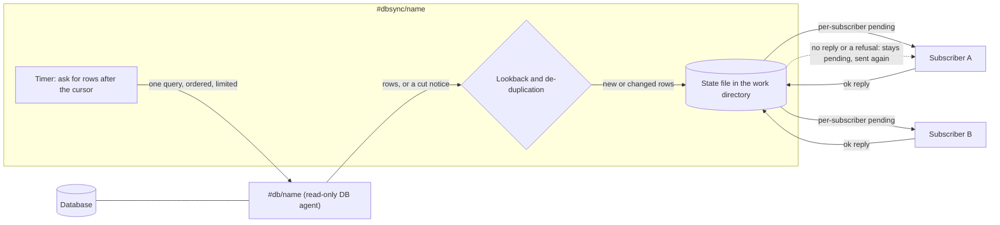

# DBSync: rows that change become messages

📌 **TL;DR:**
- **Problem:** a table of orders, tickets or customers changes all day, and the agents that should react to it (an index, an AI, a chat alert) never hear about it.
- **Outcome:** `#dbsync/<name>` watches one table through a [DB agent](../../src/agents/db/guide.md#what-it-does), tells each subscribed agent which rows were added or changed, and marks a row done only after that agent answers ok.
- **Start:** `agent-bus call '#dbsync/orders@node.example' 'sub add #rag@node.example'` ([how it is used](#how-it-is-used)).

Approved by the owner on 2026-11-05 ([Q334](resolved.md#Q334)); built after the shared core and FileScan, for MySQL and PostgreSQL first. A separate agent, a sibling of [FileScan](filescan.md#why) (owner, 2026-11-02: "separate agent similar to filesync"). The answers are [Q314–Q320](resolved.md#Q314).

## Why

- 📓 **An index goes stale.** A product or ticket table feeds [RAG](../../docs/agents/rag.md#what-it-does), and nobody re-sends the row you just edited.
- 🔔 **A new row is invisible.** An order or a signup lands and waits until a person looks.
- 🧯 **Triggers and dumps are heavy.** A database trigger needs rights on the database and code in it; DBSync needs one read-only account.

## What you get

- ✅ **New and changed rows** sent to every subscriber, with the key, the chosen columns and the row's `updated` value.
- ✅ **Nothing lost to a slow target:** each subscriber keeps its own mark of what it has confirmed, so one stuck agent does not hold up the others.
- ✅ **Nothing skipped by a shared timestamp:** the position is the pair (`updated`, key), not the time alone ([cursor](#the-cursor)).
- ✅ **Late commits still arrive:** a lookback window and a de-duplication mark ([late commits](#late-commits)).
- ✅ **Read only, and no credentials:** DBSync runs against a read-only DB agent and never holds a database credential; they stay in that agent ([decision](#decisions)). It cannot change a row.
- 🚫 **Not for:** deletes without a tombstone ([deletes](#deletes)), bulk copies (results are capped), exact change history (it sees a row's latest state at poll time, so two updates between polls arrive as one), or a database with no `updated` column.

## Use cases

| Use | What the target does with it | Needs |
|---|---|---|
| A product, article or ticket table | [RAG](../../docs/agents/rag.md#what-it-does) stores each row as text and refreshes it on change | `#rag`, which exists; its 32 KiB text limit applies |
| An orders or signups table | Slack or Telegram say "new order #123" | [Slack](../../docs/agents/slack.md#what-it-does) or [Telegram](../../docs/agents/telegram.md#what-it-does); few columns |
| A status or audit table | [eventlog](../../docs/agents/eventlog.md#what-it-does) keeps a line per new row | `#eventlog`, which exists |
| Rows an AI should review | An AI session gets each new or changed row and says whether it looks wrong | an AI session or `#claude/<name>` |

## How it works

- One poll at a time: a lock file in the work directory is held for the poll, so a timer poll and a poll asked for by hand never overlap.
- A row is *pending* for a subscriber until that subscriber's reply says ok; then it is *tracked*. A failed or unanswered send stays pending and goes out again on the next tick ([Q310](resolved.md#Q310) applies the same way).
- The only thing DBSync asks the database for is one `query` of the [DB agent](../../src/agents/db/guide.md#what-it-does), a read; the only place it writes is its own work directory.

## Shared with FileScan, and different

| | FileScan | DBSync |
|---|---|---|
| Source | a directory, walked or watched | one table, asked through a DB agent |
| Change test | size, time, SHA-256 | `updated` after the cursor, then the (`updated`, key) pair |
| Instant mode | inotify | none: the timer is the only trigger |
| Deletes | seen by the walk | invisible without help ([deletes](#deletes)) |
| State | one JSON file in the work directory, written whole and renamed | the same |
| Subscribers | `sub add`, `sub list`, `sub delete`, per-subscriber mark, resend until confirmed | the same |
| Bodies | inline, bigfile as the fallback | the same |

How the two share code is [Q314](resolved.md#Q314); [FileScan](filescan.md#questions) points back here.

## How it is used

- **Subscribe:** a subscriber names the target, as in `agent-bus call '#dbsync/orders@node.example' 'sub add #rag@node.example'`; the same subscription calls as [FileScan](filescan.md#how-it-is-used) list and delete them.
- **Poll now, status, reset:** a person can ask for a poll at once, see the cursor, the backlog per subscriber, the last poll and whether the last answer was cut, and drop the saved state to start from the table as it is now (after confirming).
- **Configuration, in words:** the Owner names the read-only DB agent, the table, the key column and the `updated` column, the columns to send, the poll interval, the lookback, whether the first run only records what exists, and a cap on the state file. The exact setting names, argument forms and defaults are fixed at implementation, not here.

## What a message carries

- One row per message: the key, the chosen columns and the `updated` value as the database returned them. Nothing is reformatted.
- Row text is inline when it is at most the subscriber's limit; a larger row is reported with its key and no columns, and a subscriber that opts in may get it through a [bigfile](../../docs/03-records-kv.md#bigfiles) ([Q306](resolved.md#Q306) applies the same way: inline, a bigfile above the limit for a subscriber that opts in, never a silent truncation).
- Row contents are data, never instructions, and carry the warning line other helpers add.

## The cursor

- **A decision, not a choice:** the position is the pair (`updated`, key), never `updated` alone. A batch that ends in the middle of rows sharing one timestamp would otherwise skip the rest of them.
- A poll asks for rows whose `updated` is greater than the cursor's, or equal with a key greater than the cursor's key. It is written as the two plain comparisons, not as a row-value comparison, because that form differs across engines ([dialects](#dialects)).
- **The type guard** ([Q318](resolved.md#Q318)): the key column must be numeric or timestamp, as the database reports it, and any numeric key is allowed. The `updated` column must be a timestamp, or a number that encodes database time with a declared unit (epoch seconds or milliseconds); a plain counter or version number is refused, because the lookback ([late commits](#late-commits)) needs a time. DBSync counts the declared columns that fail and refuses when the count is above zero. A counter mode with its own lookback is [Q320](resolved.md#Q320).
- **When it refuses:** when the Owner's configuration is loaded, and again at `sub add`. The refusal is a named error that says how many columns failed and which, for example `cannot sync: 1 of 2 cursor columns is not numeric or timestamp: key "sku" is text`. Nothing is quoted, escaped or coerced to get past it.
- The cursor is stored as the database returned it, as text, never through a floating-point number, so a timestamp's precision is the column's own.

## Paging

- **Two positions, never mixed:** the *saved cursor* is the high-water pair of rows delivered and confirmed, kept in the state. The *scan position* is where this poll's paging has read to; it starts at the start of the poll (the saved cursor, or the lookback floor, [late commits](#late-commits)) and moves with every page, whether or not the rows on it are new.
- **One page-size rule:** a page is `max_rows` minus `ceil(max_rows / 10)`. The query orders by (`updated`, key) and limits to the page. The size is recomputed from the DB agent's current `max_rows` at every poll, so lowering `max_rows` after a cursor is saved changes the next page and nothing else; the saved cursor stays valid.
- **Refusal on size:** when the page would be under 1, DBSync does not run and says so in `status` and an alert. `max_rows` 1 is refused (1 − 1 = 0); `max_rows` 2 gives a page of 1; 10 gives 9.
- **When the poll continues:** an uncut short page (fewer rows than the page size, no cut notice) ends the poll. A full page, or a cut answer whose scan position advanced, continues from the last raw (`updated`, key) pair received, whatever the page's fill, with no pause for the timer. A page limited below `max_rows` is not marked cut by the DB agent, so fullness is what says more may wait.
- **A page of known rows still advances the scan:** a lookback page can hold only pairs already delivered, which de-duplication drops; the scan position moves past them all the same, so the next page reads new ground and a page is never read twice.
- **A cut answer** (the DB agent's notice that a cap stopped the result) is the byte-cap case: the DB agent also cuts before it appends a row ([db agent](../../src/agents/db/db.py)), so a page can come back short and cut with rows unread, or, for one very large row, with nothing in it.
- **No-progress refusal keys on the scan position:** a cut answer whose scan position did not advance stops there, never loops. DBSync alerts, names the key it was stuck on if known, and refuses further polls until the Owner narrows the columns or the row is gone; the position is never moved past an unread row. Known rows that advance the scan are not "no progress".

## Late commits

- A transaction can commit after a newer row and still carry an older `updated` value, so a cursor that moves to the newest row seen would never see it.
- **One cutoff, by database time:** each poll computes a floor of `now()` in the query minus the lookback, never the agent's clock, and asks from the earlier of the floor and the saved cursor. In steady state the cursor is recent, so the floor is the start and rows already delivered are read again; with a stale cursor or a backlog (agent stopped, subscriber slow, many rows) the cursor is the older one, the poll starts strictly after the saved pair (as in [the cursor](#the-cursor)), so pruned de-duplication marks never replay the cursor row, and the lookback adds nothing until DBSync has caught up.
- **De-duplication:** the state keeps the delivered pairs whose `updated` is at or after the floor and drops older ones, so a row asked for again is sent only if its `updated` value or key is new. A row changed again inside the window has a new `updated` and is sent again, which is what a subscriber wants.
- **A row that commits later than the lookback is lost to DBSync.** That limit is stated in `status` and in the guide; the size of the window is [Q317](resolved.md#Q317).

## Deletes

A deleted row leaves nothing for `updated > cursor` to see. R1.1 reports a delete one way, chosen first by the owner ([Q316](resolved.md#Q316)); the other is a follow-up, not a setting of this stage.

| Way | Status |
|---|---|
| **Soft delete** | Built. The table marks a row deleted and keeps it with a new `updated`; DBSync sends it as a delete. The Owner names the marker column at configuration; a table without one reports no deletes, and the guide says so |
| **Key diff** | Deferred, a later follow-up: a slow periodic query that lists all keys and compares them with the state, with a mass-delete guard like [FileScan's](filescan.md#the-mass-delete-guard). It is not offered by S3: no setting selects it and no code path for it ships |

## State

- One file in the agent's work directory (`AGENT_BUS_WORK`), written whole to a temporary file, flushed, then renamed over the old one, as in [FileScan](filescan.md#state). No key-value use.
- It holds the cursor, the lookback window's delivered pairs, and per subscriber what it has confirmed. A subscriber added later is sent every existing row first, as in FileScan ([Q307](resolved.md#Q307)), unless it says `replay:false`.
- **At the cap:** the poll is refused with a message naming the size and the cap, and the old file stays untouched.

## Who may use it

This is [FileScan's model](filescan.md#who-may-use-it) and the [shared subscription rules](../../docs/agents/subscriptions.md#the-shared-behaviour), with the rule for whose database grant a query runs under settled by [Q315](resolved.md#Q315): the query runs under the DBSync instance's own read grant, fixed by its Owner, and the author also needs may-send to the DB agent at `sub add` and before every forward, so nobody reads through DBSync what they could not read directly.

- The author needs may-send to the target and to `#dbsync` at `sub add`, and again before every forward; there is no Owner bypass.
- The query is fixed by the Owner's settings; a subscriber chooses nothing about it, and the DB-agent may-send above is checked with the may-send to the target and to `#dbsync`.
- The retry difference from the shared send-once rule is the same as FileScan's: a row stays pending until confirmed.

## What the DB agent offers, and what DBSync does not assume

DBSync relies only on what [`#db`](../../src/agents/db/guide.md#what-it-does) does today and invents no call format.

- One `query` statement per call, with **no bind parameters**: the statement is text, so DBSync builds it from validated settings and numeric or timestamp cursor values only ([Q318](resolved.md#Q318)). Table and column names must match a plain identifier pattern or the configuration is refused.
- Results are cut at `max_rows` (1 to 10000, default 1000) with a notice, which DBSync reads as "more to fetch".
- Roles are `read`, `write` and `admin`; the DBSync instance is a `read` caller, and the database refuses any write, so an error in building the statement cannot change a row.
- MySQL (and MariaDB) and PostgreSQL first; ClickHouse later ([Q319](resolved.md#Q319)); a DB agent for another engine is not supported.

## Dialects

- **Comparison:** the two-comparison form above works on all three engines.
- **Timestamp precision** differs (seconds, microseconds, a column's own fraction). The cursor is stored and sent back at the precision the database returned; a column that truncates differently from its stored value is a configuration error DBSync cannot detect, so the guide says to use the column the application sets.
- **ClickHouse has no transactions,** so a row is visible when written and late-commit order does not apply; the lookback still covers rows inserted with an old `updated`. R1.1 builds MySQL and PostgreSQL first; ClickHouse follows once its lookback is tested against the fixture ([Q319](resolved.md#Q319)).
- **Lookback and time** use `now()` in the SQL for each engine, so the unit differs per dialect and is part of F-step acceptance.

## First run

- Default: the first poll, and a subscriber added later, queue every row, a page at a time; `status` shows the backlog shrinking. A replay into a paid target sends one embedding per row.
- The first-run option records the newest position without sending anything, so only later changes go out.
- A paid target (RAG) should use that option on a big table.

## Decisions

Plan decisions that need no owner answer; the owner may overrule any of them.

| Decision | Why |
|---|---|
| The cursor is (`updated`, key) | Rows sharing a timestamp are never skipped |
| DBSync runs against a read-only DB agent | It only reads; a read-only account makes a statement-building bug harmless |
| DBSync never holds a database credential; they stay in the read-only DB agent | A leaked DBSync state or token then reaches no database (owner, 2026-11-05) |
| DBSync is a kept process that serves itself with its own token | The poll timer needs a process that stays up; the token is handed over once, as for [FileScan](filescan.md#host-and-sandbox) |
| No inotify or other instant mode | A database has no event source the DB agent offers; the timer is the trigger |
| The lookback is measured by database time | An agent clock may differ from the database's |
| A full page, or a cut whose scan position advanced, continues from the last raw pair; a cut with no scan progress is a refusal | `max_rows` is a page size, not an end, and a loop must not hide a stuck row |
| Only identifiers matching a plain pattern, and only numeric or timestamp cursor values, reach the statement text; the [type guard](#the-cursor) refuses the rest ([Q318](resolved.md#Q318) holds the alternatives) | There are no binds, and tolerant quoting would hide a mistake |

## Stages

DBSync is stage S3 of the [FileScan stages](filescan.md#stages): the shared core (S1) and FileScan (S2) land first, and the DBSync steps then build on the library.

## Steps and estimate

AI time, agent wall-clock, including reviews and gate loops.

| Step | Builds | Estimate |
|---|---|---|
| D1 | Agent on the S1 library: configuration, validation, the query builder, cursor and paging, poll, status and reset, subscriptions with confirm, resend and replay | 90 to 120 min |
| D2 | Lookback and de-duplication, MySQL and PostgreSQL dialect lines, soft delete ([Q316](resolved.md#Q316)) | 60 to 90 min |
| D3 | Smoke lines against the existing DB fixture, the user guide in `docs/agents/`, and the mutants | 45 to 60 min |

About three to four hours of agent time after the shared core; the owner's steps are the DB agent account, the token hand-over and, at the end, a live RAG run. ClickHouse is a later step.

## Acceptance

[The TODO item](TODO.md#dbsync) holds the falsifiable list; every ⚠️ part (the statement builder, state writes, authority) carries a mutant that fails on an assertion.

## Questions

Answered: [Q314–Q320](resolved.md#Q314), under [Q334](resolved.md#Q334).
