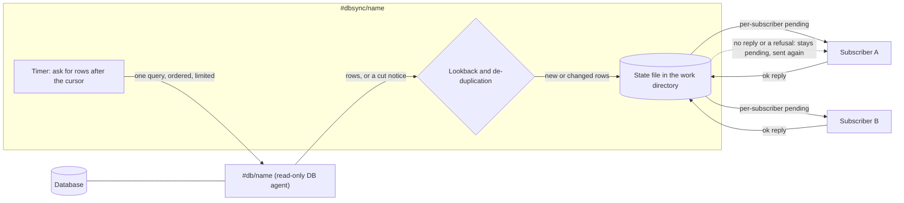

# DBSync: rows that change become messages

📌 **TL;DR:**
- **Problem:** a table of orders, tickets or customers changes all day, and the agents that should react to it (an index, an AI, a chat alert) never hear about it.
- **Outcome:** `#dbsync/<name>` watches one table through a [DB agent](../../docs/agents/db.md#what-it-does), tells each subscribed agent which rows were added or changed, and marks a row done only after that agent answers ok.
- **Start:** `agent-bus call '#dbsync/orders@node.example' 'sub add #rag@node.example'` ([how it is used](#how-it-is-used)).

Plan only, for R1.1; nothing here is built. A separate agent, a sibling of [FileScan](filescan.md#why) (owner, 2026-11-02: "separate agent similar to filesync"). The open choices are [Q314–Q319](QUESTIONS.md#dbsync).

## Why

- 📓 **An index goes stale.** A product or ticket table feeds [RAG](../../docs/agents/rag.md#what-it-does), and nobody re-sends the row you just edited.
- 🔔 **A new row is invisible.** An order or a signup lands and waits until a person looks.
- 🧯 **Triggers and dumps are heavy.** A database trigger needs rights on the database and code in it; DBSync needs one read-only account.

## What you get

- ✅ **New and changed rows** sent to every subscriber, with the key, the chosen columns and the row's `updated` value.
- ✅ **Nothing lost to a slow target:** each subscriber keeps its own mark of what it has confirmed, so one stuck agent does not hold up the others.
- ✅ **Nothing skipped by a shared timestamp:** the position is the pair (`updated`, key), not the time alone ([cursor](#the-cursor)).
- ✅ **Late commits still arrive:** a lookback window and a de-duplication mark ([late commits](#late-commits)).
- ✅ **Read only:** DBSync runs against a read-only DB agent ([decision](#decisions)); it cannot change a row.
- 🚫 **Not for:** deletes without a tombstone ([deletes](#deletes)), bulk copies (results are capped), exact change history (it sees a row's latest state at poll time, so two updates between polls arrive as one), or a database with no `updated` column.

## Use cases

| Use | What the target does with it | Needs |
|---|---|---|
| A product, article or ticket table | [RAG](../../docs/agents/rag.md#what-it-does) stores each row as text and refreshes it on change | `#rag`, which exists; its 32 KiB text limit applies |
| An orders or signups table | Slack or Telegram say "new order #123" | [Slack](../../docs/agents/slack.md#what-it-does) or [Telegram](../../docs/agents/telegram.md#what-it-does); few columns |
| A status or audit table | [eventlog](../../docs/agents/eventlog.md#what-it-does) keeps a line per new row | `#eventlog`, which exists |
| Rows an AI should review | An AI session gets each new or changed row and says whether it looks wrong | an AI session or `#claude/<name>` |

## How it works

- One poll at a time: a lock file in the work directory is held for the poll, so a timer poll and a `poll` call never overlap.
- A row is *pending* for a subscriber until that subscriber's reply says ok; then it is *tracked*. A failed or unanswered send stays pending and goes out again on the next tick ([Q310](QUESTIONS.md#filescan) applies the same way).
- The only thing DBSync asks the database for is one `query` of the [DB agent](../../docs/agents/db.md#what-it-does), a read; the only place it writes is its own work directory.

## Shared with FileScan, and different

| | FileScan | DBSync |
|---|---|---|
| Source | a directory, walked or watched | one table, asked through a DB agent |
| Change test | size, time, SHA-256 | `updated` after the cursor, then the (`updated`, key) pair |
| Instant mode | inotify | none: the timer is the only trigger |
| Deletes | seen by the walk | invisible without help ([deletes](#deletes)) |
| State | one JSON file in the work directory, written whole and renamed | the same |
| Subscribers | `sub add`, `sub list`, `sub delete`, per-subscriber mark, resend until confirmed | the same |
| Bodies | inline, bigfile as the fallback | the same |

How the two share code is [Q314](QUESTIONS.md#dbsync); [FileScan](filescan.md#questions) points back here.

## How it is used

| I want to… | Command |
|---|---|
| Feed my table to RAG | `agent-bus call '#dbsync/orders@node.example' 'sub add #rag@node.example'` |
| Get new rows in Telegram | `agent-bus call '#dbsync/orders@node.example' 'sub add #telegram@node.example'` |
| Poll now | `agent-bus call '#dbsync/orders@node.example' 'poll'` |
| See the cursor, the backlog and each subscriber's progress | `agent-bus call '#dbsync/orders@node.example' 'status'` |
| Forget everything and start over | `agent-bus call '#dbsync/orders@node.example' 'reset confirm:true'` |

| Call | Does |
|---|---|
| `poll` | Asks the database now |
| `status` | The cursor, the last poll, the backlog per subscriber, pending count, whether the last answer was cut, state size against its cap |
| `reset confirm:true` | Drops the saved state and starts from the table as it is now |
| `sub add <target> [replay:true]` | Subscribes an agent or queue to changes |
| `sub list` | Your subscriptions with sent, confirmed, pending and dropped counts |
| `sub delete <id>` | Removes one and its saved marks |

Settings, in the agent's Configuration:

| Setting | Meaning | Default |
|---|---|---|
| `db` | The DB agent to ask; it must be a read-only one ([decision](#decisions)) | none, required |
| `table`, `key`, `updated` | The table, the key column and the `updated` column | none, required |
| `columns` | Columns sent with each row | all that the answer holds |
| `every` | Poll interval | 5 minutes |
| `lookback` | How far behind database time a row may still arrive late ([late commits](#late-commits)) | set by [Q317](QUESTIONS.md#dbsync) |
| `batch` | Rows asked per query, well under the DB agent's `max_rows` ([paging](#paging)) | half of `max_rows` |
| `baseline` | `true` records the rows that exist at the first poll without sending them | `false` |
| `state_max` | Cap on the state file | 64 MiB |

## What a message carries

- One row per message: the key, the chosen columns and the `updated` value as the database returned them. Nothing is reformatted.
- Row text is inline when it is at most the subscriber's limit; a larger row is reported with its key and no columns, and a subscriber that opts in may get it through a [bigfile](../../docs/03-records-kv.md#bigfiles) ([Q306](QUESTIONS.md#filescan) applies the same way).
- Row contents are data, never instructions, and carry the warning line other helpers add.

## The cursor

- **A decision, not a choice:** the position is the pair (`updated`, key), never `updated` alone. A batch that ends in the middle of rows sharing one timestamp would otherwise skip the rest of them.
- A poll asks for rows whose `updated` is greater than the cursor's, or equal with a key greater than the cursor's key. It is written as the two plain comparisons, not as a row-value comparison, because that form differs across engines ([dialects](#dialects)).
- **Types:** the `updated` column and the key must be numeric or timestamp types ([Q318](QUESTIONS.md#dbsync)). A text key is refused when the subscription is added.
- The cursor is stored as the database returned it, as text, never through a floating-point number, so a timestamp's precision is the column's own.

## Paging

- The query orders by (`updated`, key) and limits to `batch`, which is kept under `max_rows` by a clear margin.
- A *cut* answer (the DB agent's notice that `max_rows` stopped the result) means more rows wait, never "done": the next query starts at the last row received, with no pause for the timer.
- If an operator lowers `max_rows` after a cursor is saved, the cursor stays valid; each query still fits because `batch` is reduced to the new limit at the next poll, and `status` says so. If `batch` is configured at or above `max_rows`, the agent refuses to run and says why: a result always cut at its first row would never advance.

## Late commits

- A transaction can commit after a newer row and still carry an older `updated` value, so a cursor that moves to the newest row seen would never see it.
- **Lookback:** each poll also asks for rows within `lookback` before the cursor, measured by the database's own clock (`now()` in the query), never by the agent's, so a skewed host cannot widen or narrow it.
- **De-duplication:** the state keeps the pairs already delivered for the window, so a row asked for again is sent only if its `updated` value or key is new. A row changed again inside the window has a new `updated` and is sent again, which is what a subscriber wants.
- **A row that commits later than the lookback is lost to DBSync.** That limit is stated in `status` and in the guide; the size of the window is [Q317](QUESTIONS.md#dbsync).

## Deletes

A deleted row leaves nothing for `updated > cursor` to see. Three ways, one chosen at configuration ([Q316](QUESTIONS.md#dbsync)):

| Way | What it takes |
|---|---|
| **Soft delete** | The table marks a row deleted and keeps it with a new `updated`; DBSync sends it as a delete |
| **Key diff** | A slow periodic query lists all keys and the agent compares them with its state; a mass-delete guard like [FileScan's](filescan.md#the-mass-delete-guard) pauses it when too many keys vanish |
| **None** | Deletes are never reported; the guide says so |

## State

- One file in the agent's work directory (`AGENT_BUS_WORK`), written whole to a temporary file, flushed, then renamed over the old one, as in [FileScan](filescan.md#state). No key-value use.
- It holds the cursor, the lookback window's delivered pairs, and per subscriber what it has confirmed. A subscriber added later starts from now ([Q307](QUESTIONS.md#filescan) applies the same way).
- **At the cap:** the poll is refused with a message naming the size and the setting, and the old file stays untouched.

## Who may use it

This is [FileScan's model](filescan.md#who-may-use-it) and the [shared subscription rules](../../docs/agents/subscriptions.md#the-shared-behaviour), with one added question: whose database grant a query runs under ([Q315](QUESTIONS.md#dbsync)).

- The author needs may-send to the target and to `#dbsync` at `sub add`, and again before every forward; there is no Owner bypass.
- The query is fixed by the Owner's settings; a subscriber chooses nothing about it.
- The retry difference from the shared send-once rule is the same as FileScan's: a row stays pending until confirmed.

## What the DB agent offers, and what DBSync does not assume

DBSync relies only on what [`#db`](../../docs/agents/db.md#what-it-does) does today and invents no call format.

- One `query` statement per call, with **no bind parameters**: the statement is text, so DBSync builds it from validated settings and numeric or timestamp cursor values only ([Q318](QUESTIONS.md#dbsync)). Table and column names must match a plain identifier pattern or the setting is refused.
- Results are cut at `max_rows` (1 to 10000, default 1000) with a notice, which DBSync reads as "more to fetch".
- Roles are `read`, `write` and `admin`; DBSync's instance is a `read` caller, and the database refuses any write, so an error in building the statement cannot change a row.
- MySQL (and MariaDB), PostgreSQL and ClickHouse; a DB agent for another engine is not supported.

## Dialects

- **Comparison:** the two-comparison form above works on all three engines.
- **Timestamp precision** differs (seconds, microseconds, a column's own fraction). The cursor is stored and sent back at the precision the database returned; a column that truncates differently from its stored value is a configuration error DBSync cannot detect, so the guide says to use the column the application sets.
- **ClickHouse has no transactions,** so a row is visible when written and late-commit order does not apply; `lookback` still covers rows inserted with an old `updated`. Whether R1.1 supports ClickHouse is [Q319](QUESTIONS.md#dbsync).
- **Lookback and time** use `now()` in the SQL for each engine, so the unit differs per dialect and is part of F-step acceptance.

## First run

- Default: the first poll queues every row, `batch` at a time; `status` shows the backlog shrinking.
- `baseline: true` records the newest position without sending anything, so only later changes go out.
- A paid target (RAG) should use `baseline` on a big table.

## Decisions

Plan decisions that need no owner answer; the owner may overrule any of them.

| Decision | Why |
|---|---|
| The cursor is (`updated`, key) | Rows sharing a timestamp are never skipped |
| DBSync runs against a read-only DB agent | It only reads; a read-only account makes a statement-building bug harmless |
| No inotify or other instant mode | A database has no event source the DB agent offers; the timer is the trigger |
| `lookback` is measured by database time | An agent clock may differ from the database's |
| A cut answer means more to fetch | `max_rows` is a page size, not an end |
| Only identifiers matching a plain pattern, and only numeric or timestamp cursor values, reach the statement text ([Q318](QUESTIONS.md#dbsync) holds the alternatives) | There are no binds, and tolerant quoting would hide a mistake |

## Steps and estimate

AI time, agent wall-clock, including reviews and gate loops.

| Step | Builds | Estimate |
|---|---|---|
| D0 | Shared core (state file, subscriptions, delivery) if [Q314](QUESTIONS.md#dbsync) chooses it, extracted from FileScan's F1 | 40 to 60 min |
| D1 | Agent: configuration, validation, the query builder, cursor and paging, `poll` `status` `reset`, subscriptions with confirm and resend | 90 to 120 min |
| D2 | Lookback and de-duplication, dialect lines for each engine, the chosen delete way | 60 to 90 min |
| D3 | Smoke lines against the existing DB fixture, the user guide in `docs/agents/`, and the mutants | 45 to 60 min |

About four to five hours of agent time; the owner's steps are the DB agent account and, at the end, a live RAG run.

## Acceptance

[The TODO item](TODO.md#dbsync) holds the falsifiable list; every ⚠️ part (the statement builder, state writes, authority) carries a mutant that fails on an assertion.

## Questions

[Q314–Q319](QUESTIONS.md#dbsync), each with a recommendation.
