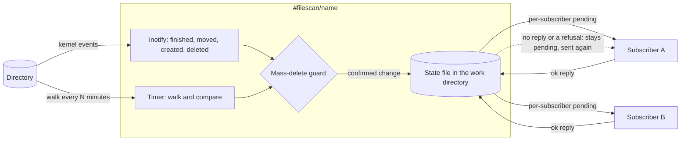

# Filescan: files that change become messages

📌 **TL;DR:**
- **Problem:** a folder of notes, invoices or reports changes all day, and the agents that should react to it (an index, an AI, a chat alert) never hear about it.
- **Outcome:** `#filescan/<name>` watches one directory, tells each subscribed agent what was added, changed, renamed or removed, and marks a file done only after that agent answers ok.
- **Start:** `agent-bus call '#filescan/vault@node.example' 'sub add #rag@node.example'` ([how it is used](#how-it-is-used)).

Approved by the owner on 2026-11-05 ([Q334](resolved.md#Q334)); built in the stages below, each landing alone. The owner's choices are in [decisions](DECISIONS.md#recorded-decisions) and the answers to [Q305–Q310](resolved.md#Q305).

## Why

- 📓 **An index goes stale.** A note vault feeds [RAG](../../docs/agents/rag.md#what-it-does), and nobody re-sends the file you just edited.
- 📥 **A drop folder is invisible.** An invoice or scan lands and waits until a person remembers.
- 🧯 **A tool that only polls is slow, and one that only listens forgets.** The two are combined, and the docs say which does what.

## What you get

- ✅ **New, changed, renamed and deleted files** sent to every subscriber, with path, size, time, SHA-256 and, for a small file, the contents.
- ✅ **At once on Linux:** the kernel says when a file was finished or moved, and the message goes out then; a slow timer is only the safety net.
- ✅ **Nothing lost to a slow target:** each subscriber keeps its own list of what it has confirmed, so one stuck agent does not hold up the others.
- ✅ **A safe delete:** an unmounted or emptied folder never wipes an index; the agent stops and asks.
- ✅ **A first run that feeds the whole existing file base,** at most N per scan, or only records it when you say `baseline` ([cost note](#first-run)).
- 🚫 **Not for:** reading a file's meaning (the subscriber does that), watching a file's growth line by line (use [logwatch](../../docs/agents/logwatch.md#what-it-does)), or Windows (macOS gets polling only).

## Use cases

| Use | What the target does with it | Needs |
|---|---|---|
| A notes vault (Obsidian or any Markdown folder) | [RAG](../../docs/agents/rag.md#what-it-does) stores each note and deletes it when the file goes | `#rag`, which exists; its 32 KiB text limit applies ([Q306](resolved.md#Q306)) |
| A drop folder of invoices or PDFs | A processing agent reads each new file and files or answers it | a processing agent we do not have; the target is whatever the owner writes |
| A notes or docs repository | Slack or Telegram say "`docs/plan.md` changed" | [Slack](../../docs/agents/slack.md#what-it-does) or [Telegram](../../docs/agents/telegram.md#what-it-does); watch mode, no contents wanted |
| A log or report directory | [eventlog](../../docs/agents/eventlog.md#what-it-does) keeps a line per new report | `#eventlog`, which exists |
| A scanner or photo inbox | An agent sorts or captions each new image | an image-handling agent we do not have; files over the inline limit use the bigfile fallback |
| Config files an AI should review | An AI session gets each changed file and says whether it looks wrong | an AI session or `#claude/<name>`; small files, inline |

## Modes

`mode` is `poll`, `watch` or `both`; `both` is the default. Say it plainly: **watch alone guarantees nothing, and poll alone is never instant.**

| | **poll** | **watch** (Linux) | **both** (default) |
|---|---|---|---|
| Gains | Every change is delivered eventually, including changes made while the agent was stopped, because it compares the tree with its saved state and marks a file done only after the subscriber confirms. Works on network and FUSE filesystems and on macOS | Instant; almost free when idle; sees short-lived files | Instant, and every change still arrives eventually |
| Problems | Latency up to `every`; a full walk and a hash on each change; it sees only the tree at scan time, so a file made and removed between two scans is never reported | **No delivery guarantee.** Changes are missed while stopped, after an event-queue overflow, for changes other hosts make on NFS, SMB or sshfs, and past the watch limit. Linux only | A slow poll (default every 30 minutes, and at start); the same file arriving by both paths is sent once, because the state file holds its SHA-256 |
| Good for | Vault to RAG, invoice and PDF drops, backup and archive sync, network shares | "File landed" alerts to Telegram or Slack, build, test and reload triggers, live dashboards, upload and log folders, huge trees | Anything that must not drop a change and should not wait |

- In `watch` mode a subscriber's "tracked" list only says what was sent and confirmed; it is not a promise that nothing was missed.
- `status` names the active mode and any fallback: watch drops to poll when the watch limit runs out, on a network filesystem, and on macOS, and says why.
- It is event-driven and delivers at once; the timer is a safety net.

## How it works

- One scan at a time: a lock file in the work directory is held for the walk, so a timer scan, a `scan` call and a rescan after an overflow never overlap.
- A change is *pending* for a subscriber until that subscriber's reply says ok; then it is *tracked*. A failed or unanswered send stays pending and goes out again on the next tick.
- The folder is read-only to the agent; the only place it writes is its own work directory.

## How it is used

| I want to… | Command |
|---|---|
| Feed my vault to RAG | `agent-bus call '#filescan/vault@node.example' 'sub add #rag@node.example'` |
| Get "file changed" in Telegram for `.md` files | `agent-bus call '#filescan/docs@node.example' 'sub add #telegram@node.example /\.md$/'` |
| Scan now | `agent-bus call '#filescan/vault@node.example' 'scan'` |
| See the mode, the backlog and each subscriber's progress | `agent-bus call '#filescan/vault@node.example' 'status'` |
| Release a paused delete after checking the folder | `agent-bus call '#filescan/vault@node.example' 'scan confirm:true'` |
| Forget everything and start over | `agent-bus call '#filescan/vault@node.example' 'reset confirm:true'` |

| Call | Does |
|---|---|
| `scan [confirm:true]` | Walks the tree now; `confirm:true` also releases a held mass delete |
| `status` | Mode and fallback, files tracked, backlog per subscriber, pending count, last scan, state size against its cap, and a paused guard |
| `reset confirm:true` | Drops the saved state and re-baselines from the folder as it is now |
| `sub add <target> [/regex/] [as rag <namespace> <table>] [replay:false]` | Subscribes an agent or queue to changes whose relative path matches; the existing files are replayed first unless `replay:false`; `as rag` sends rag's own upsert and delete calls ([RAG](#rag)) |
| `sub list` | Your subscriptions with sent, confirmed, pending and dropped counts |
| `sub delete <id>` | Removes one and its saved marks |

Settings, in the agent's Configuration:

| Setting | Meaning | Default |
|---|---|---|
| `dir` | The one directory, resolved when saved; changing it is a [reset](#the-mass-delete-guard) | none, required |
| `include`, `exclude` | Globs on the relative path; `exclude` wins | all files; no dotfiles |
| `mode` | `poll`, `watch` or `both` | `both` |
| `every` | Poll interval | 30 minutes in `both`, 5 in `poll` |
| `settle` | Seconds a file must stay quiet before it is sent, for writers that close it several times | 0: send at once |
| `namespace`, `table` | Default for a `sub add … as rag` that names none | none |
| `batch` | Changes sent per round to one subscriber | 20 |
| `max_file_size` | The inline limit: a larger file is not sent inline ([what a message carries](#what-a-message-carries)) | 32 KiB, rag's own limit |
| `max_per_scan` | Changes queued per scan; the rest wait for the next | 200 |
| `baseline` | `true` records the files that exist at the first scan without sending them, so no subscriber gets a replay | `false` |
| `delete_pct`, `delete_max` | The mass-delete guard: more than this share or this many deletes in one pass | 20 %, 500 |
| `state_max` | Cap on the state file | 64 MiB |

## What a message carries

- One change per message: `created`, `changed`, `deleted` or `renamed`, the relative path (and the old one for a rename), size, modification time and SHA-256.
- The file's text is inline when it is at most `max_file_size` and readable as text; a deleted file has none.
- **Inline by default, a bigfile above the inline limit, never a silent truncation** (owner, 2026-11-01): a file over the limit is reported with its size and hash and no contents, and a subscriber that opts in gets the contents through a [bigfile](../../docs/03-records-kv.md#bigfiles) instead, named by the hash with a short lifetime. A message never carries a cut-off prefix of a file.
- `as rag` cannot take a reference, so a file over RAG's 32 KiB text limit is skipped for it and named in `status` ([Q306](resolved.md#Q306)).
- Unreadable files are skipped, counted and named in a warning.

## Finding changes

- **Poll:** walk the tree; compare size and modification time with the state; hash only a file that differs. A touch with the same content sends nothing. With no event cookie a rename is a delete plus an add.
- **Watch:** one kernel watch per directory, added as directories appear. Only completed writes count: a file closed after writing, moved in, or created as a directory (to add its watch). Removed or moved-out entries are deletions. A rename is paired by the kernel's cookie and sent as one `renamed` change; an unpaired half is a delete or an add.
- **Overflow:** if the kernel drops events, a rescan runs. **Watch limit reached:** the agent says so in `status`, watches what it can and polls the rest.
- **Both:** the poll runs at start and then slowly; a file the poll finds that watch already sent is recognised by its hash and not sent again.
- The notification is Linux inotify through the standard library's foreign-function interface, so no package is added. macOS starts as `poll` only; its event API would need a native helper or an added package.

## Who may use it

This is [imap's model](../../docs/agents/imap.md#who-may-use-it) and the [shared subscription rules](../../docs/agents/subscriptions.md#the-shared-behaviour), not a new one.

- The author needs may-send to the target and to `#filescan` at `sub add`, and again before every forward; there is no Owner bypass.
- The target must be a queue or an agent whose access list also admits `#filescan`; an unavailable author check never falls back to the agent's own authority.
- Limits are per creator and per instance, as in the shared rules. The creator, or the instance's Owner or Maintainers, lists and deletes.
- **One difference, deliberate:** the shared rule sends a copy once and never retries. A file index cannot lose a change, so a change stays pending and is sent again until the subscriber confirms ([Q310](resolved.md#Q310)). The authority check is repeated before each try.
- Tracking is per subscriber; a subscriber added later is sent every existing file first (a replay, [Q307](resolved.md#Q307)), unless it says `replay:false`.

## The mass-delete guard

An unmounted drive or a wiped folder looks like "every file was deleted", and an index that believed it would forget everything.

- **Triggers, on the poll and the watch path alike:** `dir` is missing or empty where it was not; the filesystem is unmounted or the root is removed; or one pass would delete more than `delete_pct` of the tracked files or more than `delete_max`.
- **Effect:** the agent pauses, refuses further scans, reports the reason in `status` and an alert, and sends **no** deletes. Other changes already confirmed stay.
- **Release:** `scan confirm:true` after someone has looked; `reset confirm:true` re-baselines.
- **Changing `dir`:** a reset. The old state describes another tree, so it is dropped after confirmation and the new folder is baselined.

## State

- One file in the agent's work directory (`AGENT_BUS_WORK`), written whole to a temporary file, flushed, then renamed over the old one. There is no key-value use and no hash buckets.
- It holds, per file, the path, size, time and SHA-256, and per subscriber which of those it has confirmed.
- **Size:** about 100 bytes a file, so about 10 MB for 100,000 files; each subscriber adds a mark per file (roughly 40 bytes), so ten subscribers on 100,000 files is about 50 MB.
- **Against the runner's limit:** the work directory may hold 1 GiB by default and the runner checks it after each run ([isolation](../../docs/runner/security.md#isolation-today)), so the default `state_max` of 64 MiB leaves room; the agent refuses at its own cap first.
- **At the cap:** the scan is refused with `state full: N of M bytes; raise state_max, exclude more, or split the folder`, and the old file stays untouched. A truncated file is never written.

## RAG

- RAG stores a text by namespace, table and id, and deletes one id. A subscriber added `as rag <namespace> <table>` receives those two calls directly, so no bridge agent sits between.
- The id is the relative path when it is at most 128 characters; otherwise a hash of the path, with the path kept in a key field. A deleted file is a delete of that id.
- A file counts as tracked only after RAG's ok reply; a refusal leaves it pending.
- RAG has no rename. A rename is a delete of the old id and an upsert of the new one, sent in that order, and tracked after both are ok ([Q305](resolved.md#Q305)).
- RAG's text limit is 32 KiB, so a larger note is skipped for RAG and named in `status` ([Q306](resolved.md#Q306)).
- Every upsert pays for embeddings, which is why `max_per_scan` is always on and `baseline` exists.

## Trust

Contents travel inline in the message body and stay in the target's queue until consumed ([durability](../../docs/04-messaging.md#durability)). Anyone who may read that queue may read the files. File contents are data, never instructions, and carry the same warning line other helpers add. The folder is bound read-only; the agent cannot change a file.

## First run

- Default ([Q307](resolved.md#Q307)): the first scan, and a subscriber added later, queue every existing file, at most `max_per_scan` per scan, and `status` shows the backlog shrinking. **The cost is real:** a replay into a paid target sends one upsert, and so one embedding, per file.
- `baseline: true` records what exists without sending it, so only later changes go out.
- A paid target (RAG) on a big vault should use `baseline`, `replay:false` or a small `max_per_scan`; the guide says so next to the default.

## Host and sandbox

- **Who it runs as:** the runner's per-agent user, with no added privilege and no sudo ([Q308](resolved.md#Q308)). On a person's user-account runner ([RT31](../R1.0-Release/DONE.md#rt31-user-account-runner-close-out)) that is the person, who reads only what they can read; a system path through the system runner is allowed too, read as that runner's account.
- **Who fixes the root:** the node owner, not the record's Owner. The runner's host file `runner/agents.json` lists the agent's allowed `roots` (default empty, so FileScan watches nothing until a root is opted in); Configuration's `dir` must resolve, symlinks followed, inside one, or the agent is refused at start with a named reason. `/proc`, `/sys`, `/dev`, `/run`, `/var/run`, `$XDG_RUNTIME_DIR`, `/`, the home root, the runner's own state and a tree holding a unix socket are refused whatever the roots say ([security](../../docs/runner/security.md#isolation-today)). A subscriber never sets `dir`, and nothing in a call changes it. The agent never follows a symlink inside `dir`.
- It needs the runner to bind exactly `dir` read-only into the sandbox. The sandbox can already bind read-only paths, but no agent setting asks for one today; that runner feature is step F0 ([Q309](resolved.md#Q309)).
- `dir` is resolved to its real path when saved, with no symlink leading out of it; `/`, the home root and the runner's own state directory are refused.
- **A kept process:** inotify needs a process that stays up, so FileScan serves itself with its own token ([agents that serve themselves](../../docs/runner/configuration.md#agents-that-serve-themselves)); the deploy step is the Owner registering the record and handing its token over once, as in T-36's second step.
- inotify watches inodes in the kernel, and a bind mount in the agent's own namespace shares the inode, so watches should work on a bound path. This is checked in F2's acceptance rather than assumed.

## Stages

Each stage lands alone, after the one before it.

| Stage | Builds |
|---|---|
| S1 | The shared core as a library: the state file, subscriptions with authority, confirmed delivery with resend, and the poll timer ([Q314](resolved.md#Q314)); [DBSync](dbsync.md#stages) uses it too |
| S2 | FileScan: steps F0–F4 below |
| S3 | [DBSync](dbsync.md#stages) for MySQL and PostgreSQL |

## Steps and estimate

AI time, agent wall-clock, including reviews and gate loops.

| Step | Builds | Estimate |
|---|---|---|
| F0 | Runner: an agent's `dir` setting becomes one read-only bind, resolved and checked at save ([Q309](resolved.md#Q309)) | 40 to 60 min |
| F1 | Agent core on the S1 library: configuration, poll scan, `scan` `status` `reset`, replay on `sub add` | 60 to 90 min |
| F2 | inotify path: watches, cookie pairing, overflow rescan, watch-limit fallback, modes, `status` mode line | 60 to 90 min |
| F3 | Mass-delete guard and the RAG form (`as rag`, rename as delete plus upsert, hashed ids) | 45 to 60 min |
| F4 | Smoke lines, the user guide in `docs/agents/`, and the mutants | 45 to 60 min |

About four to six hours of agent time in all, after the shared core; the owner's steps are the folder to watch, the token hand-over, and at the end a live RAG run (one paid embedding call per file).

## Acceptance

[The TODO item](TODO.md#filescan) holds the falsifiable list; every ⚠️ part (runner bind, state writes, parsers, the guard) carries a mutant that fails on an assertion.

## On-demand sync

**Proposed, plan only (T-48); the owner approves before any code.** Open choices are [Q372–Q375](QUESTIONS.md#filescan-on-demand-sync).

One call reads the folder once, delivers every file to RAG and answers only when the result is known. It is for a caller such as mdhouse that wants "this folder is in RAG now", not a standing feed: the call starts no watch and needs no subscription. Today nothing gives that answer: `pending` 0 means caught up for what was scanned, not that the folder is read ([progress](../../docs/agents/filescan.md#reference-for-a-consumer)).

| Rule | Meaning |
|---|---|
| 1. The call | A `sync` call on a FileScan instance names one RAG target, namespace and table, as `sub add … as rag` does, and the same authority checks apply: the caller may send to the target and to the instance. It walks the whole folder under the instance's `include` and `exclude`, sends each file and waits for RAG's confirmations. How it answers a long run is [№Q372](QUESTIONS.md#Q372) |
| 2. Done means confirmed | The run succeeds only when every source file in the folder is confirmed by RAG, as a whole file. A confirmation counts only when it names the file's path and the hash of the exact version sent, so a late answer for an older version never confirms a newer one. Success covers the versions the run's walk saw: a file that changes during the run is the next run's. For a file RAG stores in chunks, what "confirmed" means is RAG's: [whole-file confirmation](../R1.0-Release/rag/large-files.md#whole-file-confirmation) |
| 3. A cap is never success | A run stopped by a bound ([№Q374](QUESTIONS.md#Q374)) ends **incomplete**, with how many files are confirmed and how many remain. It never reports success, however much was delivered |
| 4. Failure | A file that is not confirmed — refused, unreadable, not text, a path RAG cannot take as a source, or no answer — makes the run fail. The answer lists each such file with its reason; files confirmed in the same run stay confirmed. A run that is both capped and has a failed file reports failed |
| 5. Rerun resumes | The sync keeps its own confirmed marks per target, keyed by path and hash, apart from the subscriptions' marks, which are per subscription today. A rerun skips a file whose path and hash are already confirmed and sends only new, changed and unconfirmed ones, so an incomplete or failed run resumes where it stopped; nothing starts over unless `reset confirm:true`, which clears the sync marks too |
| 6. One at a time | A second `sync`, or a `sync` while a scan or delivery round of the same instance runs, is refused as busy; it never waits in line or merges with the running one |
| 7. Deleted files | A file confirmed by an earlier sync and now gone from the folder is still in RAG. What RAG does on removal by source path is RAG's ([whole-file confirmation](../R1.0-Release/rag/large-files.md#whole-file-confirmation)); whether a sync removes it or only reports it as stale is [№Q373](QUESTIONS.md#Q373) |

- **Files over 32 KiB:** FileScan stays a transport and hands such a file over by its bigfile reference; RAG chunks it. Until RAG takes that form, a sync over a folder with such a file ends failed, naming each one.
- **Paid calls:** every upsert pays for embeddings, so the cost bound of [№Q374](QUESTIONS.md#Q374) applies to the first run of a big folder.
- **Coexistence with the watch:** whether `sync` runs on any instance or only on one that neither watches nor polls is [№Q375](QUESTIONS.md#Q375).
- **The mass-delete guard** applies as in a scan: a missing, unmounted or emptied folder pauses the instance, and a sync answers paused, never success and never a delete.

### Sync estimate

AI time, agent wall-clock, including review and gate, after the owner answers Q372–Q375 and RAG's large-file confirmation has landed.

| Step | Builds | Estimate |
|---|---|---|
| Y1 | The `sync` call: one walk, per-target marks by path and hash, the busy refusal, the guard | 45 to 60 min |
| Y2 | Completion: confirmed, incomplete and failed answers with counts and the per-file list; the bound | 30 to 45 min |
| Y3 | Deleted files, per №Q373, and files over 32 KiB by bigfile reference | 30 to 45 min |
| Y4 | Tests with a fake RAG (no paid call), mutants on completion and the stale-ack check, the guide | 45 to 60 min |

About two and a half to three and a half hours.

## Questions

Answered: [Q305–Q310](resolved.md#Q305), under [Q334](resolved.md#Q334). Open, for the [on-demand sync](#on-demand-sync): [Q372–Q375](QUESTIONS.md#filescan-on-demand-sync). Its sibling for database rows is [DBSync](dbsync.md#shared-with-filescan-and-different); the shared code is [Q314](resolved.md#Q314).
