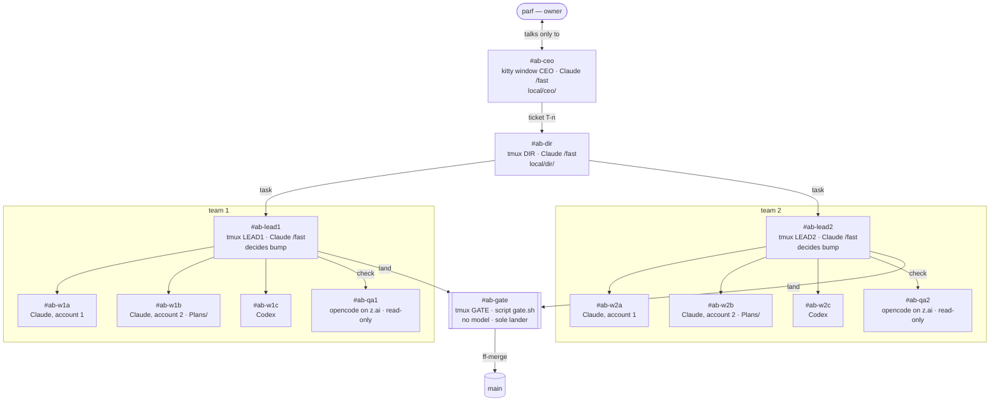
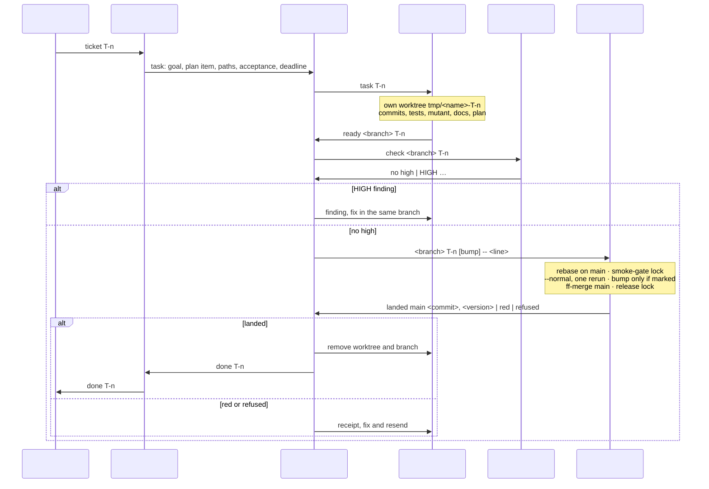

# Team v2

📌 **TL;DR:** An idea, not decided: a layered AI team for this repository. The
owner talks only to `#ceo`. `#dir` splits tickets, two leads route work to
workers, QA checks every diff, and a script agent `#gate` alone lands on
main. The coordinating layer runs on `/fast` and reads only short receipts. The
heavy work runs below it on ordinary models.

## Status

Idea from the owner, 2026-10-29; partly running from 2026-10-30 with two teams
([decision](DECISIONS.md#recorded-decisions)). Node-local, not in Git, under
`local/`: the role prompts, `start-ceo.sh` for the `#ceo` kitty window,
`gate.sh` behind `#gate`, and the `#tmux-sessions/ab-dvp@parf.us`
Configuration that starts `DIR`, `LEAD1..2`, `W1A..C`, `W2A..C`, `QA1..2` and `GATE`. The
team before it is in [today's team](#today). Open choices are in
[questions](QUESTIONS.md#open-questions).

## Shape

Two teams run ([TD3](DECISIONS.md#recorded-decisions)): `#ab-lead1` leads team 1 and
`#ab-lead2` team 2, each with three workers and a QA. Names carry the project
prefix `ab-` ([TD2](DECISIONS.md#recorded-decisions)). Account 1 workers, leads and QA run in the repository root and account 2
workers in `Plans/`; `#ab-ceo` and `#ab-dir` have their own directories under
`local/`. Each name resumes its own conversation.

A task's path, each arrow one bus message:

## Roles

| Role | Runs as | Does | Never |
|---|---|---|---|
| `#ceo` | `/fast`, a kitty window rather than tmux | is the owner's single contact; answers at once from its board and status events; writes the ticket, queues it, acknowledges it with its ID; reports results; keeps the list of what waits on the owner | calls down, waits, executes |
| `#dir` | `/fast`, tmux | takes tickets; splits large ones into tasks on disjoint paths; sets deadlines; balances leads; requeues timeouts; settles cross-team conflicts over shared files and order | code |
| `#lead1`, `#lead2` | `/fast`, tmux | assigns a task to a worker by fit; sends the finished branch to QA and to `#gate` together; reads receipts; marks done or failed; returns a red result to the same worker | gates, merges, code fixes, docs, reading logs or diffs |
| `#w<team>a..c` | three per team: Claude on account 1, Claude on account 2 and Codex; the lead gives architecture and refactors to Claude, scoped fixes and tests to Codex; tmux | one task at a time in its own worktree; done means commits, tests, a mutant where [verification](../../CLAUDE.md#mutation-first-then-belief) asks for one, docs, and the plan's TODO and DONE in the same change; runs fast checks only; sends a receipt on done or blocked | the version file, the changelog, merging to main |
| `#qa1`, `#qa2` | z.ai through opencode, a vendor other than every worker's | checks every diff of its team; findings carry file:line and a fix, reproduced first; doc drift is a standard finding; advisory, blocks a merge only at high severity | code |
| `#gate` | a script agent, no model | sole reader of the gate queue; rebases on main, runs the normal gate, bumps the version and adds the changelog line only when the lead marks the landing `bump`, fast-forwards main; the lead sends a branch only after QA reports no high finding; reruns once on a flake; sends a receipt | — |

## Principles

| Principle | Why |
|---|---|
| The `/fast` layer reads receipts only | `/fast` costs more per token; logs, diffs and long reports belong below it |
| Only `#gate` lands on main | removes landing before QA, version slot races and gate lock contention in one place |
| Teams own subsystems | team paths follow the letters in [the subsystem map](../subsystems.md), so tasks rarely collide; for example core, daemon, runner and install in one team, faces, web and agents in the other |
| State lives on the bus | the tasks queue and the board hold it, not a model's context, so closing the `#ceo` window loses nothing |
| Owner-only actions stay the owner's | push, live sends, a daemon restart and widening scope; `#ceo` shows them as a list instead of blocking silently |
| Plans stay canonical | workers update the owning `Plans/<release>/TODO.md` and `DONE.md`; there is no separate team plan file |

## Today

The team as it runs on 2026-10-29, as reported by `#claude/ab2`.

Sessions, flow and pain points

| Session | Role in practice |
|---|---|
| `#claude/ab-dvp-b` | manager: turns owner decisions into tasks, assigns, relays owner approvals, deploys some agents, pushes |
| `#claude/ab`, `#claude/ab2`, `#codex/xab`, `#codex/xab2` | implementers; each gates and fast-forwards its own work |
| `#claude/ab2-review` | main reviewer, usually after landing |
| `#opencode/oab` | occasional reviewer |

Tmux session `AB-DVP` holds the windows, kept by `#tmux-sessions/ab-dvp@parf.us`.
There is no task queue: an assignment is a bus message plus the TODO line.

| Pain point | Answer in this design |
|---|---|
| one gate lock, waits of minutes, port collisions | `#gate` is the only gate runner |
| flaky gate, manual reruns | one automatic rerun, reported in the receipt |
| review after merge, one step costing several versions | a high finding blocks the merge |
| version slot races | only `#gate` bumps |
| long free-text reports | fixed receipts upward |
| owner-only actions block without a visible queue | the `#ceo` list |
| session identity leaking into tests | fixed names, unchanged |

