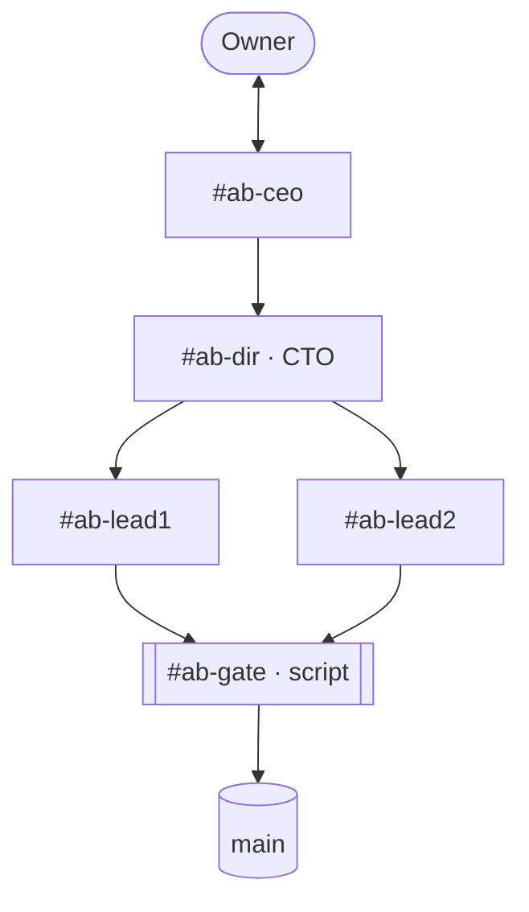
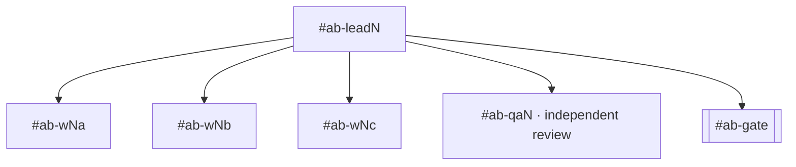
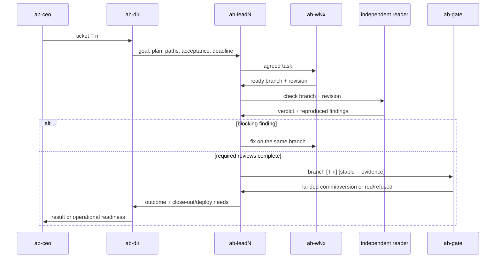

# Team v2

📌 **TL;DR:** The adopted AI development team for this repository: the owner works through a CEO, a director/CTO coordinates two technical leads, workers implement, independent readers review, and a script gate lands the work.

## Status

Team v2 began operating with two teams on 2026-10-30. The owner confirmed on 2026-11-03 that it is decided and was used for most of the 0.9 development ([decision](DECISIONS.md#recorded-decisions)). Specific open operational questions remain in [questions](QUESTIONS.md#open-questions); they do not make the team structure a proposal.

The role prompts live in [roles/](roles/common.md#team-v2--shared-rules): one file per role, plus [shared rules](roles/common.md#team-v2--shared-rules) every role follows: the task lifecycle, a review bound to one commit, the hand-off checklist, usage and workload control, simple tasks done directly, area affinity and change-type review triggers (adopted from the mdhouse team, owner, 2026-11-05).

`start-ceo.sh`, `start-team`, `gate.sh`, the launcher configuration and per-window notes stay node-local under `local/`, outside Git. The managed tmux session is `AB-DVP`, reached through `#tmux-sessions/ab-dvp@parf.us`; `local/start-team --run` starts missing windows through it and opens two Kitty tabs, CEO (no tmux) and the team (its tmux session), and `--roles` tells every live window to re-read its role.

## Shape

Two teams use the project prefix `ab-` ([TD2/TD3](DECISIONS.md#recorded-decisions)). Each has a lead developer, three workers and a QA; implementation and review are separate assignments.

Inside team N, the established worker mix is Claude on two accounts and Codex; QA uses z.ai through opencode. Model/account assignments do not change the role boundaries.

## Roles

| Role | Responsibility | Boundary |
|---|---|---|
| `#ab-ceo` | The owner's contact: turns requests into tickets, sends them to DIR, tracks owner decisions and reports outcomes. Executes authorized operational work itself: coordinated deploys, raising PATCH once per deploy with node-local `local/deploy-bump.sh --summary='<one or two lines>' [--agents-summary='<one or two lines>']` in the main checkout, which commits VERSION and one changelog entry for every commit since the last version, plus the agent pack's VERSION and changelog entry when the window changed `src/agents/` ([CLAUDE.md § versioning](../../CLAUDE.md#versioning)); each summary is required when its version moves, and a missing one refuses and prints the commits to write it from ([TD6](DECISIONS.md#TD6)), runner reloads/restarts, web/window restarts and fast-forward pushes on DIR's readiness. Checks facts before asking the owner for a missing decision, password, account access, money or GUI action. | Does not self-authorize wider scope, provider sends, new credentials or host changes. No feature implementation or gate runs; delegates technical investigation. |
| `#ab-dir` | Acts as CTO: owns technical direction, work split and quality bar. Agrees non-trivial approaches with the lead before implementation, assigns disjoint paths, sets acceptance/deadlines and resolves cross-team conflicts. Settles in-plan questions, coordinates review and deploy readiness, and checks the push range before sending push-ready. | No implementation, gate runs, main merges or operational restarts. Routes owner-only decisions and execution to CEO with options and a recommendation. |
| `#ab-lead1`, `#ab-lead2` | Lead developers, not message routers: judge design, challenge stale/unclear tasks, propose the split and acceptance, then assign a suitable worker. Arrange non-author review, group small and medium tasks into one branch and one gate run, submit reviewed work to the gate, return findings/red results to the author and coordinate close-out. Check a reader is available before assigning it. | Workers write the implementation. Leads do not run gates, merge main, push, execute deployments or restart windows. |
| `#ab-w<team>a..c` | Implements one assigned task in its own worktree; supplies code, appropriate checks/mutation proof and current user docs. Reports the exact branch/revision, findings and deploy needs; checkpoints between tasks and removes the worktree/branch after landing. | No unassigned scope, normal landing gate, independent main merge/push or version bump. Host/credential/provider actions require the standing authorization or an explicit owner decision. |
| `#ab-qa1`, `#ab-qa2` and assigned independent readers | Read-only review of the specified revision against behavior, acceptance, docs and verification requirements. Reproduce findings, give severity/file:line/concrete failure/fix, and return a clear verdict. | Never edit the reviewed branch, approve their own implementation, deploy or push. A HIGH finding blocks the ordinary landing path. |
| `#ab-gate` | Script-only landing service: validates the request, rebases, takes the gate lock, runs normal, applies only a requested stable operation and refuses `bump` by name, fast-forwards main, records range/logs and returns a machine-readable receipt. | Receives a branch only after the required independent reviews. It cannot answer planning questions or supply a model's review. |

## Work, review and landing

- Non-trivial work starts after DIR and the lead agree the approach, risks, split, acceptance and an ETA based on observed agent pace. Simple known fixes and routing changes can start directly.
- The [sensitive subsystems](../subsystems.md) require two independent readers and the required mutant proof; other changes use one reader. Test-only work in a sensitive area uses the documented one-reader rule. An author never counts as a reader.
- `#ab-gate` is a script: send `<branch> [T-n] [stable -- <reviewed tree and evidence>]`, not a prose request. `bump` is refused (`bump is retired: #ab-ceo bumps at deploy`), and so is `-- line` without `stable`; a landed receipt says `no bump`. A red/refused receipt returns to the author; a retry is not a substitute for identifying and fixing a recurring failure. Gate behavior is implemented in node-local `local/gate.sh`.
- Code branches do not perform issue/DONE close-out. After landing, a small docs close-out reconciles the owning TODO, DONE/done evidence, issue disposition and resolved questions/decisions. It names the landed revision and readers; fixed issues are marked and archived without losing evidence.
- State and readiness travel on the bus; repository plans hold the task's knowledge and acceptance. A context window or private transcript is not the only record of unfinished work.

## Operations and authority

| Operation | Permanent routing and checks |
|---|---|
| Deploy | DIR coordinates a gate-idle window and holds both leads, then sends CEO `deploy-ready <sha>` with the affected programs and steps. Go changes need a stamped rebuild before they are live. CEO performs the authorized minimal deployment, runs check-deploy, checks reconnection/readers and reports done before DIR releases the leads. |
| Agent package refresh | Replace the package tree rather than overlay stale modules. Verify every affected instance; use runner reload for configuration/package changes instead of a service restart unless one is required and authorized. |
| Push | DIR verifies VERSION, folded changelog, conflict-marker absence and the reviewed commit range, then sends CEO `push-ready <sha>`. CEO performs a fast-forward push under the standing row in node-local `CLAUDE.local.md`; owner holds and extra restrictions still apply. Other roles use local refs. |
| Worker/window recovery | Worker writes a checkpoint at a clean boundary. Lead sends DIR `compact <WIN>` or `restart <WIN>` with its path; DIR forwards to CEO, which executes the authorized action and restores the window's identity/role/checkpoint. Leads and DIR never restart another session themselves. |
| Owner questions | Worker/reader → lead → DIR → CEO. DIR resolves questions already inside the approved plan; the owner decides new scope or missing authority. Present owner choices in [item form](../MARKUP.md#options-and-threads), with a recommendation. Nobody waits on an approval prompt in their own window. |
| No response | Check the actual status/work, resend once after ten minutes, then record a still-unresolved blocker and continue independent work. Do not flood an unavailable session with repeated requests. |
| Shared gate resource | Follow [the lock rule](../../CLAUDE.md#verification), acquire in a separate call and read the grant before starting work, extend a hold you actually own before expiry and release at the batch boundary. A hold you did not just take is not yours: wait. |
| Focused Mac acceptance | Use the approved Mac run instructions through ssh mac, one checkout/workspace and cleanup after the run. Privileged actions and heavy work need their specific authorization; temporary access/deploy state does not widen it. |

## Window directories

Each worker, lead and QA window runs in its own directory, `local/<bus name without '#'>/` (for example `local/ab-w1a/`), so its
Claude memory is its own and not shared with every other window started from the same directory. `DIR` and the CEO already
have theirs and keep them. The CEO applies the node-local mechanism between tasks. Run the commands below from the repository root.

| Step | What it does |
|---|---|
| `python3 local/windows/windows.py` (the dry run) | lists, per window, the new directory, where its notes come from, where they go, and which would be copied, already there, or kept because the target holds a different file; writes nothing |
| `python3 local/windows/windows.py apply --window ab-w1a` | for the named windows only: backs up the launcher config to `local/t13-backup/`, makes the directory, copies the window's notes into its new memory, and points that window's `cwd` at the directory; `--all` names every window |

- **Copy, never move:** the originals stay where they are; a note already in the target is kept, never overwritten; DIR's memory is not touched.
- **One window's own memory:** `apply` writes only under the chosen window's new directory and its memory, and the chosen windows' entries in the config. Which account a window uses decides the memory it copies from: `ab-claude -2` is `~/.claude2`, `ab-claude` is `~/.claude`; the Codex and opencode windows get a directory and no notes.
- **Role files:** a window starts in `local/<name>/`, so the worker, lead and QA role files say so and give their worktree, link and removal commands as absolute `/usr/local/src/ai-agent-bus/` paths; run from `local/<name>/`, `git -C /usr/local/src/ai-agent-bus worktree add /usr/local/src/ai-agent-bus/tmp/<you>-T-n ...` makes the worktree at the repository root and its `node_modules` links resolve.
- **Restart cost:** a window resumes its saved session by its directory, so one moved to a new directory starts without its old transcript; apply it between tasks.
- **Checks:** `python3 -m unittest local/windows/test_windows.py` covers the dry run writing nothing, one window's apply touching no other, the originals staying, the no-overwrite rule and DIR's exemption; each of those has a mutant that fails it.

## Before Team v2

Historical predecessor, reported by `#claude/ab2` on 2026-10-29, before Team v2 was adopted. These are not the Team v2 assignments.

Sessions, flow and pain points

| Session | Role in practice |
|---|---|
| `#claude/ab-dvp-b` | manager: turns owner decisions into tasks, assigns, relays owner approvals, deploys some agents, pushes |
| `#claude/ab`, `#claude/ab2`, `#codex/xab`, `#codex/xab2` | implementers; each gates and fast-forwards its own work |
| `#claude/ab2-review` | main reviewer, usually after landing |
| `#opencode/oab` | occasional reviewer |

Tmux session `AB-DVP` held the windows, kept by `#tmux-sessions/ab-dvp@parf.us`.
There was no task queue: an assignment was a bus message plus the TODO line.

| Pain point | Answer in this design |
|---|---|
| one gate lock, waits of minutes, port collisions | `#ab-gate` is the only gate runner |
| flaky gate, manual reruns | one automatic rerun, reported in the receipt |
| review after merge, one step costing several versions | a high finding blocks the merge |
| version slot races, a version per small step | one PATCH per deploy, raised by `#ab-ceo` ([TD6](DECISIONS.md#TD6)) |
| long free-text reports | fixed receipts upward |
| owner-only actions block without a visible queue | the `#ab-ceo` list |
| session identity leaking into tests | fixed names, unchanged |

