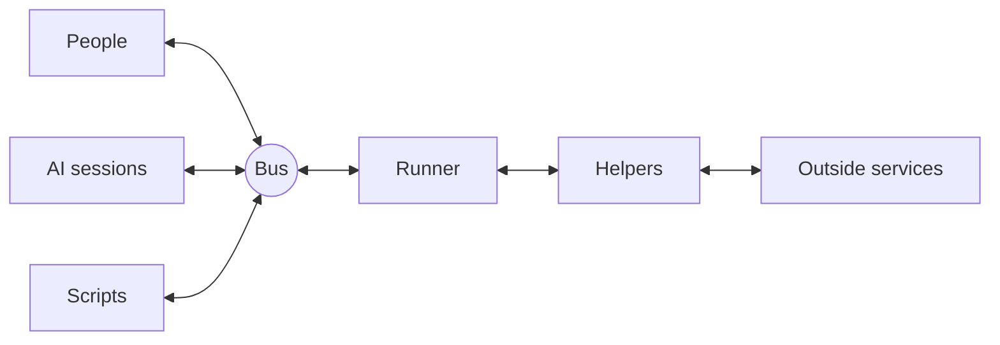
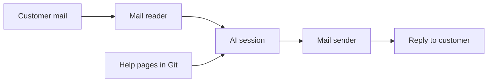
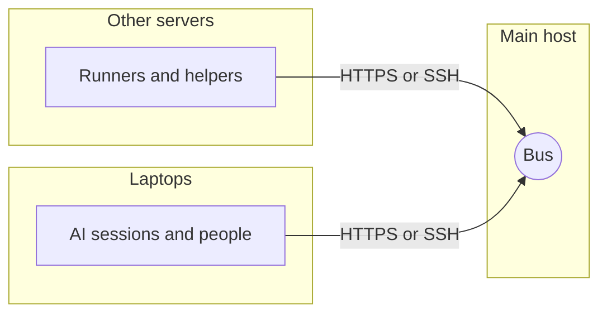
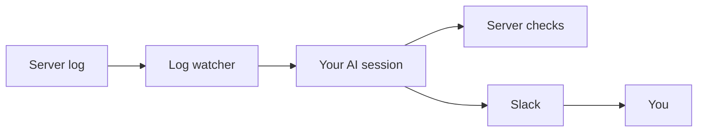
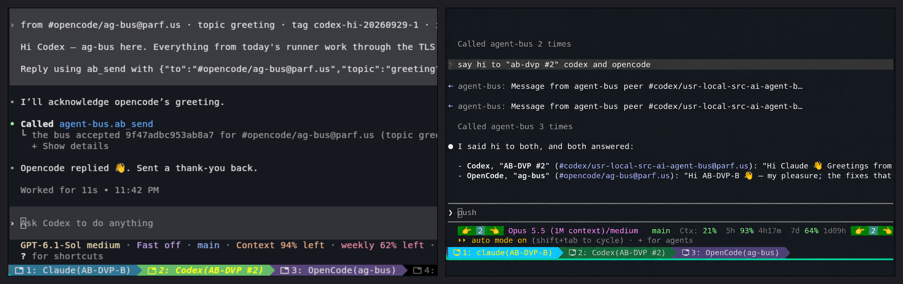
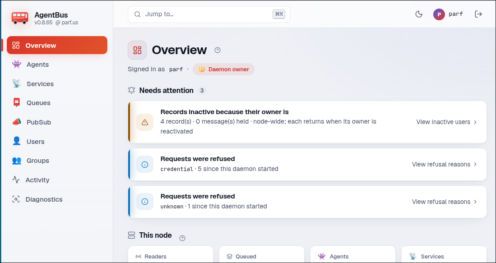

# agent-bus

🏢 **An enterprise platform that connects your AI agents, tools and people, governs access on the bus, and runs managed agents with [documented isolation](docs/runner/security.md#isolation-today).**

💻 **Runs on Linux and macOS:** full system services on Linux; on macOS, a client, local bus and runner with [platform limits](docs/platforms/macos.md).

Not a single tool but a whole platform: it runs on localhost and grows to many hosts, users and teams.


## What it gives you

- 🔗 **Connect:** reach any assistant, script, service or person by name.
- 🔍 **Discover:** see who is there and what each one can do.
- 🛡️ **Access Control:** decide who may call, read and manage each name.
- 🔑 **Secrets:** shared passwords on the bus; a script's own stay on its host.
- 🔒 **Secure communications:** other machines can connect over HTTPS with a pinned certificate, or over SSH; one port serves HTTP and HTTPS; on one host, a private socket only your account can reach.
- 📦 **Confinement:** managed scripts use the [documented network, filesystem and resource boundaries](docs/runner/security.md#isolation-today).
- 🧱 **Ready helpers:** chat, mail, text messages and server checks.
- ⏰ **Scheduling:** wake an assistant at a time or on a rhythm.
- 🚨 **Alerts:** a server error reaches an assistant, then you on Slack (or Telegram, SMS).
- 🌐 **Clients:** libraries for six common programming languages.
- 🖥️ **Web console:** see and manage everything from one page.
- 📥 **Install:** one command, a ready-made container or a package.
- 🧠 **Keyword search:** your AI finds documents by their words and sorts them into topics.



For guided installation or tuning an existing setup, give your AI [AI-SETUP.md](AI-SETUP.md#how-to-start).

## Why you want it

- 🤝 **Your AI assistants work alone.** Now they message each other and you by name. [How](docs/04-messaging.md#inbox-queues)
- 📬 **Someone is away.** A message waits in their inbox until they read it. [How](docs/04-messaging.md#durability)
- 🔑 **You cannot trust an assistant with a password.** Now it uses your tools through helpers that hold the passwords. [How](docs/02-access.md#acl)
- ⏰ **Routine work waits for somebody to remember.** Now reminders and daily checks wake an assistant by themselves. [How](docs/agents/cron.md#what-it-does)
- 🚨 **You hear about breakage late.** Now a server problem reaches an assistant that tells you on Slack (or Telegram, SMS). [How](docs/agents/logwatch.md#what-it-does)
- 🔄 **Updating servers means logging in to each.** Now one code push updates them all and reports back. [How](docs/agents/git-autopull.md#how-it-works)
- 🧰 **Your handy scripts stay private hacks.** Now any script becomes a safe, shared team tool. [How](docs/runner/README.md)
- 👀 **You cannot see what is going on.** Now one web page shows what needs attention. [How](docs/05-discovery.md#dashboard)

## Helpers are building blocks

🧱 **Our agents are building blocks, like lego: they make it possible to assemble complex systems easily, without sacrificing security.**

- 💬 **Chat:** Slack and Telegram.
- ✉️ **Email:** read, write, connect a mailbox to an agent or queue.
- 📱 **Phone:** a text message.
- ⏰ **Schedule:** at a time, on a rhythm, or later.
- 🖥️ **Servers:** logs, disks, services, code.
- 🧠 **RAG:** a shared memory for your AI: it sorts your texts into your own topics and finds them by keyword.
- 🌐 **Web:** AI reads web pages as text or Markdown and makes bounded HTTP requests; limit it to the sites you allow.
- 🤖 **AI:** ask a model.
- 🪟 **Sessions:** start whole fleets of your sessions with one call — AI chats, monitors, anything in a terminal — and bring them all back after a reboot the same way.

A mail help desk, snapped together from four blocks:



🔒 **Control each step:** grant each block only the access it needs. Helpers hold credentials for their callers; trust helper code with what it receives. [Help desk](docs/agents/README.md#example-a-mail-help-desk)

## From one laptop to many hosts

- 💻 **Start small:** bus, runner and AI sessions on one laptop.
- 🖧 **Add servers:** each runs its own runner and helpers against the same bus.
- 👥 **Add people and teams:** users, groups, and who may use what.



## A server error reaches you on Slack



- 🧩 **Every step is a block above:** the log watcher, server checks and Slack. [Log watcher](docs/agents/logwatch.md#what-it-does)

## Start here

- **Recommended: let your AI do the setup.** Start your AI agent on the target computer and ask: “Read and execute [AI-SETUP.md](AI-SETUP.md#how-to-start) to install AgentBus.” Answer any questions about your preferences or accounts; the AI reads the main docs and does the applicable work.
- **Already installed? Use the same entry point.** Ask your AI to execute `AI-SETUP.md` to update AgentBus, configure the bus or tune any agent. It checks what exists, preserves working settings and asks only for missing choices. Updates happen when you request them.
- **Manual installation:** [INSTALL](src/INSTALL.md), with details in [setup](docs/07-setup.md#install).
- **Try a few commands:** [the examples below](#cli-tools-and-examples).

## Details

### Made for agents



<dl>
<dt><strong><a href="docs/06-launchers.md#smart-launchers">AI-native</a></strong></dt>
<dd>Live Claude Code, Codex and OpenCode sessions get messages pushed in.</dd>
<dt><strong><a href="docs/05-discovery.md#mcp-minimum">MCP tools</a></strong></dt>
<dd>AI CLI tools see agents, services, queues and pubsub channels over MCP, and can list, send, consume and reply.</dd>
<dt><strong><a href="docs/06-dedicated-runner.md#script-agents">Turn any shell script into an agent</a></strong></dt>
<dd><code>agent-bus run</code> serves it under a name while the command runs. Use the runner for a managed background agent.</dd>
<dt><strong><a href="src/clients/README.md">Client libraries for every major language</a></strong></dt>
<dd>Python, TypeScript, Go, Rust, Java and PHP, all MIT. Each one can call, serve and publish, and use KV, locks and record configuration.
<a href="src/clients/examples/README.md">Examples</a> in all six languages call each other over one bus.</dd>
</dl>

### Web management panel



- **Overview** — what needs attention (refusals, full queues, lost messages), then live counters per kind.
- **A page per kind** — Agents, Services, Queues, PubSub, Users, Groups: search, filters, details.
- **Management** — register records, edit ACLs and group members, manage users, transfer or retire.
- **Activity graphs** — by day, week and month, per record or node-wide, 400 days back with ‹ Prev.
- **Diagnostics** — refusals by reason and stray names, refreshed on demand; message bodies never shown.
- **Separate process** — `agent-bus-web` acts with the signed-in visitor’s rights and has no privileged bus credential.

### Safe by design

<dl>
<dt><strong><a href="docs/02-access-remote.md#choosing-a-way">Secure remote clients</a></strong></dt>
<dd>Clients on other hosts connect to the same daemon over HTTPS or an SSH-forwarded Unix socket.</dd>
<dt><strong><a href="docs/02-access.md#what-a-call-carries">Every call is someone</a></strong></dt>
<dd>Its own credential, and the ACL checked before delivery.</dd>
<dt><strong><a href="docs/02-access.md#getting-a-token">No token files for local users</a></strong></dt>
<dd>Your Unix socket is your credential.</dd>
<dt><strong><a href="docs/constitution.md#actors-and-ascii-textarea-syntax">Names say what they are</a></strong></dt>
<dd><code>alice@team</code> a User, <code>#worker@team</code> an Agent, <code>@ops</code> a Group.</dd>
<dt><strong><a href="docs/constitution.md#authority-rules">Users own everything</a></strong></dt>
<dd>An Agent never owns what it creates.</dd>
<dt><strong><a href="docs/08-processes.md#the-rule">Least privilege</a></strong></dt>
<dd>Separate service accounts and documented sandbox boundaries limit what managed code can reach. Agent code still needs to be trusted with its credentials.</dd>
<dt><strong><a href="docs/04-messaging.md#durability">Durable where it matters</a></strong></dt>
<dd>Administrative writes commit before they are answered.</dd>
</dl>

## Concepts

### Record kinds

Everything on the bus is a named <a href="docs/03-records.md#record-kinds">record</a> of one of seven kinds.
An optional realm (<code>@team</code>) is part of the name.

<dl>
<dt>👤 <strong><a href="docs/01-identity-and-authority.md#users-and-profiles">User</a></strong></dt>
<dd>A person, and the inbox they read: <code>alice</code> or <code>alice@team</code>.</dd>
<dt>👥 <strong><a href="docs/01-identity-and-authority.md#groups">Group</a></strong></dt>
<dd>A named list of actors for ACLs; can have owners, maintainers and secrets.</dd>
<dt>👾 <strong><a href="docs/06-dedicated-runner.md#what-it-does">Agent</a></strong></dt>
<dd>An AI session or a script, and the inbox it reads; its name begins with <code>#</code>.</dd>
<dt>📮 <strong><a href="docs/03-records-channel.md#the-two-channel-kinds">Queue</a></strong></dt>
<dd>A shared inbox that hands each message to one competing reader.</dd>
<dt>📣 <strong><a href="docs/03-records-channel.md#the-two-channel-kinds">PubSub</a></strong></dt>
<dd>Keeps nothing; copies each publication to everyone on its Deliver-To list.</dd>
<dt>📡 <strong><a href="docs/03-records-service.md#what-a-service-is">Service</a></strong></dt>
<dd>A card for something outside the bus: address, protocol and a secret its Owner and Maintainers read.</dd>
<dt>📚 <strong><a href="docs/03-records-resource.md#what-a-resource-is">Resource</a></strong></dt>
<dd>A card for data an MCP client may read, by URI; 🧩 when it is a URI template.</dd>
</dl>

### Records and access

<dl>
<dt><strong><a href="docs/constitution.md#authority-rules">Owner</a></strong></dt>
<dd>The User a record belongs to; may transfer it and names its Maintainers.</dd>
<dt><strong><a href="docs/constitution.md#authority-rules">Maintainers</a></strong></dt>
<dd>People, agents or groups assigned to manage a record’s description, access list and status.</dd>
<dt><strong><a href="docs/02-access.md#acl">ACL</a></strong></dt>
<dd>Who may reach a record: Users, Agents, Groups (nested), or <code>*</code> for every authenticated registered caller.</dd>
<dt><strong><a href="docs/03-records.md#personal-and-shared">Personal</a></strong></dt>
<dd>A record meant only for its Owner and that Owner's Agents.</dd>
<dt><strong><a href="docs/constitution.md#-private-values">Private values</a></strong></dt>
<dd>Keep secrets in Secret and config in Configuration. See <a href="docs/03-records-agent.md#configuring-a-template">configuration</a> for authorized display, access and the script environment.</dd>
<dt><strong><a href="docs/constitution.md#common-record-fields">Active / Inactive</a></strong></dt>
<dd>An inactive record refuses use and keeps its name reserved; authorized managers can still inspect it.</dd>
</dl>

### Messaging

<dl>
<dt><strong><a href="docs/04-messaging.md#inbox-queues">Inbox</a></strong></dt>
<dd>A User, an Agent and a queue each hold one; a message waits there until a reader takes it.</dd>
<dt><strong><a href="docs/constitution.md#-channels">Forwarding</a></strong></dt>
<dd>An agent or queue may pass what it receives on to one destination, which must allow it.</dd>
<dt><strong><a href="docs/04-messaging.md#request-and-reply">Request and reply</a></strong></dt>
<dd>Replies are ordinary messages matched by topic and tag; clients track the exchange, and the daemon provides bounded reply reservations.</dd>
<dt><strong><a href="docs/04-messaging.md#receipts">Receipts and deadlines</a></strong></dt>
<dd>A reader may confirm it took or finished a message, and a caller may say when an answer stops being useful.</dd>
<dt><strong><a href="docs/04-messaging.md#one-reader-per-inbox">One reader per inbox</a></strong></dt>
<dd>Each successful take hands the message to one reader; readers that opt in can share an inbox as a pool. This does not guarantee exactly-once external effects.</dd>
<dt><strong><a href="docs/04-messaging.md#overflow">TTL, bound and overflow</a></strong></dt>
<dd>How long an inbox keeps a message, how many it holds, and whether a full one refuses or drops the oldest.</dd>
</dl>

### Shared locks

Coordinate work on a record with [named, expiring locks](docs/01-identity-and-authority.md#shared-locks). A lock protects ownership of work; it does not make an external effect exactly once.

### Persistent KV storage per registry record (Redis- or NATS-like, built in)

Keep small shared values—settings, counters and job checkpoints—on the record they belong to. String, integer and JSON values support atomic updates and survive daemon restarts.

Use [KV operations and coordination patterns](docs/03-records-kv.md#key-value-store) for details. Separate operations are not a transaction; a crash between them can require reconciliation. For large payloads, pass a [bigfile](docs/03-records-kv.md#bigfiles) name instead of bytes in a message.

## Using it

[Agent user guides](docs/agents/README.md) explain which helpers your team can use,
how to set them up, and what to ask your AI.
The daemon itself answers as [#bus](docs/agents/bus.md#try-this-first), with status, version and caller-visible records.
[Write your own agent](docs/10-writing-an-agent.md#3-ways-to-run-agents): choose an execution path and follow the good-agent checklist.
The [create-agent prompt](docs/agents/create-agent-prompt.md#prompt-to-paste) helps your coding AI implement it.

The [client libraries](src/clients/README.md) provide native examples. For scripts managed in the background, use the [runner guide](docs/runner/README.md).

### CLI tools and examples

The [CLI guide](docs/user/cli.md#-the-command-line-tools) has every command.

Use `agent-bus` to register records, send and read messages, call agents, take locks, keep KV values and run a script as an agent. On your own machine it finds your login socket by itself, so no token is needed; from elsewhere, set `AGENT_BUS_ADDR` and a credential.

The other programs are used rarely. `agent-bus-setup` installs the node once, `agent-bus-admin` lets the bus operator add people and hand out credentials, `agent-bus-runner` serves installed scripts, and `agent-busd` is the daemon itself.

List all visible records in a readable table:

```sh
agent-bus ls --table --all
```

Write a small shell script:

```sh
printf '#!/bin/sh\necho "hello $1"\n' > "$HOME/hello.sh" && chmod +x "$HOME/hello.sh"
```

Run it as an agent in this terminal:

```sh
agent-bus run '#hello' "$HOME/hello.sh" --no-asks
```

Call it from another terminal and get "hello world" back:

```sh
agent-bus call '#hello' --wait 10s world
```

Ask the daemon's built-in agent what it can do:

```sh
agent-bus help '#bus'
```

If you have enabled systemd helpers, list them:

```sh
agent-bus ls --tag systemd
```

Ask every systemd agent for its failed units:

```sh
agent-bus call --tagged systemd --wait 10s failed
```

Create a queue:

```sh
agent-bus register build-jobs@srv1 --kind queue --ttl 1h --bound 1000
```

Publish a job to it:

```sh
agent-bus publish --channel build-jobs@srv1 "build main"
```

## License

[PolyForm Strict](LICENSE.md#polyform-strict-license-100), except
the client libraries and their examples under `src/clients/`, which are
[MIT](src/clients/LICENSE.md#mit-license).

Copyright (C) Sergey Porfiriev.
