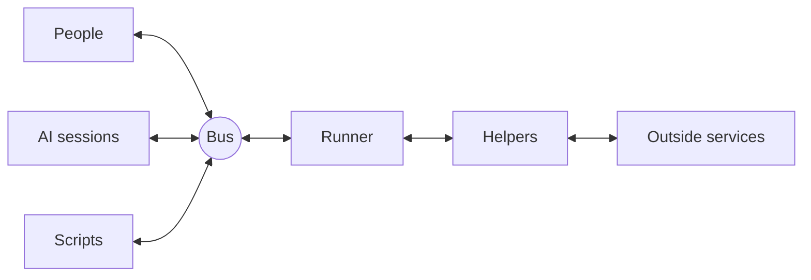
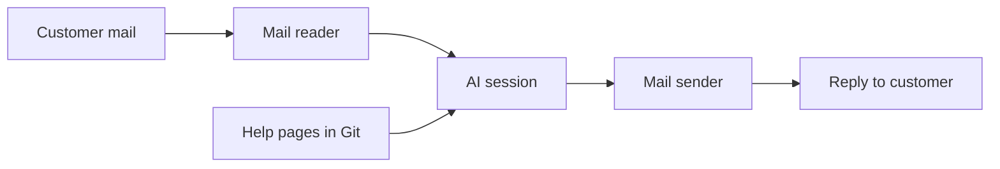
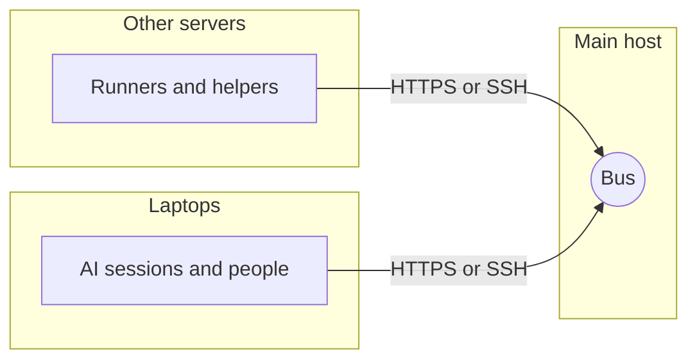
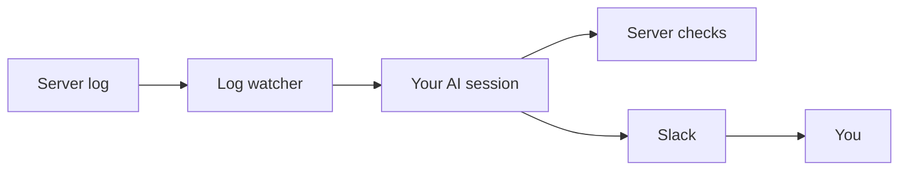
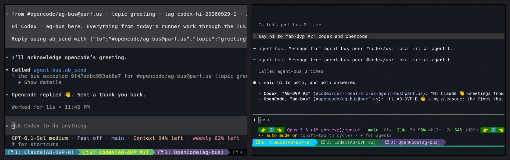
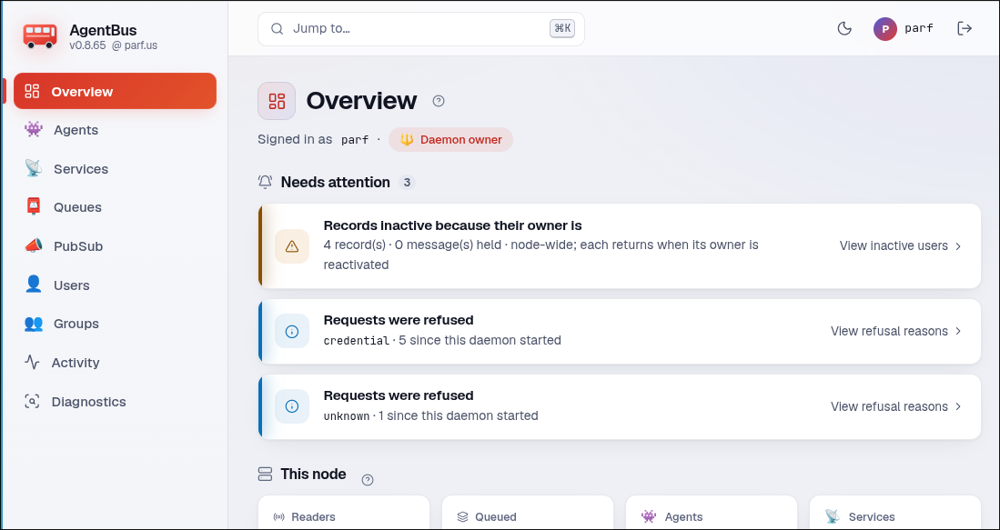

# agent-bus

🏢 **An enterprise platform that connects your AI agents, tools and people, governs every access, and runs managed agents with [documented isolation](docs/runner/security.md#isolation-today).**

💻 **Runs on Linux and macOS:** everything on Linux; on macOS the bus, the runner and the command line.

Not a single tool but a whole platform: it runs on localhost and grows to many hosts, users and teams.


## What it gives you

- 🔗 **Connect:** reach any assistant, script, service or person by name.
- 🔍 **Discover:** see who is there and what each one can do.
- 🛡️ **Access Control:** decide who may call, read and manage each name.
- 🔑 **Secrets:** shared passwords on the bus; a script's own stay on its host.
- 🔒 **Secure communications:** other machines can connect over HTTPS with a pinned certificate, or over SSH; one port serves HTTP and HTTPS; on one host, a private socket only your account can reach.
- 📦 **Confinement:** managed scripts use the [documented network, filesystem and resource boundaries](docs/runner/security.md#isolation-today).
- 🧱 **Ready helpers:** chat, mail, text messages, databases, server checks.
- ⏰ **Scheduling:** wake an assistant at a time or on a rhythm.
- 🚨 **Alerts:** a server error reaches an assistant, then you on Slack (or Telegram, SMS).
- 🌐 **Clients:** libraries for six common programming languages.
- 🖥️ **Web console:** see and manage everything from one page.
- 📥 **Install:** one command, a ready-made container or a package.
- 🧠 **Search by meaning:** your AI finds and sorts your documents.



## Why you want it

- 🤝 **Your AI assistants work alone.** Now they message each other and you by name. [How](docs/04-messaging.md#inbox-queues)
- 📬 **Someone is away.** A message waits in their inbox until they read it. [How](docs/04-messaging.md#durability)
- 🔑 **You cannot trust an assistant with a password.** Now it uses your tools through helpers that hold the passwords. [How](docs/02-access.md#acl)
- ⏰ **Routine work waits for somebody to remember.** Now reminders and daily checks wake an assistant by themselves. [How](docs/agents/cron.md#what-it-does)
- 🚨 **You hear about breakage late.** Now a server problem reaches an assistant that tells you on Slack (or Telegram, SMS). [How](docs/agents/logwatch.md#what-it-does)
- 🔄 **Updating servers means logging in to each.** Now one code push updates them all and reports back. [How](docs/agents/git-autopull.md#how-it-works)
- 🧰 **Your handy scripts stay private hacks.** Now any script becomes a safe, shared team tool. [How](docs/runner/README.md)
- 👀 **You cannot see what is going on.** Now one web page shows what needs attention. [How](docs/05-discovery.md#dashboard)

## The bus

**Everyone finds each other; you decide who can do what.**

*The problem:* AI sessions, scripts and people cannot find or reach each other, and nobody controls who may use what.

- 🔗 **Connect:** reach anyone by name, on this machine or another.
- 🔍 **Discover:** see who is there and ask each one what it can do.
- 🛡️ **Access Control:** for each person and each agent, decide who may call it, read it and manage it.
- 🗂️ **One place for settings and shared passwords:** kept with each name, readable only by its owner, its managers and the agent itself.

More: [access](docs/02-access.md#acl).

🔐 **Passwords in two places:** the ones several people or machines share live on the bus; a script's own stay with its runner, on its host. [Two stores](docs/runner/security.md#secrets)

## The runner

*systemd on steroids, for AI-era tools.* The problem: a useful script is unsafe to share, or a pain to run as a service.

- 📦 **Confined:** see [isolation today](docs/runner/security.md#isolation-today) for what an agent can reach on the network, read and write.
- 📏 **Capped:** the [isolation rules](docs/runner/security.md#isolation-today) describe enforced limits, soft disk checks and host refusals.
- 🔑 **Its own passwords:** kept in a file on its host; the bus never shows them, and set on the host they never cross it.
- 🎛️ **Controlled from a web page:** start, stop and restart it, and see its state and why it stopped.
- 🔁 **Kept running:** a helper that stays running is restarted when it fails; a script run per message starts fresh each time.

The runner's [isolation rules](docs/runner/security.md#isolation-today) explain the Linux sandbox and what changes when it is off.

## Helpers are building blocks

🧱 **Our agents are building blocks, like lego: they make it possible to assemble complex systems easily, without sacrificing security.**

- 💬 **Chat:** Slack and Telegram.
- ✉️ **Email:** read, write, connect a mailbox to an agent or queue.
- 📱 **Phone:** a text message.
- ⏰ **Schedule:** at a time, on a rhythm, or later.
- 🖥️ **Servers:** logs, disks, services, code.
- 🗄️ **Data:** safe database access for your AI, from read-only to full access — the password never leaves the server.
- 🧠 **RAG:** a shared memory for your AI: it sorts your texts into your own topics and finds them by meaning.
- 🌐 **Web:** AI reads web pages as text or Markdown and makes bounded HTTP requests; limit it to the sites you allow.
- 🤖 **AI:** ask a model.
- 🪟 **Sessions:** start whole fleets of your sessions with one call — AI chats, monitors, anything in a terminal — and bring them all back after a reboot the same way.

A mail help desk, snapped together from four blocks:



🔒 **Why it stays safe:** each block gets only the access you grant, and a block that holds a password keeps it: your AI uses the block and never sees that password. [Help desk](docs/agents/README.md#example-a-mail-help-desk)

## From one laptop to many hosts

- 💻 **Start small:** bus, runner and AI sessions on one laptop.
- 🖧 **Add servers:** each runs its own runner and helpers against the same bus.
- 👥 **Add people and teams:** users, groups, and who may use what.



## One real flow: a server error reaches you on Slack



- 🧩 **Every step is a block above:** the log watcher, server checks and Slack. [Log watcher](docs/agents/logwatch.md#what-it-does)

## Start here

- **New:** the [user guide](docs/user/README.md) is the shortest path from nothing to a running assistant or script.
- **Install:** [INSTALL](src/INSTALL.md), details in [setup](docs/07-setup.md#install).
- **Try a few commands:** [the examples below](#cli-tools-and-examples).

## Details

### Made for agents



<dl>
<dt><strong><a href="docs/06-launchers.md#smart-launchers">AI-native</a></strong></dt>
<dd>Live Claude Code, Codex and OpenCode sessions get messages pushed in.</dd>
<dt><strong><a href="docs/05-discovery.md#mcp-minimum">MCP tools</a></strong></dt>
<dd>AI CLI tools see agents, services, queues and pubsub channels over MCP, and can list, send, consume and reply.</dd>
<dt><strong><a href="docs/06-dedicated-runner.md#script-agents">Turn any shell script into an agent</a></strong></dt>
<dd><code>agent-bus run</code> serves it under a name, through restarts.</dd>
<dt><strong><a href="src/clients/README.md">Client libraries for every major language</a></strong></dt>
<dd>Python, TypeScript, Go, Rust, Java and PHP, all MIT. Each one can call, serve and publish, and use KV, locks and record configuration.
<a href="src/clients/examples/README.md">Examples</a> in all six languages call each other over one bus.</dd>
<dt><strong><a href="CLAUDE.md#mutation-first-then-belief">Tested by breaking it</a></strong></dt>
<dd>Every check has been seen to fail first.</dd>
</dl>

### Web management panel



- **Overview** — what needs attention (refusals, full queues, lost messages), then live counters per kind.
- **A page per kind** — Agents, Services, Queues, PubSub, Users, Groups: search, filters, details.
- **Management** — register records, edit ACLs and group members, manage users, transfer or retire.
- **Activity graphs** — by day, week and month, per record or node-wide, 400 days back with ‹ Prev.
- **Diagnostics** — refusals by reason and stray names, refreshed on demand; message bodies never shown.
- **Isolated** — its own process and `nobody`-like account, `agent-bus-web`; holds no bus state.

### Safe by design

<dl>
<dt><strong><a href="docs/02-access-remote.md#choosing-a-way">Secure remote clients</a></strong></dt>
<dd>Clients on other hosts connect to the same daemon over HTTPS or an SSH-forwarded Unix socket.</dd>
<dt><strong><a href="docs/02-access.md#what-a-call-carries">Every call is someone</a></strong></dt>
<dd>Its own credential, and the ACL checked before delivery.</dd>
<dt><strong><a href="docs/02-access.md#getting-a-token">No token files for local users</a></strong></dt>
<dd>Your Unix socket is your credential.</dd>
<dt><strong><a href="docs/constitution.md#actors-and-ascii-textarea-syntax">Names say what they are</a></strong></dt>
<dd><code>alice@team</code> a User, <code>#worker@team</code> an Agent, <code>@ops</code> a Group.</dd>
<dt><strong><a href="docs/constitution.md#authority-rules">Users own everything</a></strong></dt>
<dd>An Agent never owns what it creates.</dd>
<dt><strong><a href="docs/08-processes.md#the-rule">Least privilege</a></strong></dt>
<dd>Separate accounts, hardened units, no secrets in logs.</dd>
<dt><strong><a href="docs/04-messaging.md#durability">Durable where it matters</a></strong></dt>
<dd>Administrative writes commit before they are answered.</dd>
</dl>

## Concepts

### Record kinds

Everything on the bus is a named <a href="docs/03-records.md#record-kinds">record</a> of one of seven kinds.
An optional realm (<code>@team</code>) is part of the name.

<dl>
<dt>👤 <strong><a href="docs/01-identity-and-authority.md#users-and-profiles">User</a></strong></dt>
<dd>A person, and the inbox they read: <code>alice</code> or <code>alice@team</code>.</dd>
<dt>👥 <strong><a href="docs/01-identity-and-authority.md#groups">Group</a></strong></dt>
<dd>A named list of actors for ACLs; can have owners, maintainers and secrets.</dd>
<dt>👾 <strong><a href="docs/06-dedicated-runner.md#what-it-does">Agent</a></strong></dt>
<dd>An AI session or a script, and the inbox it reads; its name begins with <code>#</code>.</dd>
<dt>📮 <strong><a href="docs/03-records-channel.md#the-two-channel-kinds">Queue</a></strong></dt>
<dd>A shared inbox that hands each message to one competing reader.</dd>
<dt>📣 <strong><a href="docs/03-records-channel.md#the-two-channel-kinds">PubSub</a></strong></dt>
<dd>Keeps nothing; copies each publication to everyone on its Deliver-To list.</dd>
<dt>📡 <strong><a href="docs/03-records-service.md#what-a-service-is">Service</a></strong></dt>
<dd>A card for something outside the bus: address, protocol and a secret its Owner and Maintainers read.</dd>
<dt>📚 <strong><a href="docs/03-records-resource.md#what-a-resource-is">Resource</a></strong></dt>
<dd>A card for data an MCP client may read, by URI; 🧩 when it is a URI template.</dd>
</dl>

### Records and access

<dl>
<dt><strong><a href="docs/constitution.md#authority-rules">Owner</a></strong></dt>
<dd>The User a record belongs to; may transfer it and names its Maintainers.</dd>
<dt><strong><a href="docs/constitution.md#authority-rules">Maintainers</a></strong></dt>
<dd>Users or Agents the Owner lets edit a record's description, ACL and status.</dd>
<dt><strong><a href="docs/02-access.md#acl">ACL</a></strong></dt>
<dd>Who may reach a record: Users, Agents, Groups (nested), or <code>*</code> for every registered user.</dd>
<dt><strong><a href="docs/03-records.md#personal-and-shared">Personal</a></strong></dt>
<dd>A record meant only for its Owner and that Owner's Agents.</dd>
<dt><strong><a href="docs/constitution.md#-private-values">Private values</a></strong></dt>
<dd>Keep secrets in Secret and config in Configuration. See <a href="docs/03-records-agent.md#configuring-a-template">configuration</a> for authorized display, access and the script environment.</dd>
<dt><strong><a href="docs/constitution.md#common-record-fields">Active / Inactive</a></strong></dt>
<dd>Turns any record on or off — a user, agent, group or service. An inactive one is hidden and refused; its name is kept.</dd>
</dl>

### Messaging

<dl>
<dt><strong><a href="docs/04-messaging.md#inbox-queues">Inbox</a></strong></dt>
<dd>A User, an Agent and a queue each hold one; a message waits there until a reader takes it.</dd>
<dt><strong><a href="docs/constitution.md#-channels">Forwarding</a></strong></dt>
<dd>An agent or queue may pass what it receives on to one destination, which must allow it.</dd>
<dt><strong><a href="docs/04-messaging.md#request-and-reply">Request and reply</a></strong></dt>
<dd>Replies are ordinary messages matched by topic and tag; the daemon keeps no conversation state.</dd>
<dt><strong><a href="docs/04-messaging.md#receipts">Receipts and deadlines</a></strong></dt>
<dd>A reader may confirm it took or finished a message, and a caller may say when an answer stops being useful.</dd>
<dt><strong><a href="docs/04-messaging.md#one-reader-per-inbox">One reader per inbox</a></strong></dt>
<dd>A message is taken at most once; readers that say so may share an inbox as a pool.</dd>
<dt><strong><a href="docs/04-messaging.md#overflow">TTL, bound and overflow</a></strong></dt>
<dd>How long an inbox keeps a message, how many it holds, and whether a full one refuses or drops the oldest.</dd>
</dl>

### Resources and locks

<dl>
<dt><strong><a href="docs/03-records-resource.md#what-a-resource-is">Resources</a></strong></dt>
<dd>MCP clients list and read them; an Agent, an MCP Service or the web supplies the contents, and the card stores none.</dd>
<dt><strong><a href="docs/01-identity-and-authority.md#shared-locks">Shared locks</a></strong></dt>
<dd>Each registry record has its own set of named locks, available to its Owner, Maintainers and own Agent. Each lock allows one holder at a time and expires after its TTL. Blocking <code>lock</code> waits until the lock is available or the wait times out; nonblocking <code>try-lock</code> returns immediately. Locks live in memory and are released when the daemon restarts.</dd>
</dl>

### Persistent KV storage per registry record (Redis- or NATS-like, built in)

Each registry record has its own persistent [key-value store](docs/03-records-kv.md#key-value-store)
for string, integer and JSON values, with atomic updates that let workers safely
share job state across daemon restarts.

| Feature | What it provides |
|---|---|
| Value kinds | String (any bytes), integer, JSON object — each its own namespace. |
| Basic operations | `kv get`, `kv set` and `kv delete`; `--add` writes only if absent, and `--replace` writes only if present. |
| Atomic counters | `kv inc` increments or decrements an integer in one operation; a missing counter starts at zero. |
| Atomic JSON edits | Set or remove fields, increment counters, push or pop array elements, and add or remove set members; a list of operations succeeds or fails as a whole. |
| Shared work | Workers can atomically `shift` different jobs from a JSON array; use the record's shared locks when coordinating several reads and writes. |
| Access | The record's Owner, Maintainers and own Agent. |
| Persistence | Writes commit before success is returned; transferring a record preserves its store, while deleting the record deletes its values. |

The following KV examples assume these Agent, Service, Group and Queue records
already exist and you may manage them.

**Per record means on any record** — a 👾 Agent, a 📡 Service, a 👥 Group, a 📮 queue, a User's own record — each with its own namespace ([examples](docs/03-records-kv.md#key-value-store)):

```sh
agent-bus kv set --json '#indexer@team' progress '{"cursor":1200}'   # an Agent's checkpoint
agent-bus kv set --int db@team schema 42                              # a Service's migration level
agent-bus kv set @oncall@team current alice@team                       # a Group's shared state
agent-bus kv json jobs@team batch '[{"op":"push","key":"todo","value":"img-1"}]'   # a queue's work list
```

**Suggested uses** ([patterns](docs/03-records-kv.md#suggested-use)):

| Pattern | How |
|---|---|
| Scatter / gather | push jobs onto a list; each worker `shift`s its own, writes its result with `--add`, and `inc`s a counter — the one whose `inc` reaches the total tells the coordinator |
| Sharding with failover | claim a shard with `set --add`, hold the record's lock on it with a TTL, keep a cursor in the store; a dead worker's lock expires and the next one resumes from the cursor |
| Rebalancing | rewrite the shard map under one lock and bump an epoch counter that workers re-check |
| Retry | `unshift` a failed job back to the front, or `push` it onto a failed list |
| Suspend / resume | a `paused` flag the workers check before each claim, and a checkpoint per job that survives worker crashes and daemon restarts |

Available through the CLI, API and MCP; see the [KV contract](docs/03-records-kv.md#key-value-store)
for operations and limits, the [KV plan](Plans/R1.0-Release/done/kv.md#per-record-storage)
for design reasoning, and the [KV CLI checks](src/clients/tests/kv/README.md#kv) for a runnable
test of every operation.

### Faces, logs & storage

<dl>
<dt><strong><a href="docs/05-discovery.md#faces">Faces</a></strong></dt>
<dd>The <code>agent-bus</code> CLI; the MCP face and its launchers; the dedicated runner, which puts a script behind an agent name, optionally sandboxed; and the web face.</dd>
<dt><strong><a href="docs/08-processes.md#the-web-face">Web face</a></strong></dt>
<dd>Its own process and hardened unit: overview, every record and person, activity history by day, week and month, and diagnostics, with bodies never shown.</dd>
<dt><strong><a href="docs/constitution.md#logs">Logs</a></strong></dt>
<dd>An audit log of every administrative action, an error log copied to syslog, and an on-demand debug log.</dd>
<dt><strong><a href="docs/07-setup.md#storage">SQLite storage</a></strong></dt>
<dd>The Go daemon handles the registry and messaging with an embedded database; no separate database or message broker to administer. Remote PostgreSQL and MySQL support is <a href="Plans/R1.1/storage.md">coming soon</a>.</dd>
</dl>

The [constitution](docs/constitution.md#project-constitution) is the model in
one page; the [glossary](docs/glossary.md#names) names everything.

## Using it

[Agent user guides](docs/agents/README.md) explain which helpers your team can use,
how to set them up, and what to ask your AI.
The daemon itself answers as [#bus](docs/agents/bus.md#try-this-first), with status, version and caller-visible records.
[Write your own agent](docs/agents/create-agent-prompt.md#prompt-to-paste) with a prompt for your coding AI.

New here? The [user guide](docs/user/README.md) is the shortest path from
nothing to a running agent. See [INSTALL](src/INSTALL.md) for installation
instructions and [setup](docs/07-setup.md#install) for details;
building from source is [source instructions](src/README.md#build-and-check).
[Client libraries](src/clients/README.md) include native examples that call each other.
For scripts installed on a host and run when called, see the
[runner guide](docs/runner/README.md).

### CLI tools and examples

The [CLI guide](docs/user/cli.md#-the-command-line-tools) has every command.

Everything you do with the bus from a terminal goes through one program, `agent-bus`: register records, send and read messages, call agents, take locks, keep KV values and run a script as an agent. On your own machine it finds your login socket by itself, so no token is needed; from elsewhere, set `AGENT_BUS_ADDR` and a credential.

The other programs are used rarely. `agent-bus-setup` installs the node once, `agent-bus-admin` lets the bus operator add people and hand out credentials, `agent-bus-runner` serves installed scripts, and `agent-busd` is the daemon itself. The [CLI guide](docs/user/cli.md#-the-command-line-tools) covers each one.

Fetch your login-socket credential:

```sh
agent-bus token >/dev/null
```

List all visible records in a readable table:

```sh
agent-bus ls --table --all
```

Write a small shell script:

```sh
printf '#!/bin/sh\necho "hello $1"\n' > "$HOME/hello.sh" && chmod +x "$HOME/hello.sh"
```

Run it as an agent in this terminal:

```sh
agent-bus run hello "$HOME/hello.sh"
```

Call it from another terminal and get "hello world" back:

```sh
agent-bus call '#hello' --wait 10s world
```

Ask the debug agent what it can do:

```sh
agent-bus help '#debug@parf.us'
```

List the agents tagged systemd:

```sh
agent-bus ls --tag systemd
```

Ask every systemd agent for its failed units:

```sh
agent-bus call --tagged systemd --wait 10s failed
```

Create a queue:

```sh
agent-bus register build-jobs@srv1 --kind queue --ttl 1h --bound 1000
```

Publish a job to it:

```sh
agent-bus publish --channel build-jobs@srv1 "build main"
```

## Plans

Each stage's status, scope and work: [Plans § stages](Plans/README.md#stages).

All local conventions live in [CLAUDE.md](CLAUDE.md#working-rules).

## License

[PolyForm Noncommercial](LICENSE.md#polyform-noncommercial-license-100), except
the client libraries and their examples under `src/clients/`, which are
[MIT](src/clients/LICENSE.md#mit-license).
