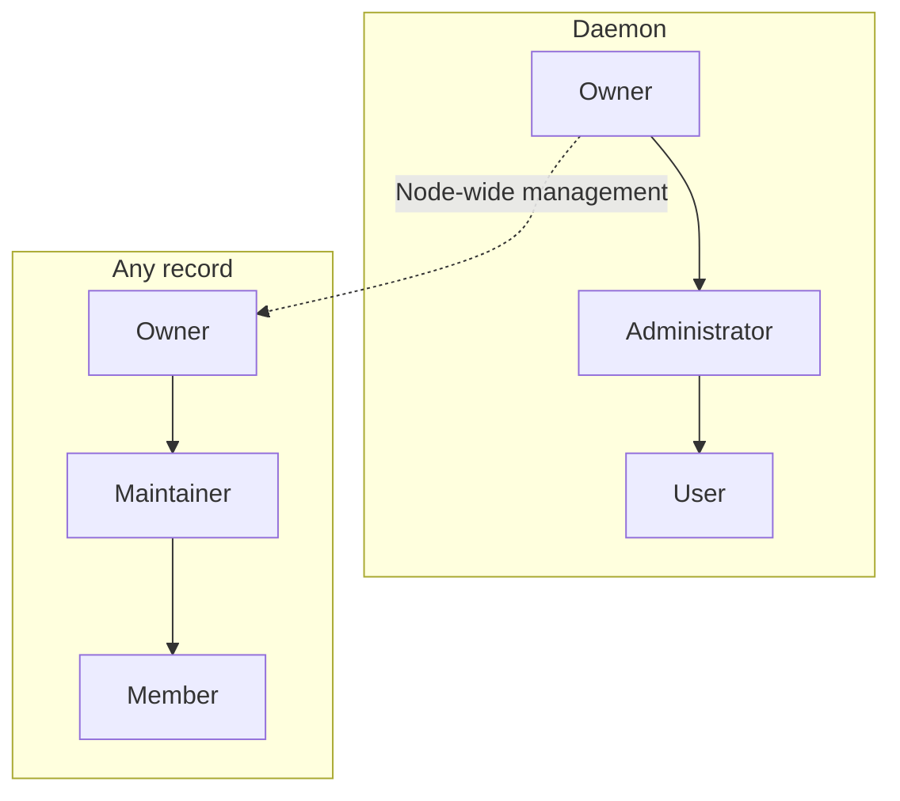

# Identity and authority

📌 **TL;DR:**
- **Problem:** without clear names and owners, nobody can tell who may do what on the bus, and a record can outlive everyone who understood it.
- **Outcome:** Owners control their records, Administrators manage users and groups, and Maintainers manage assigned records. Names keep people, agents and resources distinct.
- **Start:** check who you are on the bus: `agent-bus status` ([Try this first](#try-this-first)). See [Access](02-access.md#what-a-call-carries).

## Why you'd want it

- Assign responsibility without giving every operator control of the whole bus.
- Share access through groups and transfer records when responsibility changes.

## What you get

- A name for each person, agent and resource.
- Separate bus-wide and record-level authority.
- Ownership and lifecycle rules that preserve credentials and queued work when appropriate.

## Try this first

Check which identity your connection uses:

```sh
agent-bus status
```

The `you` field shows who you are on this connection.

## Identities

- A **User** is a registered person.
- A **principal** is the identity a credential represents; it must have a user profile or a registry record to use the bus.
- A record is one of [seven kinds](03-records.md#record-kinds): 👤 `user`, 👾 `agent`, 📮 `queue`, 📣 `pubsub`, 📡 `service`, 👥 `group`, 📚 `resource`.

## Names

Use a name to address someone or something on the bus:

- `alice` — a person.
- `#worker` — an agent.
- `@support` — a group.
- `#telegram/work` and `#telegram/home` — separate instances, each with its own settings.
- `.2`, `.3`, and so on — additional instances of the same agent: `#telegram/work.2@team`.

An optional ending such as `@team` distinguishes names: `#worker@team`. It names a namespace, not necessarily the computer running the agent. `alice` and `alice@team` are different names; the bus never adds an ending for you.

- Names are normalized to lowercase ASCII and limited to 64 characters, including prefixes and the realm.
- The last `@` separates the realm; an instance may itself contain an address-like name.
- A realm contains letters, digits, `.`, `_` and `-`, starts with a letter or digit, and contains no slash.

See [record names](constitution.md#common-record-fields) for the reference and [session names](06-launchers.md#session-names) for names chosen by AI launchers.

## Positions and scopes

- 👑 **Bus Owner** — controls the whole bus: appoints Administrators, manages users and groups, and can manage any record. Using a record's messaging interface still requires access.
- 🏷️ **Record Owner** — controls one record: chooses its access list and Maintainers, and can transfer ownership.
- 🛡️ **Administrator** — manages users and groups on the bus. This position does not grant control over their records.
- 🛠️ **Maintainer** — manages the records explicitly assigned to them.
- 🔑 **Member** — may use a record through its access list. A member can be a person or another record.

<details>
<summary>Diagram: separate position scopes</summary>



Solid arrows show permission inheritance within each scope. The dashed override
crosses scopes and belongs only to the daemon Owner, never to Administrators.

</details>

## Daemon owner

The daemon owner has root-like authority. Setup supplies the required first
owner; the daemon then stores that position and a transfer survives restart.
The daemon account's socket speaks for the Owner of each request, so a transfer
moves it at once ([local socket](02-access.md#local-socket)).

* Assign and revoke Administrators; edit, activate and deactivate them.
* Manage users and all groups.
* Edit any record, including its ACL, Maintainers and owner.
* Transfer daemon ownership to another user.

<details>
<summary>Transfer and access boundaries</summary>

- Only the current active Owner may transfer the position, to a different active registered User.
- The recipient becomes an Administrator; the former Owner stays an Administrator until the new Owner changes that group.
- A startup owner value seeds a store without an established Owner and cannot replace a transferred Owner.
- Stored state with a missing, invalid, inactive or unknown Owner fails startup rather than silently restoring the seed.

- Node-wide management includes discovery, settings, ACL, Maintainers, ownership and removal. It does not by itself grant access to [Configuration or Secret](constitution.md#-private-values).
- It does not itself grant message use: the Owner uses a record only through its record authority or [ACL](02-access.md#acl).
- Administrators gain no node-wide record authority from their administrative position.

</details>

## Daemon Administrators

Administrators manage ordinary users and groups, but cannot edit the daemon
owner or peer Administrators, or grant those positions. They may
reactivate an ordinary user, while the Owner retains authority over every
level.
Record management requires the [resource assignment](#record-authority).

## Record authority

- The **Owner** controls the record without needing Administrator status.
- [Application roles](03-records-agent.md#roles) describe what an admitted caller may do inside an agent; they grant no bus management authority.
- Maintainers is a list of actor names, groups and the supported [runtime terms](02-access.md#acl).
- Only the record's Owner or daemon Owner replaces it; group entries use ordinary nested membership.
- Human editors use one plain term per line, as ACL editors do.

| Position | Authority |
|---|---|
| Owner | All Maintainer/Member permissions; assign/revoke Maintainers and transfer ownership |
| Maintainer | Edit settings and ACL; read and write Configuration and Secret where supported |
| Member | Use the record |

<details>
<summary>Management boundaries and availability</summary>

* The owner, the resource's own principal and every direct or effective member of its Maintainers list can manage it.
  - Naming a group delegates its membership to [group administration](#groups); it does not give the record's owner control over who Administrators add to it.
* A record's `status` is `active` or `inactive`, on every kind but a 👤, which lives with its User.
  - Deactivating makes it no such entity and retains queued messages; its name stays reserved, so nothing registers over it.
  - Its Owner, a Maintainer or the daemon Owner can reactivate it with a status-only edit; ordinary operations naming it are refused as unknown.
  - Reactivating does not start a process.
  - Removing access refuses the next read; a read already waiting finishes as admitted, and delivered work is not recalled.
* Every list — `allow` (a Group's membership), `maintainers` and `deliver_to` — is written whole, or changed by `add`, `add_to_set` and `remove` deltas that resolve against the record as the write finds it, so concurrent list deltas do not overwrite one another.
  - `add` refuses a term already there, and an occupied one-slot `deliver_to`; `add_to_set` adds what is absent and succeeds on what is present; `remove` is a no-op for what is absent.
  - A list written whole and by a delta in one write is refused, and a delta takes the same authority and checks as the whole write it becomes.
* Re-registration retains the [protected settings](#registration).
* Management covers access, availability and removal, subject to [removal conditions](#unregistering). Configuration and Secret have their own [read/write authority](constitution.md#-private-values). Starting and stopping managed processes is [runner work](runner/operations.md).

</details>

## Ownership

- Changing a record's owner requires its current owner's or the daemon Owner's authority, and the new owner is a User.
- Transfer changes who may manage the record and request its credential; it does not revoke existing tokens. A former Owner holding token bytes can still use them until rotation removes their validity ([token lifetime](02-access.md#token-lifetime)).
- Transferring an Agent rebinds its tokens to the new Owner in the transfer's own commit, so they keep working and act for the new Owner; a transfer whose commit fails moves neither the record nor its tokens.
- See [constitution § Token](constitution.md#-token).

<details>
<summary>Transfer recipients and user records</summary>

A recipient must be an active User. A User's own 👤 record cannot be
transferred. User creation, enrolment and Administrator membership each
create the User's record with it.

Existing credentials and copies already held follow the
[token lifetime policy](02-access.md#token-lifetime).

</details>

## Groups

- A Group is an ordinary record of kind `group`, named `@name`, or `@<owner>/<name>` for one reserved to its Owner and required of a Personal one ([Group rules](constitution.md#-group)). Its `allow` list is its membership.
- Any User creates one, and it belongs to that User.
- Its Owner, Maintainers, the daemon Owner and Administrators may change membership. Administrator status alone permits no other record edit.
- Members are actors — Users, Agents and other Groups — never the wildcard or a runtime term.
- For shared management, create a group and add it to each resource's Maintainers list.
- Choosing a group accepts its membership changes on every resource using it.
- Retire an ordinary group by emptying it; groups are not deleted.
- An inactive Group grants nothing and is [no such entity](constitution.md#common-record-fields) while its name stays reserved; at a publication it is skipped with an error-log warning and counts no drop.
- Membership follows the stored graph: cycles terminate, and any valid path to a principal grants effective membership. Membership edits require existing Users, live Agents or live Groups; missing references grant nothing.

<details>
<summary>Administrative membership and shared-group limits</summary>

* The protected `@administrators` group grants daemon administration.
  - Its Owner is the daemon Owner and moves with daemon ownership in the same write; it has no Maintainers, is never Personal, and takes no owner, Maintainer, membership or status change through record management.
  - Only the daemon Owner changes its membership, with Users only; the Owner always remains a member.
  - An added Administrator gets a user profile; removing membership keeps that profile.
  - Ordinary group membership creates no profiles.
  - A restored one owned by anyone else refuses the start.
* Groups are not principals: they have no credential. A Group's
  [private values](constitution.md#-private-values) are its Owner's and
  Maintainers', as on every record; membership does not read them. Emptying a group preserves references to its name; adding members
  later makes those references effective again. The protected group cannot be emptied.
* Group names are available for Maintainer assignments; full membership
  lists are visible to Administrators and to whom a Group's own ACL — its
  membership — and managers admit. Owning a record grants no daemon
  user/group administration.
* Membership nests. Stored group lists show direct entries;
  user views report effective membership. Administrators can edit membership on Group pages without gaining access to other record settings or private values. ACL and Maintainer checks use the
  same reachability rule. [Application roles](03-records-agent.md#roles) use the same live membership.
* `@administrators` accepts direct user identities only; the Owner remains a
  direct member. Stored state that nests a group there is refused at startup.
  An ordinary group may name `@administrators`: its direct members then receive
  that ordinary group's access or Maintainer grant, without creating nested
  Administrator authority.
* Sharing a Maintainer group across resources does not require joint owner
  approval for membership changes. Record Owners control assignment of the
  group; Administrators control its members. The protected Administrator group
  retains its separate daemon-owner-only membership rule.

</details>

## Channels

- A channel is a 📮 `queue` or a 📣 `pubsub` record: a name **nobody acts as**.
- Its creator's User owns it, under the [registration](#registration) and [record authority](#record-authority) rules.
- The daemon provides queue or pub/sub delivery; joining, publishing or reading grants no ownership of the channel or another recipient's inbox.
- See [channel delivery](03-records-channel.md#the-two-channel-kinds). A message's `topic` is a separate [envelope label](04-messaging.md#envelope).

## Users and profiles

- Users can register records and become their owners.
- A user may edit or clear only their own email; username, person name, GitHub name, state and authority stay protected.
- The daemon Owner may edit every profile; Administrators edit ordinary users below their level.
- Person names come from an Administrator, the trusted local-account adapter or the GitHub directory used for key enrolment; imports fill a blank name and never overwrite an existing one.

<details>
<summary>Profile fields and the user directory</summary>

* Profiles contain person name, email, GitHub login, company, location and a
  Twitter/X name. GitHub may populate these ordinary editable fields. The
  daemon separately retains trusted photo/provenance data and one bounded local
  thumbnail; a blank profile is still a registered user.
* Email, GitHub login and Twitter/X name are syntax-checked, trimmed and unique across profiles: email and GitHub login in lowercase ASCII, and the Twitter/X name — 1 to 15 letters, digits and `_` — without regard to case.
  - Checked on add, edit, import and restore; a stored duplicate refuses startup rather than selecting one User.
  - Provider aliases such as dots and plus-addresses are not merged.
  - Person names need not be unique.
* A GitHub identity retains its own GitHub username; a matching profile field does not establish a cross-provider identity alias.
* A GitHub challenge retains the provider's person name with the public keys;
  successful proof imports both from that lookup. A public GitHub email fills
  only a blank Email, and an imported email or Twitter/X name is skipped on a
  uniqueness collision. Fetching any of
  these facts remains evidence from GitHub, not authentication by itself.
* Setting or changing a GitHub login attempts to fetch the public profile, but provider availability does not block the login field.
  - An explicit Company, Location or Twitter/X value in that edit wins; otherwise the provider value fills it.
  - Explicit refresh replaces those fields and reports failure without mutation.
  - The trusted public-profile adapter is available independently of whether an enrolment realm uses GitHub keys; enabling one never enables the other.
  - Unrelated edits do not contact GitHub.
  - Clearing the login clears provider provenance and its photo while retaining ordinary profile fields.
* GitHub imagery is fetched only by the trusted adapter, constrained to the
  provider host set, bounded before decode and re-encoded as a 96-pixel PNG.
  Photo failure keeps the prior local thumbnail or initials and never blocks an
  otherwise valid profile update. Pages never hotlink a provider image.
* `agent-bus-admin user import-local` reads the local account through the OS
  account database. Its input names an account; it accepts no free-form person
  name. Setup uses it for the first key-backed user.
* Self-email editing derives the target from the credential and carries no
  identity or protected field. Email remains normalized and unique by the same
  rule as an administrative edit.
* Administrators see the user directory; ordinary callers see their own details.
* The directory separates users, self-owned records and credential-only names.
  Classification comes from profiles and records, not spelling or blank fields.
  Only users have lifecycle controls; cleanup follows the
  [credential removal rule](02-access.md#ownerless-credentials).
* Viewing a directory removes nothing. Search, filters and pagination survive
  return from details; counts cover the visible entries, not the whole store.
  Entries link to relevant records; avatars do not trigger another directory
  fetch per person.
* Profiles and membership persist in the database.

</details>

## User states

- A User is **active** or **inactive**, with no second level.
- An inactive User cannot act — every token, session, local socket and enrolment is refused as `403 suspended` — and every record it owns is inactive too, so it is [no such entity](constitution.md#common-record-fields): hidden and answered as unknown (`404`) to every caller, readable only through the web face's read-only view.
- Inactivity keeps credentials and queued work, stops no process, and is reversible.
- Users are never deleted.

| Who | May change a User's status |
|---|---|
| daemon Owner | any User but itself: the daemon Owner stays active |
| an active Administrator | an ordinary User, never another Administrator |
| anyone else | no one |

<details>
<summary>Inactivity, reactivation and inboxes</summary>

* A status change takes effect on the next request; a read already waiting
  finishes as admitted ([authority at the door](constitution.md#authority-at-the-door)).
  Already delivered work cannot be recalled.
* Inactivity follows the **direct owner**; only a User owns records, so there
  is no chain to follow.
* Credentials are kept, not rotated or revoked. Reactivation restores their
  use. Stored status survives restart; queued messages keep their expiry.
* Nobody drains an inactive record's inbox, however admitted: the work waits
  for its reactivation.
* A copy published to an inactive recipient beside live ones is that
  recipient's `dropped` and an error-log warning; see
  [Deliver-To](04-messaging.md#deliver-to).

</details>

## Registration

An active User or Agent can register an unheld name in an unbacked realm. A User owns what they create; an Agent creates records for its User Owner. Creating a name in a directory-backed realm requires
[key-possession enrolment](02-access.md#proving-possession).

<details>
<summary>Creation and re-registration</summary>

- A credential-only unknown name cannot bootstrap itself by registering.
- A name must first be created by an existing authorized principal or through enrolment.
- The owner must be a registered User.
- Enrolment creates a profile and self-owned record.
- State the [kind](03-records.md#record-kinds) explicitly when registering. If omitted, a `#` name selects an Agent and an ordinary name selects a Service, which also requires an address and a protocol.

A conditional creation refuses an existing canonical name, even for its owner;
claim and insertion happen together. Launchers use this for unique session
names. Ordinary re-registration instead permits authorized updates under the
[management rules](#record-authority).

The User Owner or daemon Owner may set initial Maintainers when creating a
record. The complete grant is validated before the record is stored; an Agent
creating a record for its Owner cannot assign Maintainers. Re-registration
keeps the existing grant; changing it uses management.

Re-registration preserves ownership, record configuration, Deliver-To entries,
assigned Maintainers and the status. Omitting the ACL retains its
grants; an explicit ACL replaces them. Use management to deliberately clear
grants.

</details>

## Unregistering

`agent-bus unregister <name>` removes an idle record, its inbox, configuration
and Deliver-To entries, and ends its [locks and pending takes](#shared-locks); it does
not stop the process. Record authority is required. Drain live queued work and stop all readers first.

<details>
<summary>Removal checks and what survives</summary>

* Missing names are errors. Expired messages are pruned before checking whether
  live work or any reader still blocks removal, so even a refused removal can
  prune expired messages.
* A User's own 👤 record is never removed, and only a User owns records, so
  a removed name owns nothing.
* The removal's one commit deletes the name's credentials and every reference
  to it: ACL, Maintainer, Group member and Deliver-To entries. Reads it held
  elsewhere end too. A commit that fails removes nothing.
* A removed name is free for reuse, without priority for its former owner.
  Re-registration starts with an empty inbox, no configuration, no references
  and a new internal ID, so nothing the former holder kept answers for it.
  Existing history remains history.

</details>

## Orphaned records

- A record's Owner must be a registered User, and every User must have its own User record.
- Stored state violating either rule refuses startup. The daemon does not free those names, serve a partial snapshot or attach their queues to new owners.
- Well-formed credentials whose principal no longer exists have a separate [ownerless cleanup rule](02-access.md#ownerless-credentials).
- Ownership is checked one step: an Agent never owns a record, so there are no ownership chains to follow.

## Key-value store

Use a record's [key-value store](03-records-kv.md#key-value-store) for durable string, int and JSON values. Its Owner, Maintainers and own Agent have access, as with its [shared locks](#shared-locks).

## Shared locks

- Each named lock belongs to a record and has one holder at a time.
- The record is the lock's namespace, and its **Owner, its Maintainers** (nested groups and the `@owner` and `@agent` terms included) **and its own Agent** may use its locks — the record's [management authority](#record-authority), checked once when the lock call comes in and never again while it waits ([authority at the door](constitution.md#authority-at-the-door)).
- Its allow list grants use of the record, not of its locks. Locks have no fencing token: expiry cannot stop external work already running under an expired hold.
- Every lock has a ttl, so a crashed holder cannot wedge the rest; the table is memory only, and a restart releases every lock.
- A Maintainer that loses its grant keeps a lock it already holds until the ttl or a `--force` release; a deactivated User's locks still end at once.
- A lock name is 1 to 256 bytes of UTF-8, as a [key-value](03-records-kv.md#key-value-store) name is, and one record holds at most 10,000 locks at once.
- The record is spelled as any name is: every spelling of it is one namespace, and answers give the canonical one.

| Verb | |
|---|---|
| `lock <record> <name> --ttl` | take it; waits until granted or the caller's `--wait` runs out (default 30s, at most 60s). Waiters are granted in the order they began waiting, a release or expiry handing the lock to the oldest. Re-taking your own lock is refused at once — use extend |
| `try-lock <record> <name> --ttl` | the same, granted or refused now; a refusal names the holder |
| `extend <record> <name> --ttl` | the holder sets a fresh ttl from now; anyone else is refused, and a lock nobody holds is not extended |
| `release <record> <name>` | the holder gives it back before the ttl; anyone else is refused |
| `release <record> <name> --force` | releases a lock somebody else holds; any of those who may use the record's locks may, and it is audited |
| `holders <record>` | who holds which of the record's locks and the time left; the API answers each as `{holder, expires}` |

- The API names the record `record`, in a body or a query.
- An inactive record has no locks: taking one is refused as no such entity, and any deactivation ends its locks and refuses pending takes at once ([common record fields](constitution.md#common-record-fields)).
- The web face shows a record's locks on its page to those who may use them, and every such lock on its Locks page.
- `GET /holders` with no record answers that listing: each lock with its record, the record's kind, holder and expiry.
