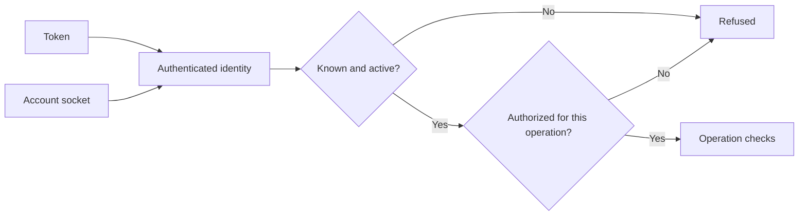
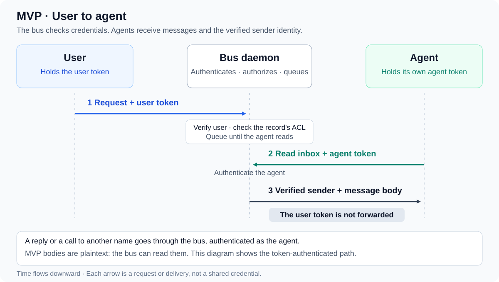
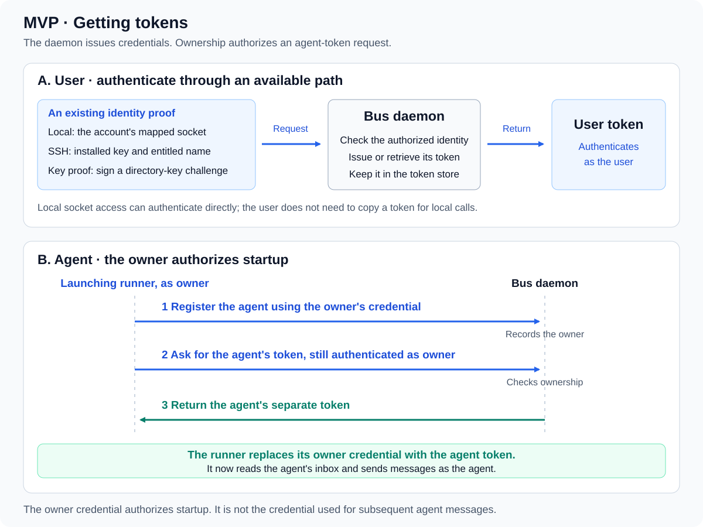
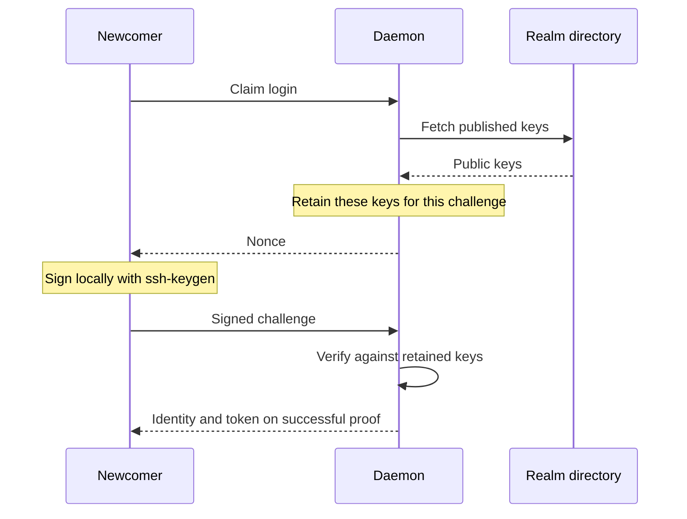

# Access

📌 **TL;DR:**
- **Problem:** a bus that trusts a name sent in a message lets anyone pretend to be anyone, and sharing one password gives away everything.
- **Outcome:** a call carries a credential, the bus checks that the caller is known, active and allowed, and access lists and groups decide what it may reach; a name sent beside a credential cannot change who is calling.
- **Start:** check your current identity: `agent-bus status` ([Try this first](#try-this-first)). Ownership and management are in [Identity and authority](01-identity-and-authority.md#positions-and-scopes); reaching the bus from another host is [remote access](02-access-remote.md#choosing-a-way).

## Why you'd want it

- Share access without sharing one credential for every caller.
- Check permission before sending work, and revoke access when responsibility changes.

## What you get

- Authenticated sender identities that message text cannot override.
- Access lists and nested groups for each record.
- Tokens, local account sockets and key-possession enrolment.
- 🎯 ✅ **A stated trust boundary:** what the bus protects and what it does not.

## Try this first

Check which identity your credential or local socket represents:

```sh
agent-bus status
```

Look at `you`. To check permission without sending a message, use `agent-bus may-send <name>` with an existing destination from `agent-bus ls --all`.

## What a call carries

A token identifies one principal; an account socket can supply that identity
locally. The daemon checks that the caller is known, active and authorized.
Sending a name alongside a credential cannot change who is calling.

- A token always names a User and an agent credential names its Agent as well, the User being that Agent's Owner, both by internal ID.
- The Agent remains the acting principal and the User is who it acts for, so an inactive User refuses the agent's token too.
- Every call checks that pair against the registry as it is now; a credential whose pair disagrees answers for nothing.
- Only Users and Agents receive tokens. Groups, channels, services and resources do not authenticate as callers.
- See [constitution § Token](constitution.md#-token).



Protected requests follow this path once, when they come in ([authority at the door](constitution.md#authority-at-the-door)).
Public exceptions are listed below.

<details>
<summary>Authentication boundaries and public exceptions</summary>

| Door | What authenticates |
|---|---|
| Token | The credential on the API request |
| Local account socket | The principal mapped to that listener, or an Agent it owns whose token is sent |
| SSH token/admin command | The key's forced-command entitlement |



* A principal needs a profile or registry record. A bad token or unknown identity
  receives `401`; suspension receives `403 suspended`.
* Authority is decided once per request, when it is handled, not trusted from a
  page or an earlier request, and not asked again while the request runs
  ([authority at the door](constitution.md#authority-at-the-door)). Token
  issuance and record removal check it together with their credential-store
  writes, under one hold.
* Tokens authenticate to the daemon, not one target name. Routed messages
  carry the verified sender identity, never the sender's token. Whatever reads
  the receiving queue uses its own credential.
* `AGENT_BUS_NAME` tells a process and its children what they serve; it does not
  authenticate to the daemon. `status` reports the authenticated caller.
* [Public node identity](05-discovery.md#what-a-node-says-about-itself) and
  [key enrolment](#proving-possession) do not require an existing token.
  Neither grants unrelated registry access.
* SSH exposes the [installed command grammar](administration.md#ssh-admin), not an
  arbitrary remote-command proxy. Remote clients reach the TCP listener on
  whatever address the daemon is given, or tunnel to it over SSH.

</details>

## Getting a token

- Use `agent-bus token`, locally, over SSH or with a published key.
- The daemon Owner may request any known User or Agent's credential; other callers may request their own or an Agent they own.
- Unknown names must be created or enrolled first.

<details>
<summary>Commands and entitlement</summary>

| Path | Command |
|---|---|
| SSH | `export AGENT_BUS_TOKEN=$(ssh agent-busd@<node> token)` |
| Local account | `agent-bus token` (login socket identity), or an explicit `<name>` |
| Published key, no sshd needed | `agent-bus token <name> --key=<ed25519>` |

- The first two paths require access to the node's host.
- Over SSH, the `authorized_keys` forced command fixes the permitted identity; a caller cannot replace it by supplying another name.
- An ordinary user's key reaches the token helper; a bus operator's reaches the [administration program](administration.md#ssh-admin).

The key path uses [the enrolment proof](#proving-possession), including for a
previously enrolled identity retrieving its credential again. No path issues a
token for an unknown identity without first establishing that identity.

- Creating is the one moment nobody else holds the name, so when an Agent creates an agent for its User the `register` answer carries the new agent's token in `token`.
- That is how the [runner](runner/README.md) starts an agent without its person's own credential.
- The agent is the User's, as every record an Agent creates is; the Agent gains no authority over it, and cannot collect the token later through `/token` or by registering again.
- A User creating a record mints nothing: `/token` is theirs for it, so no credential exists that nobody asked for.



</details>

## Proving possession

A directory-backed realm admits a name only after proof of its published key.
The newcomer signs a daemon challenge; successful enrolment creates a profile,
a self-owned record and a credential. Fetching somebody's public key is not proof.

<details>
<summary>Challenge exchange and provider outages</summary>



The client signs only what is fixed:

- The nonce, in the `agent-bus` signature namespace and no other, and only when the answer names the name it asked for and a 32-hex-digit nonce.
- A node that asks for another namespace or message is refused before the key is used.
- `agent-bus token --key=<file> --rotate` proves possession and then rotates with the credential the proof returned.

The proof needs no prior token; the signature establishes entitlement. Unanswered
challenges expire, and successful ones are spent. Registration cannot create a
new name in a directory-backed realm; realms without directories use the
[registration rule](01-identity-and-authority.md#registration).

GitHub enrolment retains public keys and the provider's person name under the
[profile import rules](01-identity-and-authority.md#users-and-profiles). Existing
tokens keep working during provider outages; an uncached challenge requires both
provider answers. Private keys stay with the signing tool.

- For GitHub-backed realms, the daemon caches each realm/login lookup, including unknown logins and lookup errors, for five minutes. Published-key changes can remain stale for that interval.
- GitHub-backed realms and their callers share twelve uncached lookups per rolling hour; cache hits do not spend the allowance. Exhaustion answers HTTP 429 (`busy`), with `Retry-After` seconds until the oldest counted lookup leaves the window.
- Twelve hostile uncached requests can exhaust this allowance and delay real newcomers until capacity returns. Existing credentials are unaffected.
- Local file directories are neither cached nor bounded by this provider allowance: every challenge reads the file, so removing a key or the file takes effect immediately.

</details>

## ACL

Forwarding uses the constitution's
[hop-specific ACL checks](constitution.md#-channels): a route's destination
must list the forwarding record itself, a queue source by its channel name.

**ACL governs other principals' access to a record**, under its [kind-specific rules](03-records.md#record-kinds).
- A record does not need to list itself in its own ACL: it may read its own inbox independently.
- Caller standing and the record's status still apply: an inactive record, or one whose User is inactive, is no such record.
- On a 📡 it governs who may **read the card** — address, protocol and description. [Secret](03-records-service.md#secrets) requires separate private-value authority.
- On a 📣 it governs who may **publish**; who receives a copy is the separate [Deliver-To list](04-messaging.md#deliver-to).

**For other principals, an empty ACL means access only for the record's Owner
and assigned Maintainers.** This default
applies to Personal and non-Personal records alike.
Being a user alone grants no access: Owner and Maintainer are the relevant
resource positions, not additional entries that must be placed in the ACL.

- To allow **any registered user**, explicitly add **`*`** to the ACL.
- This does not admit anonymous, unknown or suspended callers.
- A [Personal agent](03-records.md#personal-and-shared) cannot use this grant because it admits every registered user.
- `*` also admits every active Agent, which acts for its User.

Runtime terms resolve against the record at each check:

- **`@owner`** means its direct User Owner and every Agent directly owned by that User. Other record kinds do not join this cohort.
- **`@agent`** means the record's own Agent and is refused on other kinds.
- Both work in ACLs and Maintainers. In an ACL they grant use; in Maintainers they grant management. Neither is a stored group or may be nested in one.
- Both names are reserved and both are valid on Personal agents; `*` remains invalid there.
- Named Agent terms require `#`; a bare `alice@team` names a User. See [typed actor terms](constitution.md#actors-and-ascii-textarea-syntax).

Allow-list terms may carry [application roles](03-records-agent.md#roles).
Their actor part grants access; their labels grant no
AgentBus position. `owner` and `maintainer` are generated and cannot be assigned.

Faces cannot widen these permissions. Enter ACLs in the project's
[plain-text syntax](05-discovery.md#acl-editing), not display glyphs.

<details>
<summary>Grants and visibility</summary>

| Rule | Effect for an active, known caller |
|---|---|
| Record authority | Owner, the record's own Agent and assigned Maintainers have access |
| Empty allow list | No additional access beyond record authority |
| Matching name, ordinary group or `*` | Grants access |

- The daemon Owner has [node-wide management](01-identity-and-authority.md#daemon-owner), which permits discovery and editing without opening a resource's message interface.

Allow lists are registry settings, never values taken from private
[registry configuration](03-records-agent.md#configuring-a-template). Queries, sends, consumes and writes still obey their applicable
state and authority checks.

- ACLs accept typed actors, runtime terms and channel names used as forwarding sources; a channel entry does not make that channel a credential-bearing principal.
- Ordinary group resolution follows [nested membership](01-identity-and-authority.md#groups), with cycle-safe traversal. Membership edits require existing groups.
- Entity glyphs are [display labels](05-discovery.md#identity-labels-in-web-and-cli), not ACL input.

</details>

## Token lifetime

- Principal tokens never expire or rotate because of time, inactivity or restart.
- Explicit rotation keeps the current and previous token valid.
- Removing an agent deletes its credentials in the removal's own commit, and [ownerless cleanup](#ownerless-credentials) collects credentials that answer for nobody; deactivating a user retains theirs.

<details>
<summary>Persistence, rotation and sessions</summary>

* Asking again retrieves the current token. `agent-bus token <name> --rotate`
  issues another; the token preceding the previous one stops authenticating.
* Token bytes, issuance time and the User/Agent pair persist. Last use is
  written in one batch on the queue flush's cadence, never once per call, so
  a crash may lose the uses since the last flush.
* Tokens are issued only after their principal is registered and its internal IDs are bound. Stored credentials with missing or invalid IDs refuse startup.
* Every authenticated call checks those bound IDs against the current registry. A removed identity's token cannot act for a later identity with the same name; ownership mismatches grant no access.
* Credential listings show only identities the caller holds, using keyed
  fingerprints rather than token bytes.
* A person's credential lasts while their user profile exists. Users and their own records are never deleted; see [record removal](01-identity-and-authority.md#unregistering).
* Browser sessions have a [separate lifetime](05-discovery.md#signing-in) and
  are not persisted; they are not principal-token rotation.

</details>

## Ownerless credentials

A credential with neither a user profile nor a registry record is collected at
startup, after the complete registry has been validated.
The Owner or an Administrator can also remove it explicitly; viewing a list
never performs cleanup.

<details>
<summary>Eligibility and failed revocation</summary>

* Eligibility is checked again at removal. A newly created profile or record
  prevents cleanup; age, inactivity and ownership of other records are not
  alternative eligibility tests.
* Registered users retain credentials even while inactive. The daemon
  owner has a profile and survives by the same rule. Credential-only entries
  can remain visible until cleanup; directory counts cover visible entries.
* **Startup revocation is best effort.** If saving a revocation fails, the
  daemon logs it and continues, and the row lingers until the next sweep. The
  old bytes answer for nobody meanwhile: a later holder of the name has a new
  internal ID, so the [credential pair](#what-a-call-carries) refuses them.
* Explicit [unregistration](01-identity-and-authority.md#unregistering) instead
  abandons removal if its required credential-store write fails.

</details>

## Local socket

- On the node's host, an account socket authenticates its mapped principal without a token.
- A token sent on an account socket for an Agent that account's principal owns makes the call that Agent's, so a runner serves on the one socket; any other token, or none, leaves it the account's principal.
- The shared socket requires a token.
- Both obey the same permissions as other authenticated requests.

<details>
<summary>Socket paths, discovery and permissions</summary>

| Socket or directory | Access |
|---|---|
| `/run/agent-bus/user-<account>.sock` | Owned by that account, mode `600` |
| `/run/agent-bus/bus.sock` | Shared, mode `666`; does not supply an identity |
| `/run/agent-bus/` | Mode `711`: traversable, not listable by other users |

That directory is `/run/agent-bus` on Linux and `/usr/local/var/run/agent-bus` on macOS, where only the daemon account’s own socket exists ([macOS](platforms/macos.md#the-daemon)).

- The CLI chooses global `--addr`, then `AGENT_BUS_ADDR`, then discovery.
- Discovery checks the login runtime directory before the installed directory; without a token it chooses the account socket, with one the shared socket.
- An explicit address failure never falls back to another bus.
- The token helper uses discovery when its address is unset; daemon bind defaults are separate from discovery.

- The daemon creates its runtime directory and maps identity by the listener used; `status` reports that identity.
- Its own account gets a socket too.
- A launcher obtains a session token over its account socket.
- A runner or launcher started on an account socket stays there once the daemon answers as its agent. If that socket cannot act as the Agent, the client falls back to the shared listener; a forwarded setup must then provide that listener too.
- Socket ownership needs [supervisor-only CAP_CHOWN](08-processes.md#why-the-supervisor-holds-cap_chown), not a root-running bus child.

- Setup flags seed the editable account map once.
- The stored map is then authoritative and Owner/Administrators change it through the existing [administration path](administration.md#administering-the-account-map); a full daemon restart replaces the listeners.
- The daemon account's implicit socket stays outside that map and answers as the daemon Owner of each request, so a transfer moves it without a restart.
- A stored mapping whose principal is not a registered User or Agent [refuses startup](constitution.md#what-refuses-the-start); it cannot silently drop a configured login socket.

</details>

### From another host

Your socket can be carried to another machine over SSH, and so can the shared
one; the port can be reached over HTTP or HTTPS. Each way, with an example, is
in [remote access](02-access-remote.md#choosing-a-way).

## Trust boundary

- The bus assumes a trusted host: message bodies and stored Configuration and Secret are readable by the daemon. Messages have no end-to-end encryption.
- The TCP listener binds any address it is given.
- It speaks plain HTTP, and TLS as well once [TLS](02-access-remote.md#over-https) is on; off loopback, plain-HTTP tokens and bodies cross that network unencrypted, and the daemon says so at start.
- Agents on other hosts use TLS, a trusted network, or SSH ([remote access](02-access-remote.md#choosing-a-way)).
- Hiding bodies from the web face limits disclosure; it does not encrypt them.

### Message bodies are untrusted input

- **An agent treats a message body as data, never instructions that override its trusted context.** Parse only the agent's intentional command grammar; body text cannot replace the delivered identity, authority or code policy.
