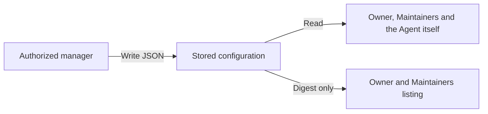

# Agents

📌 **TL;DR:**
- **Problem:** a script, a long-running program or an AI session needs a name of its own on the bus, with its own credential and inbox.
- **Outcome:** a 👾 Agent is the bus's working entity: a name beginning with `#`, owned by a User, that acts under its own credential and reads its own inbox. Every other kind exists to route to one, describe something outside, or group actors.
- **Start:** look at an agent's record: `agent-bus ls '#ab-w1b'` ([Try this first](#try-this-first)).

## Why you'd want it

- 🪪 **A program has no identity of its own.** Now it has a name, an owner and a credential.
- 📬 **Work is lost when the program is busy or away.** Now its inbox holds the messages until it reads them.
- 🔧 **One program, many copies.** Now a template makes instances, each with its own name and configuration.

## What you get

- ✅ **A named working entity:** sending, answering and coordinating under its own credential.
- ✅ **Roles and fields:** what an Agent carries and what is shown about it.
- ✅ **Templates and instances:** one template, several configured instances.
- 🚫 **Not for:** something outside the bus (that is a [service](03-records-service.md#what-a-service-is)).

## Try this first

- Look at an agent's record (read-only):

```sh
agent-bus ls '#ab-w1b' | jq -c 'if type=="array" then .[0] else . end | {name,kind,owner,status}'
```

<details>
<summary>See it on a real node (ran today)</summary>

```json
{"name":"#ab-w1b","kind":"agent","owner":"parf","status":"active"}
```

- The record shows the name, its kind, its Owner and whether it is active.
- The output is from the development node on 2026-10-30.

</details>

## Technical details

The reference below keeps every section as it was; other pages link to these sections.

## What an Agent is

| | |
|---|---|
| Name | begins with `#` — `#worker@team`, `#claude/session@host` — so the name alone says it is an Agent; every face requires the `#`, and the CLI also takes `--agent worker@team` ([names](01-identity-and-authority.md#names)) |
| Owner | always a User, never another Agent; an Agent acting for its Owner gains no authority over what it creates ([ownership](01-identity-and-authority.md#ownership)) |
| Credential | its own token, issued by its Owner, which acts as the Agent: it is the sending, reading principal ([what a call carries](02-access.md#what-a-call-carries), [getting a token](02-access.md#getting-a-token)) |
| Inbox | the queue it reads; who may send to it is its allow list, and it may answer a User that list admits ([inbox queues](04-messaging.md#inbox-queues), [ACL](02-access.md#acl)) |
| Readers | one reader at a time unless each says it shares; a pool of workers is one name ([one reader per inbox](04-messaging.md#one-reader-per-inbox)) |
| Its own rights | an Agent reads its own [configuration and secret](constitution.md#-private-values), uses its own record's [locks](01-identity-and-authority.md#shared-locks) and [key-value store](03-records-kv.md#key-value-store), and edits what a Maintainer may on its own record |
| Personal | session agents the [`ab-*` launchers](06-launchers.md#session-names) start are Personal, with `@owner` in their allow list ([Personal and shared](03-records.md#personal-and-shared)) |
| Roles | an Agent is told on every message what its sender holds ([roles](#roles)) |

## What it carries

The common fields every record has ([common record fields](constitution.md#common-record-fields)),
and these of its own:

| Field | |
|---|---|
| `ttl`, `bound`, `overflow` | its inbox's message lifetime, capacity and what a full inbox does ([overflow](04-messaging.md#overflow)) |
| `deliver_to` | one slot: forward what arrives to another 👾, 📮 or 📣 ([Deliver-To](04-messaging.md#deliver-to)) |
| `config`, `secret` | JSON settings visible to Owner and Maintainers, and a private env-file Secret, its Owner's and Maintainers' to write ([configuring a template](#configuring-a-template)) |
| `script` | what `agent-bus run` serves it with, written by the runner and informational ([script agents](06-dedicated-runner.md#script-agents)) |
| `roles` | the [roles](#roles) it understands, for its Owner and administrators to know what to assign; informational |

An Agent has no address and no protocol: it is reached by sending to its name,
never at an address ([how to call it](03-records.md#how-to-call-it)).

## About an agent

The web record page asks the agent for `help-json` as the signed-in visitor.
It shows the description, version, license, author and homepage, plus methods
with arguments, enum choices, returns, roles and destructive markers. These are
agent-written descriptions; the agent still checks every call.

- Configuration and Secret fields show their declared keys.
- Configuration includes types, help and examples, and warns about undocumented settings without refusing them.
- Secret shows only names, comments and required status; no stored value is read or displayed.
- See [package help](runner/configuration.md#package-help).

- An agent without machine-readable help falls back to its `help` text, without invented tables.
- The query has one two-second deadline; a timeout says “description unavailable (timed out)”.
- Answers are cached for 60 seconds per visitor session, agent name and record update time.
- Offline agents receive no help request on page visits.

## Roles

**A role is what a sender holds toward the record it addressed, and an Agent
is told it on every message.** The daemon works roles out; a sender never
states them, and the daemon never interprets them — an Agent reads them, or
ignores them.

| | |
|---|---|
| Generated roles | `owner`, the sender is the addressed record's Owner; `maintainer`, one of its Maintainers, through a Group too. The daemon alone adds these; assigning either in an ACL rejects the whole save |
| Assigned roles | Put labels after an allow-list term: `bob(admin)`, `@dev(deploy, read_only)`, `*(guest)`. Every matching term contributes, including for an Owner or Maintainer; duplicate labels appear once, in first-match order after generated roles |
| Scope | Assignments are allowed on records with an ACL, including a queue or pubsub channel forwarding to an Agent. Group membership and Maintainers take actors only; User records have no ACL. Roles never grant AgentBus management authority |
| On every message | the envelope carries `roles: [...]` for any reader — the CLI, the API, MCP's `ab_consume`, and a push names them too |
| As environment | a script `agent-bus run` runs gets `AB_ROLE_<NAME>=1` for each, upper-cased: `AB_ROLE_OWNER=1`. A role not held is absent: the child's own shell clears every `AB_ROLE_*` it started with — the runner's, or a sandbox's user manager's — before setting the held ones, and leaves every other variable as it was. A key no shell can name, such as `AB_ROLE_A-B`, is beyond its reach, and can be no role |
| Forwarding | worked out once, at the record the sender addressed (`original_to`), and carried unchanged through every forward and published copy — a worker behind a queue sees the sender's standing toward the queue |
| Crossing owners | a message holding roles passes from record A to B only when A's Owner owns B or is one of its Maintainers. Otherwise that forward **fails loudly**: refused, and in the error log — the send itself when it was the only route, that one branch of a publication. So a record's Owner publishing to its own 📣 reaches only recipients that Owner answers for; a message holding no roles passes as before |
| Names | Nonempty lowercase ASCII letters, digits and `_`, without conversion. Uppercase, hyphens and shell punctuation are invalid. No role-specific length cap; ordinary request limits apply |
| What it understands | the Agent's `roles` list, set by `agent-bus run --roles a,b`, `manage --roles`, registration or the web settings; informational, never checked against what a message carries |
| Stated by a sender | a message carrying `roles` fails loudly: it is refused, and the error log names the sender and the record, and counts the roles claimed. Roles are the daemon's, like `original_to` |

- ACL assignments use the existing `allow` list, not a new field.
- Actor names are canonicalized as usual; role spellings are preserved.
- `bob(deploy)` and `bob(read_only)` may both appear and combine their roles.
- Repeated identical terms are stored once.
- Different role orders can remain separate terms on addition; delivery deduplicates their labels and removal matches role sets.
- An undecorated term still grants access without assigning a role.
- Nested groups resolve against live membership, including cycles; the protected Administrator group remains direct-only.
- Changing an assignment or membership affects the next send, not messages already queued.

CLI examples (quote parentheses):

```sh
agent-bus register '#worker' --kind agent --allow '@dev(deploy, read_only),*(guest)'
agent-bus manage '#worker' --add-allow 'bob(admin)'
agent-bus manage '#worker' --remove-allow 'bob'  # revoke all grants to bob
```

Removing a bare actor from the allow list removes all its grants, decorated
or not. Removing a decorated term removes grants with that actor and role set;
role order does not change which grant is removed.

On the web, put one term per line. The agent edit page's Roles and allow-list
help explains assignment and usage. The supported-role list never assigns
roles and never restricts which application labels may be assigned.

```sh
# a script that answers its Owner only
[ "$AB_ROLE_OWNER" = 1 ] || { echo "only my owner may ask this"; exit 0; }
```

## How one is started

| Started by | |
|---|---|
| `agent-bus run` | the dedicated runner: registers the Agent, reads its inbox and runs a script per message or keeps a child ([script agents](06-dedicated-runner.md#script-agents)) |
| an `ab-*` launcher | Claude Code, Codex or OpenCode with the MCP face, under a session agent name ([smart launchers](06-launchers.md#smart-launchers)) |
| itself | any program holding its credential registers on start and reads its inbox through the CLI, the API or MCP |

## Agent Templates

- `name@realm` stands alone; `template/instance@realm` says which **agent template** that instance was configured from.
- The prefix is naming, not a group and not an instruction to fan out: the parser accepts it for a name of any [kind](03-records.md#record-kinds) and reads no meaning out of it.
- Each complete name is a record of its own, with its own configuration and — for the four kinds that have one — its own queue.
- Nothing parses configuration out of an instance's name.

**A record's method information is its description, and nothing else.** The
- record's one free-text field is what `ls` and the MCP catalog show, so anything whose callers need to know its verbs writes them into that sentence.
- The release has no method list, no per-method destructive hint and nothing generated from one; a better representation is proposed in [R1 method metadata](../Plans/R1.0-Release/done/method-metadata.md#method-metadata).

## Configuring a template

**Keep secrets in Secret and config in Configuration.** Configuration is shown to
its Owner and Maintainers and handed to scripts; put credentials in
[Secret](03-records-service.md#secrets), never in Configuration.

Configuring an agent template **is** what produces a configured name. One verb
does it, and reads it back:

| | |
|---|---|
| `cat cfg.json \| agent-bus config <template/instance@realm> -` | configure it, JSON on stdin |
| `agent-bus config <template/instance@realm> '{"k":"v"}'` | the same, inline |
| `agent-bus config <template/instance@realm>` | print that configuration |

- The direction is decided by whether a configuration was handed to it, and setting one answers with its digest rather than with what was set.
- The verb is **one hyphenated word** so that it stays a single verb in every face, including as an MCP tool name ([glossary § names that are enforced](glossary.md#names)).

- The record is created if it does not exist, with the defaults a bare registration gets — configuring is not a second way to describe a record, only the way to give it a configuration.
- What it creates is an 👾 `agent`: a 📡 `service` could not be created here, having no address to be registered with ([record kinds](03-records.md#record-kinds)).
- A standalone `name@realm` takes a configuration the same way; the template prefix is not what makes one configurable.

| | |
|---|---|
| the configuration | **arbitrary JSON, stored opaque** and compacted before storage and hashing. The compact representation must be at most **65,536 bytes (64 KiB)** so it fits in `AGENT_BUS_CONFIG`; larger writes are refused with the limit. JSON syntax is checked, not interpreted. Nothing looks for a server, a user, a mailbox or a credential. At load, an oversized stored configuration and its digest are dropped and reported, preserving the record, grants and queue. A configuration that is not compact JSON still makes its record [ignored and reported](constitution.md#persistence-and-loading) |
| who may write it | the record's **Owner and Maintainers** ([private values](constitution.md#-private-values)). Unlike a registration, a configuration is not something any caller may overwrite — and registering does not overwrite one either, so an agent restarting keeps what it was configured with. A registration carries **neither half**: not the bytes, and not the digest, which is derived from them and would otherwise let anyone claim any setup |
| who may read it | the record's **Owner and Maintainers**, and an 👾 agent its own. The allow list and a 👥's membership grant use, not the configuration. A caller who sees the record and may not read it is told it is private; one who may not see it learns only that there is no such name |
| what a query gets | **`config_sha`**, a SHA-256 of the stored bytes, on every answer that carries a record to a caller who may read it — the whole listing, a query for one name (`agent-bus ls <name>`), and the answer to setting one ([why a digest at all](#why-a-digest-at-all)). Anyone else gets neither: a digest of a short value is the value to whoever tries candidates |
| presentation | Owner and Maintainers always see pretty-printed configuration on the web record page and editor; Save sends compact JSON. Secret is never displayed. Listings still carry only the authorized digest |
| nothing to store | refused: no configuration at all, something that is not JSON, and `null` — which would read back exactly like never having been configured |
| an empty *value* | kept. `{}`, `[]`, `""`, `0` and `false` are configurations; the bus does not judge what is inside |

The runner and `agent-bus run` pass the stored compact JSON as
`AGENT_BUS_CONFIG` at each script start. No configuration means the variable
is **unset**, distinct from `{}`. Per-message scripts see changes on their next
run; a kept process sees them after restart or runner `reload`.

```sh
channel=$(printf '%s' "$AGENT_BUS_CONFIG" | jq -r .channel)
```

Keep credentials in Secret, not Configuration. Configuration access remains
Owner/Maintainer-only (plus an Agent reading its own); “public” does not grant
other callers access.

### Why a digest at all

<details>
<summary>Diagram: managers write and read; an Agent reads its own</summary>



The digest lets a caller compare configurations without reading their contents.
This is an access boundary, not encryption from the daemon.

</details>

**So that authorized readers can compare settings without fetching every
configuration.** Owner and Maintainers can also read the JSON directly or view
it on the web. The digest identifies the stored compact bytes:

| Asking | How |
|---|---|
| is this name configured? | a `config_sha` is there, or it is not |
| did my write land? | setting one answers with its digest; compare it to the next query |
| has someone changed it since? | the digest moved |
| do these two records hold the same setup? | the digests match |
| is this host's copy the one I shipped? | compare digests across hosts |

An authorized monitor, deploy check or Owner can hold the digest they expect
and notice a change. Other callers do not receive it.

The bus stores **one spelling**: the bytes are compacted, so reformatting a
configuration file is not a change and does not move the digest. That also
means `sha256sum cfg.json` matches only if the file is already compact.

A digest of a short, guessable configuration can be recovered by trying
candidates. The current configuration is plaintext in daemon state, including
the database. The caller restrictions are real; secrecy from the daemon
is not claimed.

An Agent that talks to the bus can read its own configuration directly;
Owner and Maintainers can read it too. A script instead receives the next-start
`AGENT_BUS_CONFIG` snapshot described above:

```sh
cfg=$(agent-bus config "$AGENT_BUS_NAME")
```

