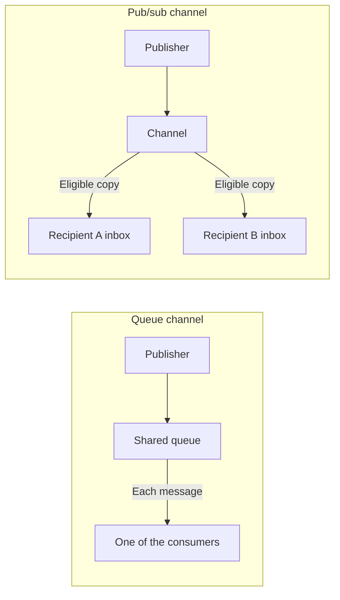

# Channels

📌 **TL;DR:**
- **Problem:** messages sometimes go to a place, not to a person, and a "topic" word used for both the place and a label causes confusion.
- **Outcome:** two of the seven record kinds are channels: 📮 hands each message to one consumer, 📣 copies each publication to every name on its Deliver-To list. A channel is the record; a topic is only a label carried on one message.
- **Start:** read [channel, not topic](#channel-not-topic) first. What a channel declares and what publishing puts on the message are owned here.

## Why you'd want it

- 🏷️ **"Topic" means two things.** Now a channel is the record, and a topic is only a label on one message.
- 📮 **Several workers must share a stream of jobs.** Now a 📮 queue gives each message to exactly one consumer.
- 📣 **Many readers must all see an announcement.** Now a 📣 pubsub copies each publication to every name on its list.

## What you get

- ✅ **Two channel kinds:** a queue for one consumer, a pubsub for every subscriber.
- ✅ **A declared shape:** what a channel states about itself.
- ✅ **A stamped message:** what publishing adds to a message.
- 🚫 **Not for:** labelling one exchange; that is a topic on a message.

## Try this first

- See the exact words for sending with a label (read-only):

```sh
agent-bus help send
```

## Technical details

The reference below keeps every section as it was; other pages link to these sections.

## Channel, not topic

**A channel is the record; a topic is a label on one message.** One word
cannot be both: `send --topic t` labels a
message inside an exchange, while the thing published *to* is a record with an
owner, an ACL and a queue.

| | Is | Spelled |
|---|---|---|
| **Channel** | a 📮 or 📣 [record](03-records.md#record-kinds) | `register --kind=queue|pubsub`, `publish --channel`, `unsubscribe <channel>`, and `channel` on the wire |
| **Topic** | a label on one [envelope](04-messaging.md#envelope), matched by a filtered read | `send --topic`, `consume --topic`, `reply --topic`, and `topic` on the wire |

The old spellings are not kept as aliases: before R1.2 there is no compatibility
obligation, and a second name for one thing is a second thing to explain.

## The two channel kinds

A channel is registered like any other record and is **first-class** in the
same registry. Two of the [seven kinds](03-records.md#record-kinds) are
channels — the Redis model:

| Kind | Delivery | Retention | No recipients at publish time | Redis analogue |
|---|---|---|---|---|
| 📮 **queue** | each message to **one** consumer (competing consumers take turns) | until consumed or **TTL**; bounded; overflow per its policy | fine — it waits for its TTL | list + `BRPOP` + `EXPIRE` |
| 📣 **pub/sub** | a **copy** to every name on its Deliver-To list, into that name's own inbox ([messaging § Deliver-To](04-messaging.md#deliver-to)) | none of its own — each copy is kept by the inbox it is in | dropped, a no-op | `PUBLISH` / `SUBSCRIBE` |

<details>
<summary>Diagram: one consumer versus recipient copies</summary>



Each recipient is checked again at publication, and `@group` entries are
expanded then. A copy that an inbox refuses is dropped; the other recipients
still receive theirs. With no eligible recipients, the 📣 channel retains
nothing.

</details>

## What a channel declares

A channel **declares its kind at creation** — a 📮 its TTL, bound and overflow
policy, a 📣 its [Deliver-To list](04-messaging.md#deliver-to):

| Aspect | Behavior |
|---|---|
| Create and change | [Ownership](01-identity-and-authority.md#ownership) applies |
| Visibility and use | [Audience](05-discovery.md#audience) and the record ACL apply — on a 📣 the ACL is who may publish, and delivery follows its [Deliver-To list](04-messaging.md#deliver-to) |
| Storage | [Restart persistence](04-messaging.md#durability), with messages in memory |
| Observations | [Listing state](05-discovery.md#what-a-listing-answers) |

Inboxes belong to registered names ([messaging § inbox queues](04-messaging.md#inbox-queues)). Signed records are [R1.1 work](../Plans/R1.1/registry.md#registry-sync).

## What publish puts on the message

`publish` stamps the **channel's own name as the message's topic**, so the two
words meet on one envelope exactly once and deliberately:

```sh
agent-bus publish --channel alerts@srv1 "disk nearly full"
#   To:    alerts@srv1     the channel it went to
#   Topic: alerts@srv1     the label it carries
```

A recipient can then pick out copies that came from that channel with a
filtered read, `consume --topic alerts@srv1`, without needing a second field.
Nothing else fills the topic in for a publication, and an ordinary `send` never
does it at all.
