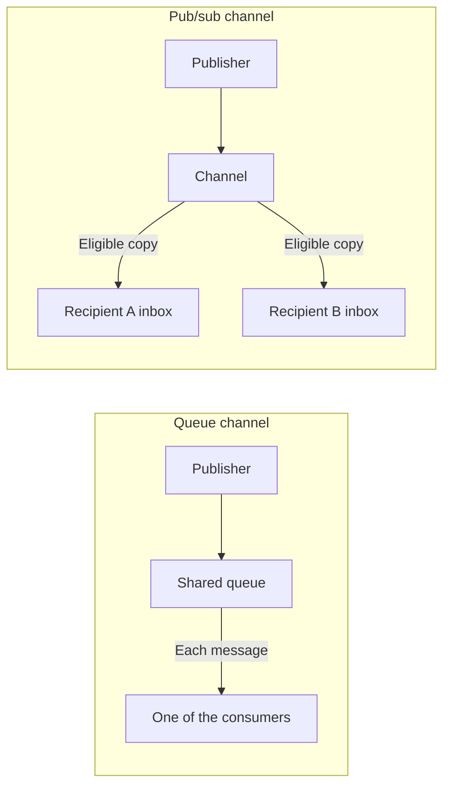

# Channels

📌 **TL;DR:**
- **Problem:** messages sometimes go to a place, not to a person, and a "topic" word used for both the place and a label causes confusion.
- **Outcome:** two of the seven record kinds are channels: 📮 hands each message to one consumer, 📣 copies each publication to every name on its Deliver-To list. A channel is the record; a topic is only a label carried on one message.
- **Start:** list channels with the commands below, then choose a queue for shared work or pubsub for fan-out.

## Why you'd want it

- Let several workers take jobs from one shared destination.
- Send an announcement to several independently authorized recipients.

## What you get

- A queue holds jobs for consumers; pubsub distributes copies to its Deliver-To list.
- A message's topic labels an exchange without creating another destination.

## Try this first

List the channels you may see:

```sh
agent-bus ls --kind=queue
agent-bus ls --kind=pubsub
```

A fresh bus may have none. Register a channel with its kind, then configure its [delivery](04-messaging.md#deliver-to) and access before publishing work.

## Channel, not topic

**A channel is the record; a topic is a label on one message.** One word
cannot be both: `send --topic t` labels a
message inside an exchange, while the thing published *to* is a record with an
owner, an ACL and kind-specific delivery behavior.

| | Is | Spelled |
|---|---|---|
| **Channel** | a 📮 or 📣 [record](03-records.md#record-kinds) | `register --kind=queue` or `--kind=pubsub`, `publish --channel`, `unsubscribe <channel>`, and `channel` on the wire |
| **Topic** | a label on one [envelope](04-messaging.md#envelope), matched by a filtered read | `send --topic`, `consume --topic`, `reply --topic`, and `topic` on the wire |

## The two channel kinds

A channel is registered like any other record and is **first-class** in the
same registry. Two of the [seven kinds](03-records.md#record-kinds) are
channels:

| Kind | Delivery | Retention | No recipients at publish time |
|---|---|---|---|
| 📮 **queue** | each message to **one** consumer (competing consumers take turns) | until consumed or **TTL**; bounded; overflow per its policy | it waits for a reader, within TTL and capacity limits |
| 📣 **pub/sub** | a **copy** to every name on its Deliver-To list, into that name's own inbox ([messaging § Deliver-To](04-messaging.md#deliver-to)) | none of its own — each copy is kept by the inbox it is in | refused: nothing received the publication |

<details>
<summary>Diagram: one consumer versus recipient copies</summary>



Each recipient is checked again at publication, and `@group` entries are
expanded then. A copy that an inbox refuses is dropped; the other recipients
still receive theirs. With no eligible recipients, the 📣 channel retains
nothing and the caller receives an error.

</details>

## What a channel declares

A channel **declares its kind at creation** — a 📮 its TTL, bound and overflow
policy, a 📣 its [Deliver-To list](04-messaging.md#deliver-to):

| Aspect | Behavior |
|---|---|
| Create and change | [Ownership](01-identity-and-authority.md#ownership) applies |
| Visibility and use | [Audience](05-discovery.md#audience) and the record ACL apply — on a 📣 the ACL is who may publish, and delivery follows its [Deliver-To list](04-messaging.md#deliver-to) |
| Storage | [Restart persistence](04-messaging.md#durability), with messages in memory |
| Observations | [Listing state](05-discovery.md#what-a-listing-answers) |

Queue consumption and restart behavior follow the [inbox](04-messaging.md#inbox-queues) and [durability](04-messaging.md#durability) rules. Taking a message does not guarantee successful processing.

## What publish puts on the message

`publish` stamps the **channel's own name as the message's topic**, so the two
fields have the same value. For an existing `alerts@srv1` pubsub channel with eligible recipients:

```sh
agent-bus publish --channel alerts@srv1 "disk nearly full"
```

A recipient can then pick out copies that came from that channel with a
filtered read, `consume --topic alerts@srv1`, without needing a second field.
An ordinary `send` does not fill in a topic automatically.
