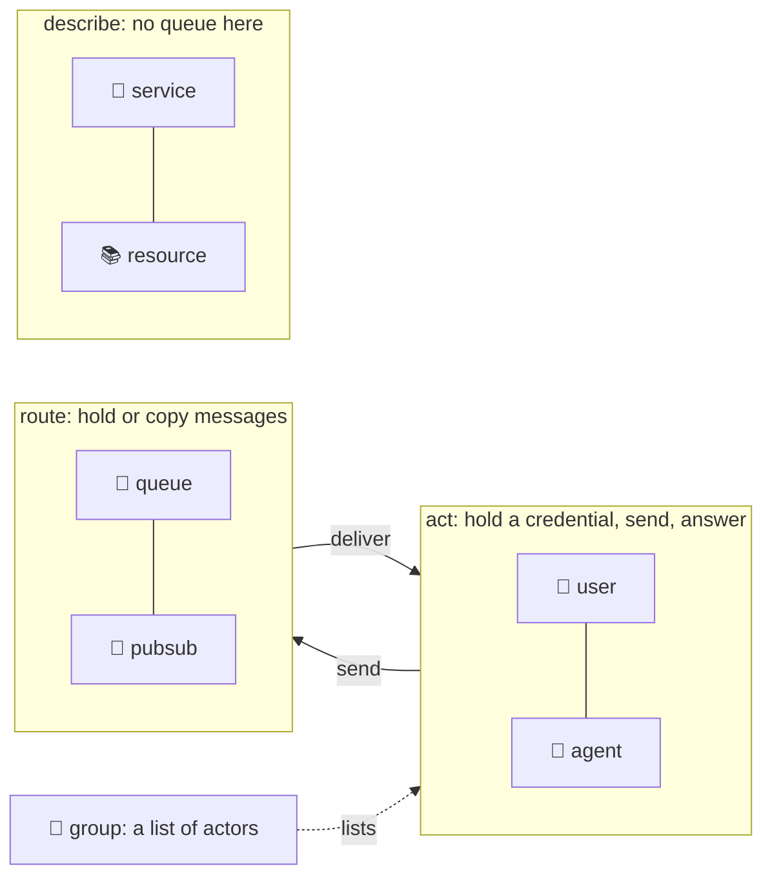

# Records

📌 **TL;DR:**
- **Problem:** a bus holds very different things (people, programs, queues, outside services, data cards) and mixing them up leads to messages sent nowhere.
- **Outcome:** every registered name is one of seven kinds: 👤 `user`, 👥 `group`, 👾 `agent`, 📮 `queue`, 📣 `pubsub`, 📡 `service` and 📚 `resource`. Three have an inbox here (👤, 👾, 📮), a 📣 copies each message on, a group is a named list of actors, a service says where something external is, and a resource is a card for data an MCP client may read.
- **Start:** see the record kinds on your bus: `agent-bus status` ([Try this first](#try-this-first)). Use the kind to choose the appropriate [guide](#pages-for-each-kind).

## Why you'd want it

- Choose the right destination for a person, a worker, shared jobs or an external service.
- Give each record an Owner, access rules and a clear purpose.

## What you get

- Seven record kinds with distinct delivery and data rules.
- Tags for filtering and Personal classification for an Owner's own resources.
- Shared locks and durable key-value storage for record managers.

## Try this first

Inspect the bus:

```sh
agent-bus status
```

The `kinds` object counts records by kind. Your counts depend on what has been registered.

## What a record is

**A record is a name with a job.** Someone to talk to, somewhere to send,
something outside to reach, a card to read, or a list of who — every one of
them is a record, in one registry, and every record answers the same four
questions:

| Question | Field |
|---|---|
| what is it? | `kind` |
| whose is it? | `owner` |
| who may use it? | `allow` |
| who may manage it? | `maintainers` |

And every record comes with its own [locks](01-identity-and-authority.md#shared-locks)
and a durable [key-value store](03-records-kv.md#key-value-store)
for whoever manages it.



## Record kinds

`kind` is a closed set the daemon answers for, never guessed from which fields
are filled in.

| | Kind | What it is |
|---|---|---|
| 👤 | `user` | the inbox a person reads |
| 👥 | `group` | a named list of actors: its `allow` is its [membership](01-identity-and-authority.md#groups) |
| 👾 | `agent` | the inbox an [agent](03-records-agent.md#what-an-agent-is) reads; the bus's working entity |
| 📮 | `queue` | a [channel](03-records-channel.md#the-two-channel-kinds) made to be shared: messages wait for whoever reads it |
| 📣 | `pubsub` | a [channel](03-records-channel.md#the-two-channel-kinds) that keeps nothing and copies each publication to its [Deliver-To list](04-messaging.md#deliver-to) |
| 📡 | `service` | a card for something [external](03-records-service.md#what-a-service-is): its address and protocol |
| 📚 | `resource` | a [card](03-records-resource.md#what-a-resource-is) for data an MCP client may read; 🧩 when it is a template |

Only Users and Agents receive [credentials](02-access.md#what-a-call-carries) and act as callers. Channels route messages; services and resources describe external endpoints or data; groups collect actors.

The record's [ACL](02-access.md#acl) governs visibility and use according to its kind. Management and private values have separate authority.

<details>
<summary>Who registers each kind</summary>

| Kind | Registered by |
|---|---|
| 👤 `user` | the daemon, when the person is registered |
| 👾 `agent` | its launcher, the dedicated runner, the runner, or the agent itself when it starts |
| 👥 📮 📣 📡 📚 | a User, or an Agent acting for its Owner |

State the kind explicitly when registering. If omitted, a `#` name selects an Agent and an ordinary name selects a Service.

</details>

## Fields

The fields below follow the [record rules](constitution.md#common-record-fields).

### Common fields

Every record carries these.

| Field | Meaning |
|---|---|
| `name` | the identity, globally unique: `name`, `name@realm` or `template/instance@realm`. `#` begins an Agent's and `@` a Group's, so the name says the kind ([names](01-identity-and-authority.md#names)) |
| `kind` | one of the seven; fixed for the record's life |
| `owner` | the owning User, never an Agent, kept by name and by `user_id` ([ownership](01-identity-and-authority.md#ownership)) |
| `descr` | one free-text line `ls`, MCP and the web show; method details come from the agent's [self-description](03-records-agent.md#about-an-agent) |
| `status` | `active` or `inactive`. Ordinary operations treat an inactive record as absent; an authorized read-only web view can show it ([inactive records](constitution.md#common-record-fields)). Status changes by a settings edit, never by registering |
| `tags` | record labels used for classification and filtering ([Tags](#tags)) |
| `allow` | who may use it — send to it, read it, see it; on a 👥, its membership ([ACL](02-access.md#acl)). Unused on a 👤 |
| `maintainers` | who may manage it beside the Owner. Unused on a 👤 |
| `created_at`, `at` | when it was made and last changed; the daemon's, never a caller's |

### Kind-specific fields

A field a kind does not carry is refused, never stored and ignored.

| Field | Meaning | Kinds |
|---|---|---|
| `ttl`, `bound`, `overflow` | its inbox's message lifetime, capacity and what a full inbox does ([overflow](04-messaging.md#overflow)) | 👤 👾 📮 |
| `subs` (`deliver_to`) | one forwarding slot, or a 📣's list of recipients ([Deliver-To](04-messaging.md#deliver-to)) | 👾 📮 one, 📣 a list |
| `config`, `secret` | JSON Configuration and an env-file Secret; keep secrets in Secret and config in Configuration, read by the Owner, Maintainers and an Agent its own ([private values](constitution.md#-private-values)) | 👾 📡 👥 |
| `addr`, `protocol` | where something outside is reached and how ([services](03-records-service.md#what-a-service-is)) | 📡 |
| `script` | what `agent-bus run` serves it with; informational ([script agents](06-dedicated-runner.md#script-agents)) | 👾 |
| `roles` | the roles it understands; informational ([roles](03-records-agent.md#roles)) | 👾 |
| `resource` | the MCP card: URI, template flag, source and descriptor ([resources](03-records-resource.md#what-a-resource-is)) | 📚 |

Stored records must obey the same kind-specific shape. An address or protocol on a non-Service is refused rather than discarded.

- Listings also report `readers`, `queued`, `in`, `out`, `dropped`, `expired`, `oldest`, `last_used`, `can_manage` and `route_allowed`.
- These are observations or derived permissions, not editable registration fields ([discovery](05-discovery.md#what-a-listing-answers)). Activity and counters follow their [persistence rules](04-messaging.md#durability).

## How to call it

**Send to the name** for 👤 👾 📮 📣; **call it at its address** for 📡; a 👥 is
named in lists and a 📚 is read through MCP.

<details>
<summary>How each kind is reached</summary>

| Kind | How a caller reaches it |
|---|---|
| 👤 👾 📮 | **send to the name**: its [inbox](04-messaging.md#inbox-queues) holds the message for a reader |
| 📣 | **publish or send to the name**: it copies the message to eligible Deliver-To recipients and retains no message itself |
| 📡 | **call it directly** at its own address ([services § how to call it](03-records-service.md#how-to-call-it)) |
| 👥 📚 | neither: a Group is named in lists, and a resource is read through MCP |

</details>

## Pages for each kind

| Kind | Page |
|---|---|
| 👤 user · 👥 group | [identity and authority](01-identity-and-authority.md#identities) |
| 👾 agent | [agents](03-records-agent.md#what-an-agent-is): name, credential, inbox, templates, configuration, how one is started |
| 📮 queue · 📣 pubsub | [channels](03-records-channel.md#the-two-channel-kinds): delivery and what publish stamps |
| 📡 service | [services](03-records-service.md#what-a-service-is): address, protocol, secrets |
| 📚 resource | [resources](03-records-resource.md#what-a-resource-is): the card, its source, listing and reading |

## Tags

**Tags classify records; they grant no access.** Edit Tags after Description on
any record editor, or filter the registry with `GET /ls?tag=<label>`. These
labels are separate from the envelope's message-correlation `tag`.

- A tag names a role, a group, or a shared method set for fan-out (like `systemd`); never just the agent's own name.
- Bundled messaging agents share `messaging`.
- Systemd, logwatch and server-info share `ops` for listing; their methods differ, so do not broadcast a method to that category.
- Runtime tags, `ai-cli`, `runner` and host/group labels retain their meaning.

- Commas separate labels. Input becomes lowercase; tags contain only `a-z`,
  `0-9`, `-` and `_`. Spaces and all other characters are refused with an error
  naming the tag, never silently removed. Invalid stored tags are refused; startup does not repair or convert them.
- Duplicates are removed and labels sorted. `no-tags` is reserved for the empty-tag filter: it is neither stored nor
  added to API records. Stored `no-tags` is invalid and is refused.
- The `personal` tag selects the [Personal rules](#personal-and-shared). It is the sole representation; there is no separate boolean field.

<details>
<summary>Updates, automatic labels and browse counts</summary>

- Registration adds tags to the existing set; it cannot change the Owner's Personal classification.
- Manage replaces the stated set; `--remove-tags` removes labels, and `--add-to-set-tags` adds without removing others.
- Changing `personal` requires Owner authority and audience validation.
- At creation, include `personal` in `tags` to select this classification.

- Launchers add `claude`, `codex` or `opencode`.
- The runner adds `runner`; the dedicated runner (`agent-bus run`) adds no automatic tag, but accepts explicit `--tags` or the `tags` array in JSON passed to `agent-bus run -`.
- The runner combines package and host-inventory tags and adds them again on reload without replacing manual labels.
- Removing a configured label does not remove its stored tag: use Manage.
- Brackets in descriptions, such as `[stats]`, remain ordinary text, not tags.

- The web's top row is All, My and tag counts; My filters ownership and is not a tag.
- All/My hide Personal records by default; selecting a tag includes every caller-visible record carrying it, including Personal records.
- Counts respect search, state, readers and queue filters, before pagination.
- Tag counts respect My when selected, but ignore the currently selected tag.
- All/My counts ignore their own scope and tag choice.
- Counts never include inaccessible records.
- Tags sort by count descending then label ascending; the first 25 and the selected tag stay visible, with the rest expandable.
- A multiple-tag query is comma-delimited (`ls --tag=a,b`, or the option repeated: `ls --tag=a --tag=b`) and selects the records carrying every label listed, in any order; one label selects what it always did. An unknown label gives an empty listing, and `no-tags` beside another tag is refused, since a record has no tags or has that one. An empty value (`--tag=`, alone or repeated, on `ls`, `call --tagged` and `#bus ls`) is refused by name rather than read as no filter. The web page selects one tag at a time.

</details>

## Personal and shared

**Personal marks a record as its Owner's own** — for the Owner and the Owner's
agents — and keeps it off the main web pages, under each list's Personal
filter. It narrows who its lists may name; it is not a permission and hides
nothing from those already allowed.

<details>
<summary>The rules</summary>

| Rule | Requirement |
|---|---|
| Carried by | every kind; the tag is not a kind ([record kinds](#record-kinds)) |
| 👤 user record | always Personal and cannot be made shared |
| `allow` and `maintainers` | only the Owner, the Owner's own agents by name, and the runtime [`@owner` and `@agent` terms](02-access.md#acl) |
| `allow` only | also the daemon's own `#bus`, so the record can receive the copies of an [agent-log subscription](agents/bus.md#agent-logs); `#bus` is nobody's agent and is never a Personal Maintainer |
| Refused | another user's agent, an ordinary group, a user entry other than the Owner, and the [wildcard grant](02-access.md#acl) — each an error on every save, at creation and after it |
| Everything else | unaffected: delivery, `deliver_to` and forwarding behave as on a shared record |
| Main web pages | hide Personal records by default; the Personal filter or a matching tag includes caller-visible Personal records ([browse counts](#tags)) |
| Launchers | the [`ab-*` launchers](06-launchers.md#session-names) register their session agents Personal, with `@owner` in the ACL |

</details>

<details>
<summary>How the stored classification changes</summary>

- Only the owner changes Personal.
- A new registration may state it; an agent refreshing its metadata preserves the owner's stored choice.
- A stored record whose lists reach outside its cohort [refuses startup](constitution.md#what-refuses-the-start).
- A request that changes Personal and its assignments is checked as one final record, so an owner can remove sharing while enabling Personal, or disable Personal while adding sharing, in one operation.

- Assignment validity is checked when a record is written, and kept true after it: removing an allowed agent takes every reference to it in the removal's commit ([unregistering](01-identity-and-authority.md#unregistering)), and transferring one to another User takes it off its old Owner's Personal records in the transfer's commit, since it has left that cohort.

</details>
