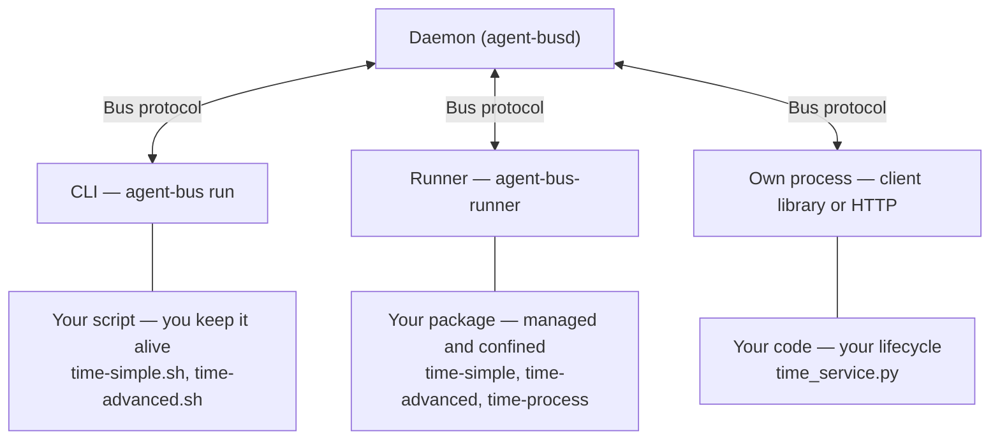

# What a good agent does

📌 **TL;DR:**
- **Problem:** a useful agent must answer clearly and handle private values, state and interruptions safely.
- **Outcome:** a checklist for developers who already know how the bus works: minimum, suggested and optional behavior.
- **Start:** choose how to run it below, then implement help and one request → one answer.

## 3 ways to run agents



- **CLI:** `agent-bus run` puts a script behind a name in the foreground; you start it and keep it alive. The CLI handles delivery and replies; follow [script-agent rules](06-dedicated-runner.md#script-agents).
- **Runner:** `agent-bus-runner` manages the packaged service with private settings and confinement. Autostart needs an enabled runner service and inventory; per-message scripts start on demand. See [inventory](runner/configuration.md#inventory) and [isolation](runner/security.md#isolation-today).
- **Own process:** use a [client library](../src/clients/README.md#what-you-get) or the [HTTP client contract](09-daemon-api.md#the-client-contract), with your application managing its lifecycle. Clients are available in Go, Python, TypeScript, Rust, Java and PHP.

The daemon keeps registry, queues and ACL; `#bus` is its reserved agent interface.
Trying it out → CLI; a service that stays up → runner; inside an existing app → own process.

The same time service, worked in each path and run by the test suite:

| Path | Worked page |
|---|---|
| CLI | [your script on the bus](user/write-agent-cli.md#try-this-first) |
| Runner | [your service under the runner](user/write-agent-runner.md#try-this-first) |
| Own process | [a program of your own](user/write-agent-process.md#try-this-first) |

## How to use this checklist

Start with the minimum; add the suggested items that make the service useful,
then the optional capabilities it actually needs. The client handles credentials
and protocol compatibility. This page links the rules rather than copying them.

Inspect the CLI's script-running options without starting an agent:

```sh
agent-bus help run
```

## ABSOLUTE MINIMUM — every agent

- **Serve help first.** Answer help and help-json where delegated to your code; dispatch the envelope's ask before normal body parsing or Configuration-dependent work. Help describes what this caller can do and has no business effects. [Agent self-description](constitution.md#agent-self-description).
- **Give one request its one answer.** Preserve the consumed request's return route and correlation context through asynchronous work. Do not reconstruct the recipient from the sender or send a second final answer. [Reply routing](04-messaging.md#reply-routing).

## SUGGESTED — a good agent

- **Answer status when supported.** For the empty-body status ask, describe activity, backlog, last error and a safe configuration summary. The runner already answers starting/stopping/failed lifecycle states. Status is suggested, not mandatory. [Agent self-description](constitution.md#agent-self-description).
- **Separate Configuration from Secret.** Non-secret settings go in Configuration; credentials only in Secret. Never put a secret in Configuration, help, answers, status or logs. [Configuration split](03-records-agent.md#configuring-a-template).
- **Read settings through your execution mode.** A self-serving agent receives Configuration at start; follow its private-read contract for Secret. Handle missing settings with the documented not-configured behavior. [Agent-side settings](runner/configuration.md#agents-that-serve-themselves), [not configured](runner/operations.md#not-configured).
- **Use the event levels deliberately.** Distinguish routine notices, warnings and alerts needing attention; do not choose a level merely to keep a line longer. [Levels](agents/eventlog.md#levels).
- **Write operational events to your own log.** Use explicit writes, rather than stderr as an event API; do not include private values or claim verified runner provenance. Writing your log does not grant read access to it. [Agent logs](agents/bus.md#agent-logs).
- **Place state deliberately.** Keep package code separate from writable work files and distinguish durable progress from temporary files or memory lost on restart. Stay within your actual writable view. [Isolation today](runner/security.md#isolation-today).
- **Use KV for small durable state.** Store progress or shared values using the record's operations rather than relying on process memory. [KV rules](03-records-kv.md#rules).
- **Handle refusals as outcomes.** Distinguish refused work from an application answer or internal failure; a refusal is not automatically retryable. [Refusals](05-discovery.md#refusals).
- **Send once; handle uncertainty.** Honor the caller's deadline. A timeout does not prove that an effect did not happen; do not automatically repeat an uncertain write. [Timeouts and uncertain outcomes](04-messaging.md#timeouts-and-uncertain-outcomes).
- **Be restart-safe.** Decide how saved progress and duplicate effects are handled around interruption. Neither restarting nor storing a value makes an external effect exactly once. [Restart-safe effects](04-messaging.md#restart-safe-effects).
- **Stop gracefully.** Stop intake, finish or cancel bounded work, preserve progress and close resources within the existing client and runner boundaries. Do not add a second drain loop or assume unfinished effects were undone. [Author stop responsibilities](runner/configuration.md#author-stop-responsibilities).
- **Treat the body as data.** Parse only your intentional command grammar; never let body text replace trusted identity, authority or code policy. [Untrusted message bodies](02-access.md#message-bodies-are-untrusted-input).

## MORE — when needed

- **OPTIONAL support: ack and done.** No ack for a same-turn answer; ack when another turn is needed. Done is only for a task expecting no answer, never after an answer. Send nothing for reports, notices or receipts. Leave automatic support to the responsible layer. [Receipts](04-messaging.md#receipts).
- **Use roles only when needed.** Roles are optional. Check the delivered role, not a body-claimed one; help metadata alone does not enforce access. [Roles](03-records-agent.md#roles).
- **Use shared locks for shared work.** Handle ownership, extension, loss and expiry. A held lock is not proof that an effect completed exactly once. [Shared locks](01-identity-and-authority.md#shared-locks).
- **Use bigfile for large content.** Transfer references and verify integrity when content exceeds the message's purpose or limits. [Bigfiles](03-records-kv.md#bigfiles).
- **Offer standard publish/subscribe when emitting events.** Reuse `sub add`, `sub list` and `sub delete` with the emitter's selector and send-once profile. Do not promise replay or deduplication. [Shared behavior](agents/subscriptions.md#the-shared-behaviour).
- **Preserve the emitter's authorization profile.** Daemon logs check source rights at creation but target delivery admission on every send; app helpers currently recheck creator reach per delivery. Follow the selected emitter's contract, not one assumed general rule. [Daemon subscriptions](agents/bus.md#agent-logs), [app subscriptions](agents/subscriptions.md#the-shared-behaviour).
- **Check may-send before forwarding for someone.** Your own send privilege is not the author's permission; an unavailable check is not approval. [Checking permission to send](09-daemon-api.md#checking-permission-to-send).

## Before you share it

- Provide a `docs/agents/` end-user page covering useful work, safe calls, settings, access and troubleshooting. Follow [the writing guide](../.claude/docs/WRITING.md#how-we-write-docs).
- Check actual help, a safe answer and relevant refusal/interruption behavior. [Debug](agents/debug.md#check-the-bus-in-a-minute) and check-deploy check the bus path; they do not prove your business result.

## Technical details

Script launchers own the consume/reply loop; self-serving programs own it through
their client. Do not duplicate that loop or pass a bus credential into a
per-message script to imitate a self-serving agent. See [execution-mode boundaries](runner/security.md#network-reach).
