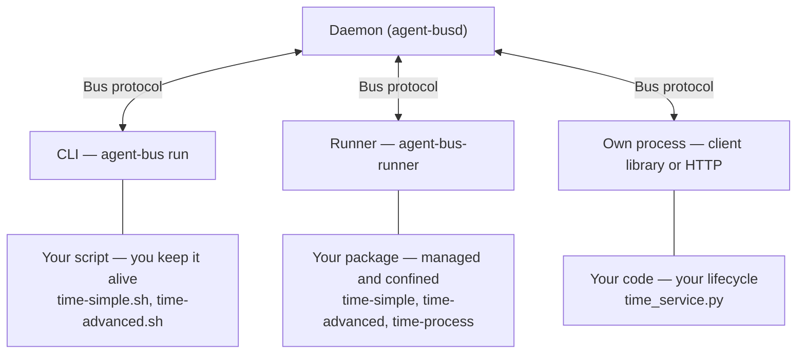

# What a good agent does

📌 **TL;DR:**
- **Problem:** a useful agent must answer clearly and handle private values, state and interruptions safely.
- **Outcome:** a checklist for developers who already know how the bus works: minimum, suggested and optional behavior.
- **Start:** choose how to run it below, then implement help and one request → one answer.

## 3 ways to run agents



- **CLI:** `agent-bus run` puts a script behind a name in the foreground; you start it and keep it alive. The CLI handles delivery and replies; follow [script-agent rules](06-dedicated-runner.md#script-agents).
- **Runner:** `agent-bus-runner` manages the packaged service with private settings and confinement. Autostart needs an enabled runner service and inventory; per-message scripts start on demand. See [inventory](runner/configuration.md#inventory) and [isolation](runner/security.md#isolation-today).
- **Own process:** use a [client library](../src/clients/README.md#what-you-get) or the [HTTP client contract](09-daemon-api.md#the-client-contract), with your application managing its lifecycle. Clients are available in Go, Python, TypeScript, Rust, Java and PHP.

The daemon keeps registry, queues and ACL; `#bus` is its reserved agent interface.
Trying it out → CLI; a service that stays up → runner; inside an existing app → own process.

The same time service, worked in each path and run by the test suite:

| Path | Worked page |
|---|---|
| CLI | [your script on the bus](user/write-agent-cli.md#try-this-first) |
| Runner | [your service under the runner](user/write-agent-runner.md#try-this-first) |
| Own process | [a program of your own](user/write-agent-process.md#try-this-first) |

## How to use this checklist

Start with help and a correct answer. Apply the safety requirements for the
capabilities you use, then add features that solve a caller’s actual problem.
A stateless calculator needs neither subscriptions nor a progress database.
The client handles credentials and protocol compatibility.

Inspect the CLI's script-running options without starting an agent:

```sh
agent-bus help run
```

## ABSOLUTE MINIMUM — every agent

- **Serve help first.** Answer help and help-json where delegated to your code; dispatch the envelope's ask before normal body parsing or Configuration-dependent work. Help describes what this caller can do and has no business effects. [Agent self-description](constitution.md#agent-self-description).
- **Give one request its one answer.** Preserve the consumed request's return route and correlation context through asynchronous work. Do not reconstruct the recipient from the sender or send a second final answer. [Reply routing](04-messaging.md#reply-routing).
- **Treat the body as data.** Parse only your intentional command grammar; body text cannot replace trusted identity, authority or code policy. [Untrusted message bodies](02-access.md#message-bodies-are-untrusted-input).

### Required when the capability applies

- **Protect settings and secrets.** Keep non-secret settings in Configuration and credentials in Secret. Read them through your execution mode; handle missing settings with the documented not-configured behavior. Never expose secrets in help, replies, status or logs. [Settings](runner/configuration.md#agents-that-serve-themselves), [not configured](runner/operations.md#not-configured).
- **Enforce permissions at the action.** Application role tiers are optional; check delivered roles for restricted methods. Before forwarding for someone, check their may-send permission; your own send privilege is not theirs. An unavailable check is not approval. [Roles](03-records-agent.md#roles), [may-send](09-daemon-api.md#checking-permission-to-send).
- **Bound work and handle uncertainty.** Honor the caller’s deadline and bound external operations. Distinguish refusals from application errors; neither a refusal nor a timeout justifies blindly repeating a write. [Refusals](05-discovery.md#refusals), [uncertain outcomes](04-messaging.md#timeouts-and-uncertain-outcomes).
- **Preserve state and effects across interruption.** Keep writable state outside the package. If work changes external state, define what interruption and duplicate requests can do; a saved marker alone cannot guarantee exactly-once effects. [State placement](runner/security.md#isolation-today), [restart-safe effects](04-messaging.md#restart-safe-effects).
- **Close what you open.** A retained worker stops intake, finishes or cancels bounded work, saves progress and closes resources within its client and runner boundaries. Avoid a second drain loop. [Stopping](runner/configuration.md#author-stop-responsibilities).

## SUGGESTED — when it helps callers

- **Answer status when useful.** Report observed activity, backlog, last error and a safe configuration summary. A stateless tool may have nothing useful to report. Leave starting, stopping and failed lifecycle states to the runner. [Agent self-description](constitution.md#agent-self-description).
- **Make failures diagnosable.** For operational events worth retaining, use your own event log and choose notice, warning or alert deliberately. Avoid routine success noise; retain useful diagnostic or audit outcomes, without private values. [Agent logs](agents/bus.md#agent-logs), [levels](agents/eventlog.md#levels).
- **Use KV for small durable state.** Store progress or shared values with the record's operations when that persistence is needed; do not create state merely to satisfy a checklist. [KV rules](03-records-kv.md#rules).

## MORE — when needed

- **OPTIONAL support: ack and done.** No ack for a same-turn answer; ack when another turn is needed. Done is only for a task expecting no answer, never after an answer. Send nothing for reports, notices or receipts. Leave automatic support to the responsible layer. [Receipts](04-messaging.md#receipts).
- **Use shared locks for shared work.** Handle ownership, extension, loss and expiry. A held lock is not proof that an effect completed exactly once. [Shared locks](01-identity-and-authority.md#shared-locks).
- **Use bigfile for large content.** Transfer references and verify integrity when content exceeds the message's purpose or limits. [Bigfiles](03-records-kv.md#bigfiles).
- **Offer standard publish/subscribe when emitting events.** Reuse `sub add`, `sub list` and `sub delete` with the emitter's selector and send-once profile. Do not promise replay or deduplication. [Shared behavior](agents/subscriptions.md#the-shared-behaviour).
- **Preserve the emitter's authorization profile.** Daemon logs check source rights at creation but target delivery admission on every send; app helpers currently recheck creator reach per delivery. Follow the selected emitter's contract, not one assumed general rule. [Daemon subscriptions](agents/bus.md#agent-logs), [app subscriptions](agents/subscriptions.md#the-shared-behaviour).

## Before you share it

- Give callers a useful description, accurate method arguments, safe examples and a guide covering settings, access and troubleshooting. Exercise every advertised entry point, including body commands and asks separately. Text and machine help must reflect the same permissions and configured scope. [Writing agent help](agents/authoring.md#checklist-writing-an-agents-description-and-help).
- For a packaged agent, check the installed artifact: it contains its runtime dependencies and can answer help through its intended launcher. Keep writable state outside the installed tree. [Packaging](runner/agents.md#package-a-script).
- Exercise a real request and count its answers. Test the relevant refusal, invalid input, timeout and interruption paths; assert secret absence where errors and logs can expose it. [Debug](agents/debug.md#check-the-bus-in-a-minute) checks the bus path, not the business result.
- Judge an extra feature by a concrete benefit: status helps diagnose a retained worker; subscriptions avoid repeated polling for events; durable progress avoids losing a long job. Omit a feature that adds state, authority or dependencies without such a benefit.

Script launchers own the consume/reply loop; self-serving programs own it through
their client. Do not duplicate that loop or pass a bus credential into a
per-message script to imitate a self-serving agent. See [execution-mode boundaries](runner/security.md#network-reach).
