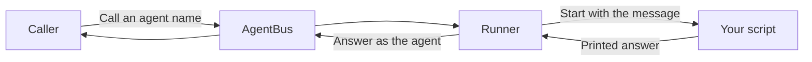

# AgentBus runner

📌 **TL;DR:** The runner manages agent processes, makes agents simple to run,
and protects their secrets and execution. It is a separate program using
AgentBus, shipped in the same release.

- **Process management:** run agent processes, control how much work runs at
  once, and see their status and failures in one place.
- **Simplicity:** install code, supply its settings and call its agent name.
  A script needs no bus library or message loop.
- **Security:** keep secrets separate from shipped code and supply them when
  the agent runs; sandbox its execution to restrict what it can reach.

Read [security](security.md#isolation-today) before installing code: managed
agents are sandboxed by default, each in a cgroup of its own with its
[limits](configuration.md#limits) and under a system-call filter.
Accepted settings are not all active; see [current limits](security.md#what-is-accepted-but-inert).

## What it does

The bus controls access and delivers messages. The runner executes code.
Installing the runner does not make the daemon execute scripts.

## Choose your starting point

| You want to… | Read |
|---|---|
| Install a script and get its first answer | [Getting started](getting-started.md) |
| Write an agent or configure several instances | [Agents](agents.md) |
| Find the right home for a setting or secret | [Configuration](configuration.md) |
| Check status, inspect errors, update or remove code | [Operations](operations.md) |
| Understand permissions and current protections | [Security](security.md) |

For a script you want to keep in your own terminal, use the
[dedicated runner](../user/dedicated-runner.md) instead. For Claude Code, Codex or
OpenCode sessions, use the [session launchers](../user/agents.md).
Agents using a [client library](../../src/clients/README.md) run on their own,
or under the runner as [agents that serve themselves](configuration.md#agents-that-serve-themselves).

## Availability

Today the runner starts one process per message, with bounded parallel work,
sandboxing and resource limits by default, and keeps self-serving agents running
with restarts (0.8.150–0.8.155). Remote deployment and shared pools remain in the
[runner plan](../../Plans/R1.0-Release/runner.md#runner).
The runner uses the repository's shared version and [installation](../07-setup.md#install).
