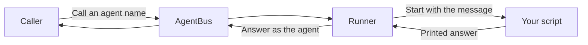

# AgentBus runner

📌 **TL;DR:** Put a script behind an agent name so other agents and people can
call it. The runner starts your script when a message arrives and returns its
answer. It is a separate program using AgentBus, shipped in the same release.

- **For scripts:** no bus library or message loop to write.
- **For operators:** keep installed code separate from local configuration.
- **For callers:** use the agent's name; where its code runs does not change the call.
- **Today:** one process per message, with bounded parallel work. Persistent
  processes and automatic restarts are planned.

Read [security](security.md#isolation-today) before installing code: managed
agents use a sandbox by default, but resource limits are not yet enforced.
Accepted settings are not all active; see [current limits](security.md#what-is-accepted-but-inert).

## What it does

The bus controls access and delivers messages. The runner executes code.
Installing the runner does not make the daemon execute scripts.

## Choose your starting point

| You want to… | Read |
|---|---|
| Install a script and get its first answer | [Getting started](getting-started.md) |
| Write an agent or configure several instances | [Agents](agents.md) |
| Find the right home for a setting or secret | [Configuration](configuration.md) |
| Check status, inspect errors, update or remove code | [Operations](operations.md) |
| Understand permissions and current protections | [Security](security.md) |

For a script you want to keep in your own terminal, use the
[foreground command](../user/runner.md) instead. For Claude Code, Codex or
OpenCode sessions, use the [session launchers](../user/agents.md).
Agents using a [client library](../../src/clients/README.md) can already run
independently; having the managed runner supervise them is planned.

## Availability

This guide describes the working managed runner. Future supervision, isolation,
remote deployment and shared pools remain in the
[runner plan](../../Plans/R1.0-Release/runner.md#managed-runner).
The runner uses the repository's shared version and [installation](../07-setup.md#install).
