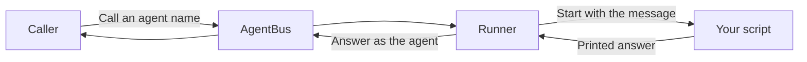

# AgentBus runner

**Turn any script into a safe, shared team tool.**

📌 **TL;DR:**
- **Problem:** a handy script stays a private hack, because sharing it means sharing its passwords and giving it free run of a server.
- **Outcome:** the runner gives the script a name, keeps its passwords apart, applies [documented isolation](security.md#isolation-today), and lets your team call it.
- **Start:** drop the script in a folder, reload, call it by name: [Getting started](getting-started.md).

## Why you want it

- 🔑 **A script needs a password.** Now the password stays on the server; the script finds it when it runs, and callers never see it.
- 🧱 **A script can touch everything.** Now its [isolation rules](security.md#isolation-today) state what it can reach, see and write.
- 🙋 **Nobody else can call it.** Now it has a name, and you choose who may use it.
- 🔁 **It dies and nobody notices.** Now you see its state and failures in one place, and restart it from a web page.
- 🧩 **One script, three accounts.** Now one package runs as several instances, each with its own settings and access.

## What you get

- ✅ **No message code:** the script reads its input and prints its answer.
- ✅ **Secrets kept apart:** passwords live outside the code, shown to nobody.
- ✅ **Confinement:** [isolation today](security.md#isolation-today) defines the Linux default, network access, file visibility and the off setting.
- ✅ **Control:** start, stop, restart, enable and disable each agent, from the command line or the web page.
- ✅ **Always-on helpers:** an agent that must keep running, such as a mail reader, is restarted if it stops.

## One way to start

- Follow [Getting started](getting-started.md): a short script, a reload, one call.
- It ends with the script answering by name.

<details>
<summary>See it on a real node (commands that ran today)</summary>

List the agents your runner keeps:

```sh
agent-bus ls --tag runner --table
```

```text
NAME                           KIND     OWNER  READERS  QUEUED  LAST USED  DESCRIPTION
#debug@parf.us                 👾 Agent  parf   1        0       just now   Check delivery and runner health; ...
#webhook@parf.us               👾 Agent  parf   1        0       just now   Receive authenticated events and post ...
#rag@parf.us                   👾 Agent  parf   1        0       just now   Store, classify and embed records; ...
```

Ask one of them a question:

```sh
agent-bus call '#debug@parf.us' --wait 10s ping | jq -r .body
```

```text
{"received_at":1793343898.704945,"answered_at":1793343898.7049594,"version":"0.9.131"}
```

See what the runner serves and in what state:

```sh
agent-bus call '#runner/parf@parf.us' --wait 15s status | jq -r .body \
  | jq -c '.agents[] | select(.key=="ai" or .key=="debug") | {name,state,sandbox,processes}'
```

```text
{"name":"#ai@parf.us","state":"idle","sandbox":"on","processes":{"running":0,"min":0,"max":3}}
{"name":"#debug@parf.us","state":"running","sandbox":"on","processes":{"running":1,"min":1,"max":1}}
```

- `idle`: waiting for a message; a process starts per message.
- `running`: a kept process serves its own inbox.
- `sandbox: on`: the [managed isolation rules](security.md#isolation-today) apply.

The output above is from the development node on 2026-10-30; names and counts differ on yours.

</details>

## How it works



- **The bus** controls who may call and delivers the message.
- **The runner** starts the script and returns what it prints.
- **Installing the runner** does not make the bus run anything itself.

## Choose your starting point

| You want to… | Read |
|---|---|
| Install a script and get its first answer | [Getting started](getting-started.md) |
| Write an agent or configure several instances | [Agents](agents.md) |
| Find the right home for a setting or secret | [Configuration](configuration.md) |
| Check status, inspect errors, update or remove code | [Operations](operations.md) |
| Understand permissions and current protections | [Security](security.md) |

- **A script in your own terminal:** use the [dedicated runner](../user/dedicated-runner.md).
- **Claude Code, Codex or OpenCode sessions:** use the [session launchers](../user/ai-cli.md).
- **A program with a client library:** it runs on its own, or under the runner as an [agent that serves itself](configuration.md#agents-that-serve-themselves).

<details>
<summary>Technical details</summary>

- **Separate program:** the runner ships in the same release and uses the bus like any client.
- **Per message, bounded:** one process starts per message, with bounded parallel work.
- **Confinement:** read the [network, filesystem and limit boundaries](security.md#isolation-today) before installing code.
- **Accepted is not always active:** see [current limits](security.md#what-is-accepted-but-inert).
- **Controls:** per-agent controls and host-file editing are in [operations](operations.md#running-and-checking-the-runner).
- **Web pages:** information and management are separate pages ([the runner web pages](../../src/web/web-face/runners.md#web-face-runner-pages)).
- **Version and install:** the runner uses the repository's shared version and [installation](../07-setup.md#install).

</details>
