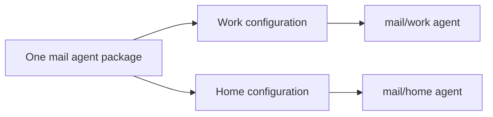

# Agents: write a script once, run it under several names

📌 **TL;DR:**
- **Problem:** turning a script into a tool usually means message code, and a second account means a second copy.
- **Outcome:** you ship a command plus a short `agent.json`; the host adds settings, and one package becomes as many named agents as it needs.
- **Start:** see how a finished package looks to callers ([Try this first](#try-this-first)), then [package a script](#package-a-script).

## Why you'd want it

- 🧾 **Message handling is boilerplate.** Now the script handles one message and exits; the runner does the rest.
- 🔑 **Settings end up in the code.** Now the host supplies them separately, so the checkout stays clean.
- 👯 **Two accounts mean two copies.** Now one package runs as `mail/work` and `mail/home`, each with its own settings.

## What you get

- ✅ **Two simple input forms:** the message as one argument, or the whole message as JSON.
- ✅ **Help for free:** your `agent.json` description and methods become the agent's help.
- ✅ **Instances:** several names from one package, each configured and permitted on its own.
- ✅ **Required settings checked:** an instance missing a required value is refused by name, not started broken.
- ⚠️ **No automatic retry:** a message the script failed on is not run again.

## Try this first

See what callers get from a finished package's `agent.json`:

```sh
agent-bus help --no-color '#debug@parf.us'
```

```text
Check delivery and runner health; diagnose failures with bounded probes
selftest: Check ping, echo and slow/error answers locally, plus own KV and lock via the bus; ...
echo: Return the delivered envelope fields as JSON, never process credentials
...
hello [name...]: Greet a name; hello smoke returns hello, smoke
  name (string): Name to greet
...
```

- This ran on the development node on 2026-10-30.
- Your first package: [Getting started](getting-started.md).

## Package a script

Place `agent.json` beside the script in `agent.d/<agent>/`:

```json
{"command":"./hello.sh","form":"args","description":"Greets the caller"}
```

| Form | The script receives | The runner returns |
|---|---|---|
| `args` | Message body as one argument | Printed output |
| `json` (default) | The whole message as JSON on its input | Printed output |

- 📁 `./hello.sh` is found inside the package folder.
- 🗂️ The script starts in its own writable work folder, not in the checkout.
- 🔒 The checkout is read-only: keep lasting files in the work folder, throwaway ones in the private temporary folder.
- 🆚 The [dedicated runner](../user/dedicated-runner.md) differs: it asks for an absolute script path.
- 📋 Every key of `agent.json`: [package options](configuration.md#package-options).
- ✍️ Start from the [create-agent prompt](../agents/create-agent-prompt.md#prompt-to-paste).

## Give one package several configurations



The package declares its settings in `agent.d/mail/env.dist`:

```dotenv
MAIL_HOST=mail.example.com
MAIL_USER= # required
```

The host inventory declares the instances:

```json
{"mail/work": {}, "mail/home": {}}
```

- 🏷️ After reload the names are `#mail/work@<realm>` and `#mail/home@<realm>`.
- 🔑 Supply `MAIL_USER` in `runner/mail/work/env` and `runner/mail/home/env`, or once for both in `runner/mail/env`.
- ✅ Only `# required` marks a requirement; a bare `KEY=` is optional, and a required key may have a default.
- 🙋 Grant access to each name before calling it, as in [getting started](getting-started.md#load-it-and-grant-access).
- 📂 Where each file lives: [configuration](configuration.md#where-settings-belong).

<details>
<summary>When the plain name has a status row</summary>

- A package is a template only when the inventory declares instances of it.
- With only instance entries, the plain `mail` name has no status row.
- A plain `mail` entry without its required values is refused.
- An instance still missing a required value is refused by its own name.

</details>

## Message context and roles

- 🏷️ **Labels:** the script gets the message's labels and its work path in environment variables.
- ⚙️ **Configuration:** `AGENT_BUS_CONFIG` carries the record's settings, unset when none ([jq example](../03-records-agent.md#configuring-a-template)).
- 🛡️ **Roles:** let the script tell which operations its caller may perform; see the [agent record](../03-records-agent.md#roles).
- 📖 **The full list,** and what each value may be trusted for: [what the code is told](security.md#what-the-code-is-told-and-what-it-may-trust).
- 🔌 **A program with a [client library](../../src/clients/README.md)** reads its own inbox: run it as an [agent that serves itself](configuration.md#agents-that-serve-themselves).

## Technical details

<details>
<summary>How a run ends</summary>

- Success with no output sends a completion notice.
- A nonzero exit is logged and sends no answer.
- A request whose caller has already given up is not run.
- Work already taken is not retried.
- Failure boundaries: [message delivery](../04-messaging.md#durability).

</details>
