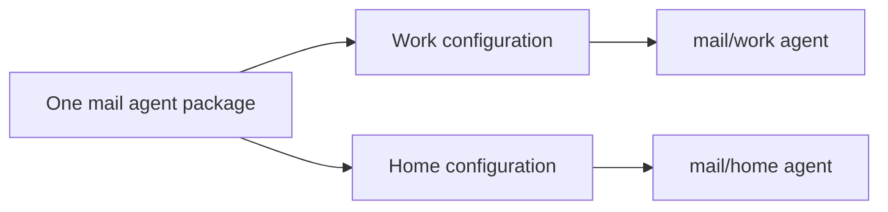

# Writing agents and creating instances

📌 **TL;DR:** Ship a command and a description of how it receives a message.
The host supplies configuration separately. One package can become several
agent names, each with its own settings.

- A script handles one message and exits; the runner handles bus communication.
- Keep secrets and host choices out of the code checkout.
- Declare required variables to make a configurable template.

## Package a script

Place `agent.json` beside the script in `agent.d/<agent>/`:

```json
{"command":"./hello.sh","form":"args","description":"Greets the caller"}
```

The runner resolves `./hello.sh` relative to this package.
The script starts in its own writable work directory, so do not assume its
current directory is the checkout. This differs from the dedicated runner,
which asks for an absolute script path.
The sandbox mounts the checkout read-only: write persistent files in the work
directory, or use the private temporary directory for disposable files.

| Form | The script receives | The runner returns |
|---|---|---|
| `args` | Message body as one argument | Printed stdout |
| `json` (default) | Message envelope as JSON on stdin | Printed stdout |

Success with no output sends completion; a nonzero exit is logged and sends
no answer. An expired request is not run. Taken work is not retried automatically.
See [message delivery](../04-messaging.md#durability) for failure boundaries.

## Give one package several configurations



For example, `agent.d/mail/env.dist` declares:

```dotenv
MAIL_HOST=mail.example.com
MAIL_USER=
```

An empty declaration means required. Declare instances in the host's inventory:

```json
{"mail/work": {}, "mail/home": {}}
```

Supply `MAIL_USER` in `runner/mail/work/env` and `runner/mail/home/env`.
After reload the two names are `#mail/work@<realm>` and `#mail/home@<realm>`.
Grant access to each record before calling it, as in
[getting started](getting-started.md#load-it-and-grant-access).

With only instance entries, the bare template has no status row. If you also
declare a bare `mail` entry without supplying its required variables, that row
is refused. A required value still missing from an instance refuses that
instance by name.

## Message context and roles

The script gets message labels and its work path in environment variables;
their reference is [what the code is told](security.md#what-the-code-is-told-and-what-it-may-trust).
Application roles let a script distinguish operations its caller may perform.
Their meaning and assignment belong to the [agent record](../03-records-agent.md#roles).

For code that talks to the bus directly, choose a
[client library](../../src/clients/README.md). Managed supervision of such
agents and kept streaming processes are not available yet.
